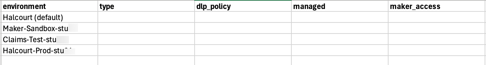
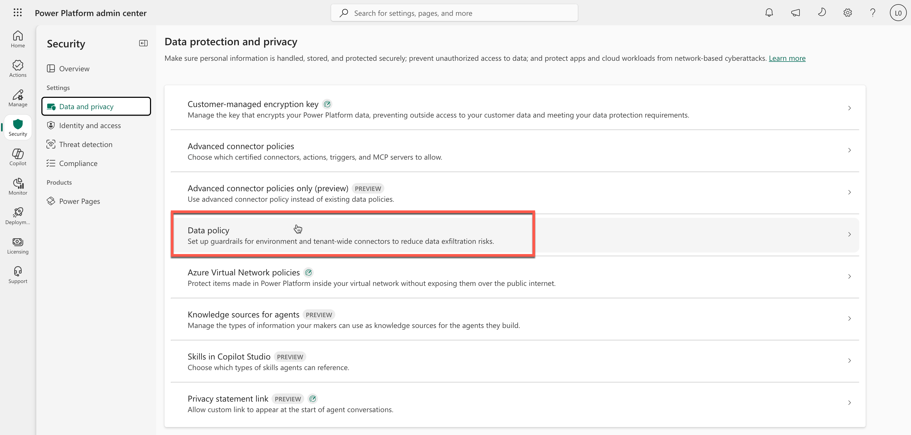

# Task 00-02 — Meet Halcourt Mutual

## Introduction

Before you hunt for problems, learn the terrain. A security review that starts by naming the environments,
the identities, and the systems in play is far harder to fool than one that dives straight into a single
agent. This task orients you to Halcourt Mutual, its four Power Platform environments, and where the day
is headed.

## Description

You will read the **four environments** in the Power Platform admin center and record them in your blank
`environments-export.csv` (or read them from the filled-in export if you can't reach the tenant), walk the
day's arc from **DISCOVER** to **OPERATIONALIZE**, and look over all five CSVs to feel how hard the three
questions really are. You record facts here, not findings: whether any of them is a problem is a call
you make in Exercise 02. For now you are building a mental map so the later exercises land. You will also
locate the Estate Binder templates you fill in as you go.

## Success Criteria

- [ ] You can name Halcourt Mutual's four environments and, for each, say its type, DLP policy, and managed status.
- [ ] *(Live tenant only)* Your `environments-export.csv` has a row for each of the four environments.
- [ ] You can state the day's arc: **DISCOVER → MAP → BREAK → CONTROL → RETEST → OPERATIONALIZE**, and which exercise each phase maps to.
- [ ] You have looked over all five CSVs and can restate the three questions — how many agents, who owns them, what can they access — in your own words.
- [ ] You know where the Estate Binder templates live and that you build one deliverable per phase.

## Learning Resources

- [Power Platform environments overview](https://learn.microsoft.com/power-platform/admin/environments-overview){:target="_blank"}
- [Power Platform environment strategy](https://learn.microsoft.com/power-platform/guidance/adoption/environment-strategy){:target="_blank"}
- [Enable Managed Environments](https://learn.microsoft.com/power-platform/admin/managed-environment-enable){:target="_blank"}
- [Data policies](https://learn.microsoft.com/power-platform/admin/prevent-data-loss){:target="_blank"}
- [Security roles and privileges](https://learn.microsoft.com/power-platform/admin/security-roles-privileges){:target="_blank"}
- [Copilot Studio security and governance](https://learn.microsoft.com/microsoft-copilot-studio/security-and-governance){:target="_blank"}

## Key Tasks

### 01: Read the four environments

<details markdown="block">
<summary>Expand this section for detailed steps</summary>

1. In the **Power Platform admin center** at `https://admin.powerplatform.microsoft.com`, choose **Manage**, then **Environments**. Find your estate's four environments: 

- the three that carry your estate id 
- and `Halcourt (default)`, which every estate shares

   Add the environments to the `environments-export` sheet, for example: 

   

   > If you filter by your estate id the list will also show **your own lab environment** (`Lab-<estate_id>-NN`). This isn't one of the estate's four environments so you can exclude this from the sheet. Do note that it's there. Exercise 03 sends you into it. 

   For each environment in the sheet, you will fill in the sheet values: `environment`, `type`, `dlp_policy` (empty when no policy applies), `managed` (`Yes` or `No`), and `maker_access`. 
 
 2. Each environment shows its **type** in the listing.

 3. To see whether the environment is **managed**, open its **…** menu. The menu offers **Edit Managed Environments** when the environment is managed, and **Enable Managed Environments** when it isn't.

4. For **maker access**, open each environment and go to **Settings** → **Users + permissions** → **Security roles**. Select **Environment Maker**, then **…** → **Members**, and do the same for **System Administrator**. In the Default environment, all licensed users are makers.

   The admin center lists roles person by person; `maker_access` is your one-line summary of who holds them.

5. In the far left navigation pane, choose **Security** → **Data and privacy** → **Data policy**. 

   

   The **Applied to** column shows which environments each **DLP policy** covers. Record the DLP policy name.

6. After completing the above steps, your rows should match values similar to this table, with your estate id on the names of your environments and DLP policy:

   | Environment | Type | DLP policy | Managed | Maker access |
   |---|---|---|---|---|
   | Halcourt (default) | Default | *(none)* | No | All users |
   | Halcourt-Prod | Production | Halcourt-Prod-DLP | Yes | Makers group |
   | Claims-Test | Sandbox | *(none)* | No | Claims team |
   | Maker-Sandbox | Developer | *(none)* | No | Individual maker |

   If you didn't have access to the tenant, the end result can be reviewed in the filled-in [`environments-export.csv`]().

5. Read the table without judging it yet. Just notice the shape: which environments carry a DLP policy and which do not; which are managed; who is allowed to build in each. You will come back to these facts in Exercise 02 and decide what they mean.

6. Note the trust-boundary question you will keep asking all day: **whose authority does an agent exercise, and what can it reach when it does?** Where an agent lives — and whether that environment has guardrails — is the first clue.

</details>

### 02: Walk the day arc and look over your CSVs

<details markdown="block">
<summary>Expand this section for detailed steps</summary>

1. This lab moves along one arc:

   ```mermaid
   flowchart LR
     D[DISCOVER] --> M[MAP] --> B[BREAK] --> C[CONTROL] --> R[RETEST] --> O[OPERATIONALIZE]
   ```
   Keep this in mind throughout each step in the lab. 

2. Here is the map for each phase and which lab will take you through the steps for that phase: 
   - **DISCOVER** — inventory every agent, everywhere ([Exercise 02]()).
   - **MAP** — trace identity, authorization, and effective access ([Exercise 03]()).
   - **BREAK** — observe the failure modes in controlled scenarios ([Exercise 04]()).
   - **CONTROL / RETEST** — put Microsoft's controls to the test and rule **CLOSES IT / DENTS IT / MISSES IT** ([Exercise 05]()).
   - **OPERATIONALIZE** — turn it into a repeatable baseline ([Exercise 06]()).
3. Spend a few minutes reviewing the five CSVs. Keep this to two minutes total. 

   If you're working in the tenant, they are   still header rows, apart from the environments you just recorded. Read the columns, because you fill them in during Exercise 01. 

   If you were unable to connect to the tenant, skim the filled-in set. 
   
   At this time, do not analyze the sheets. Reember the weight of the three questions: 
   - how many agents are there?
   - who owns each one?
   - what does each one connect to?
   
   Notice that no single file answers any question on its own; the answers live in the joins between them.
   
4. Open the [Estate Binder](). You will produce one deliverable per phase — the first is the **Agent Estate Inventory** in Exercise 02. Keep the binder handy; you fill it in as you work.

</details>

{: .tip }
> No single file tells the whole story. An agent whose owner has left, a connection owned by someone who
> is gone, an agent in an environment with no DLP — those only appear when you **join** the files. That is
> the skill Exercise 02 builds; today just notice how the pieces fit together.

## Summary

You have met Halcourt Mutual: a regulated insurer with four Power Platform environments, a fleet of
maker-built Copilot Studio agents, and no one who can answer the three questions. You read each
environment's type, DLP policy, managed status, and maker access, walked the day's arc from DISCOVER to
OPERATIONALIZE, and found the Estate Binder you will fill in along the way. With the terrain mapped, you
are ready to start counting agents in Exercise 02.
