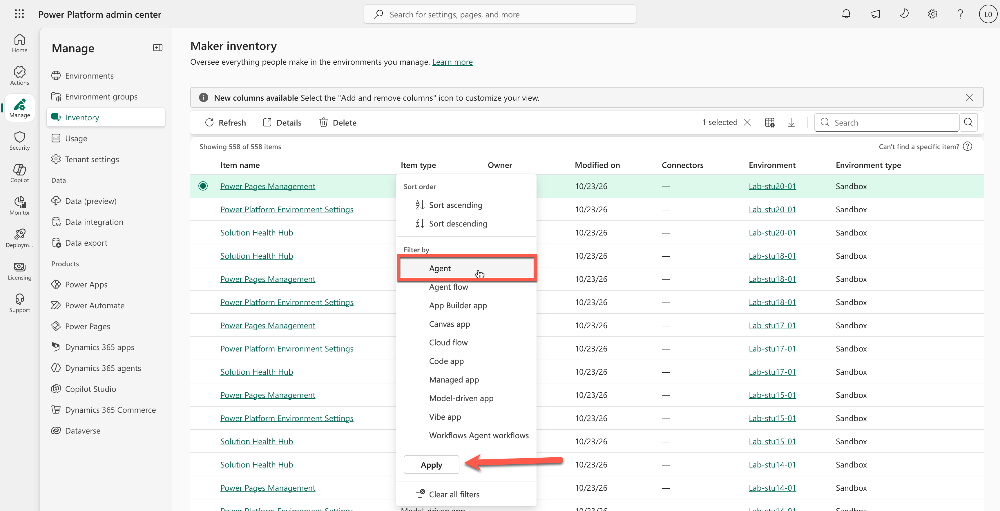
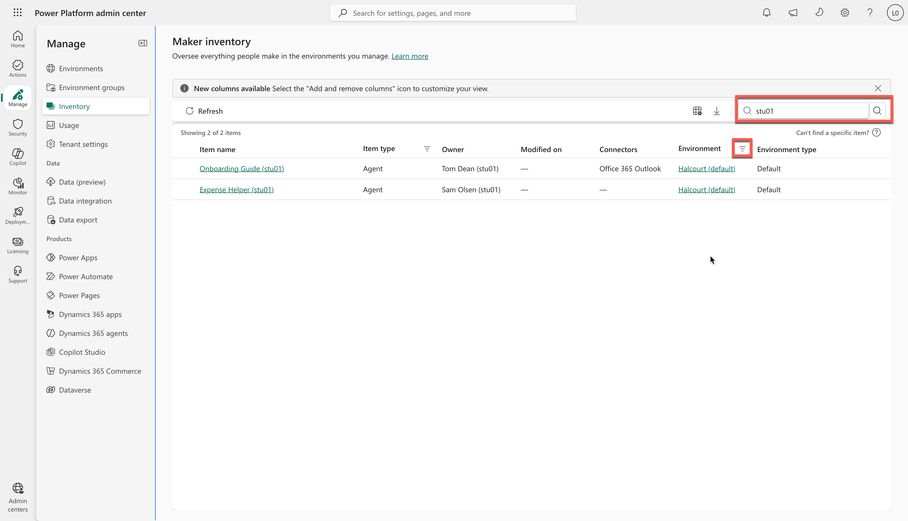
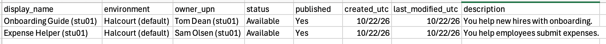
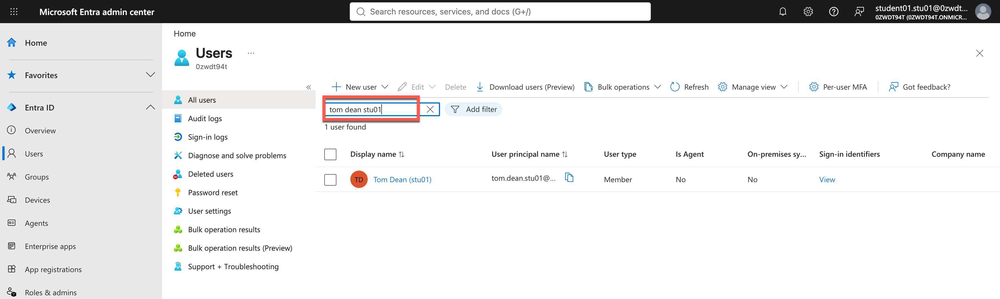
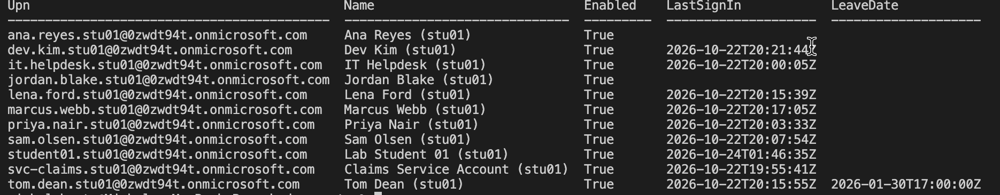
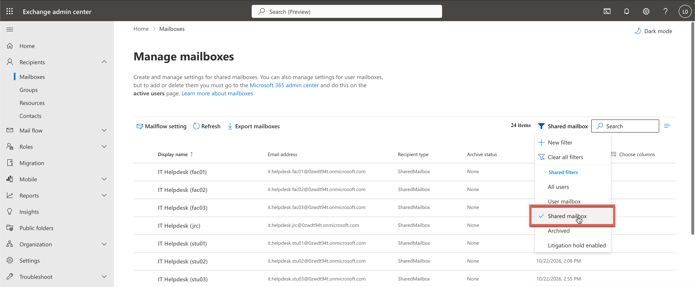

# Task 01-01 — The three questions

## Introduction

Every agent-governance conversation collapses into three questions: **How many agents do we have? Who
owns them? What can they access?** They sound like a five-minute lookup. They are not — and feeling *why*
they are hard, before you have any tooling, is the point of this task. You have to assemble the answer from
data scattered across environments, connections, and identities.

## Description

You will take the three questions to the live tenant and try to answer each one for the Halcourt Mutual
estate. This is your first evidence-gathering pass: as you go, you fill in three of your blank CSVs from
the portals and APIs — `agents-export.csv`, `users-export.csv`, and `connections-export.csv` — and those
CSVs feed the inventory and findings you build in Exercise 02. If you can't reach the tenant, work from the
filled-in [artifact pack](#the-artifact-pack) instead. Along the way you will
notice that no single source answers any question cleanly: the findings live in the *joins* between them.
Record how far you get and where you get stuck.

## Success Criteria

- [ ] *(Live tenant only)* You have filled in your `agents-export.csv`, `users-export.csv`, and
      `connections-export.csv` from the tenant.
- [ ] You can say which columns each of the five CSVs carries.
- [ ] You have a first count of agents, and you can name at least one reason that count might be
      incomplete for a real tenant.
- [ ] You have cross-checked agent and connection owners against account status and account type, and
      recorded anything that weakens clear human accountability.
- [ ] You have attempted "what can they access" for a single agent and listed which sources you had to
      join to get even a partial answer.
- [ ] You can state, in one sentence, why these three questions are hard to answer at a glance.

## Learning Resources

- [Copilot Studio security and governance](https://learn.microsoft.com/microsoft-copilot-studio/security-and-governance){:target="_blank"}
- [Power Platform environments overview](https://learn.microsoft.com/power-platform/admin/environments-overview){:target="_blank"}
- [Power Platform inventory](https://learn.microsoft.com/power-platform/admin/power-platform-inventory){:target="_blank"}
- [Agent registry in the Microsoft 365 admin center](https://learn.microsoft.com/microsoft-365/admin/manage/agent-registry){:target="_blank"}
- [How to manage inactive user accounts](https://learn.microsoft.com/entra/identity/monitoring-health/howto-manage-inactive-user-accounts){:target="_blank"}
- [Shared mailboxes in Exchange Online](https://learn.microsoft.com/exchange/collaboration-exo/shared-mailboxes){:target="_blank"}
- [Create and manage connections in Copilot Studio](https://learn.microsoft.com/microsoft-copilot-studio/authoring-connections){:target="_blank"}
- [Add tools to custom agents in Copilot Studio](https://learn.microsoft.com/microsoft-copilot-studio/add-tools-custom-agent){:target="_blank"}
- [Center of Excellence (CoE) Starter Kit](https://learn.microsoft.com/power-platform/guidance/coe/starter-kit){:target="_blank"}

## Key Tasks

### 01: How many agents do we have?

Get a first count from the admin center, then stress-test whether that count is really complete.

<details markdown="block">
<summary>Expand this section for detailed steps</summary>

1. Open the [Power Platform admin center](https://admin.powerplatform.microsoft.com){:target="_blank"}
   and choose **Manage** → **Inventory**. Select the **Item type** column header to open its filter menu,
   and keep only **Agents** — these are your Copilot Studio agents.

   

   The tenant holds other estates' agents too. Filter the **Environment** column the same way: keep your
   `-<estate_id>` environments, and in `Halcourt (default)` only the agents whose names carry your estate
   id.

   

2. Choose **Download** to export the list as CSV, and copy your agents into your blank
   [`agents-export.csv`](), one row per agent.
   The number of rows is your starting count of agents.
   - **Item name** → `display_name`
   - **Status** → `status`
   - **Environment** → `environment`
   - **Owner** → `owner_upn`
   - **Created on** → `created_utc`

   Three columns don't come out the way the CSV wants them: **Owner** holds display names, not UPNs;
   **Status** says *Available* where the filled-in pack says *Active*; and **Created on** is a short date in
   your local time. The next step's export fixes the owner and the dates. **Modified on** shows a dash for
   agents, so leave `last_modified_utc` for the next step too.
3. Open the [Microsoft 365 admin center](https://admin.microsoft.com){:target="_blank"} and go to
   **Agents** → **All agents**. This list covers the same agents, and fills in the rest of each row.

   

   The list holds every estate's agents (several hundred), and searching for your estate id finds only
   the few agents whose *names* carry it. Instead, choose **Export**, open the CSV, and filter its **Owner**
   column on `.<estate_id>@` — every account in your estate carries your estate id. Then, for each of your
   agents:
   - **Owner** → `owner_upn` (this export holds the UPN)
   - **Date created** → `created_utc`
   - **Last Modified** → `last_modified_utc` (this export's dates are UTC)
   - **Instructions** → `description`: write one line of your own from them, or use the agent's
     description where it has one.
   - `published`: select the agent in the portal list; on its **Details** tab, `Yes` if it shows a
     published date, otherwise `No`.

   If you aren't in the tenant: review and count the rows in the filled-in
   [`agents-export.csv`]().
4. **OBSERVATIONS:** Look at the `environment` column. Note how many *distinct* environments the agents live in, then
   compare against your `environments-export.csv` from
   [Task 00-02](). Is every environment represented? Which
   environment types (Default, Production, Sandbox, Developer) are in scope?
5. **OBSERVATIONS:** Ask the question: in a real tenant, would this list contain *every* agent? Consider what any
   single inventory can miss: environments or sources you don't have permission to see, agent types that
   surface doesn't cover, agents too new to appear yet, and the same agent listed twice under different
   publishers. And a list names owners, but not whether those owners are still here, whose credentials
   each agent runs on, what it grounds on, or what it can reach. An agent in someone's personal environment
   can be listed and still reviewed by no one.

   Write down which of these would worry you most in a real tenant.
6. In your notes for this exercise, record your count and a one-line caveat about what it might be
   missing.

</details>


<!--  -->

### 02: Who owns them?

An owner column looks like an answer. Cross-check it against the account data and watch it get slippery.

<details markdown="block">
<summary>Expand this section for detailed steps</summary>

1. In your `agents-export.csv`, read the `owner_upn` column for each agent. On its face, every agent has
   an owner.
2. Now look up each owner's account. Open the
   [Microsoft Entra admin center](https://entra.microsoft.com){:target="_blank"}, go to **Entra ID** →
   **Users**, and search for your estate id to list your estate's accounts.

   

   The list shows each account, but not its **leave date** (the date HR recorded the person as gone) or
   its last sign-in. Get those for every account at once with the Azure CLI. In a terminal, sign in with
   your lab account; device-code sign-in lets you finish in the browser where you're already signed in to
   the lab:

   ```bash
   az login --use-device-code --allow-no-subscriptions
   ```

   Then run this command, with your estate id in place of `<estate_id>`:

   ```bash
   az rest --method get --url 'https://graph.microsoft.com/v1.0/users?$select=userPrincipalName,displayName,accountEnabled,employeeLeaveDateTime,signInActivity&$top=999' --query "value[?contains(userPrincipalName, '.<estate_id>@')].{upn:userPrincipalName, name:displayName, enabled:accountEnabled, leaveDate:employeeLeaveDateTime, lastSignIn:signInActivity.lastSignInDateTime}" -o table
   ```

   Example output:
   

   Record each owner in your blank
   [`users-export.csv`]():
   - **upn** → `upn`
   - **name** → `display_name`
   - **enabled** → `account_enabled`
   - **leaveDate** → `employee_leave_date`
   - **lastSignIn** → `last_sign_in_utc`

   Then find the shared mailboxes. Open the
   [Exchange admin center](https://admin.exchange.microsoft.com){:target="_blank"}, go to
   **Recipients** → **Mailboxes**, filter to **Shared mailbox**, and search for your estate id. Set
   `is_shared_mailbox` to `TRUE` for any owner listed there, `FALSE` for the rest.

   

   `is_service_account` is optional: no tenant field marks it, so it's your judgement from the account's
   name and what it is used for.

   If you are doing this exercise without the tenant: take each `owner_upn` from the [`agents-export.csv`](), find the same UPN in the [`users-export.csv`]() and look at four columns:
   `account_enabled`, `employee_leave_date`, `is_service_account`, and `is_shared_mailbox`.

3. Flag any owner that is not a real, present, accountable person — someone who has **left** (a leave
   date, whether or not the account was disabled), a **disabled** account, a **service account**, or a
   **shared mailbox**. For each, ask: if this agent misbehaved tomorrow, who would you call? Note the
   flagged owners in your notes for this exercise; Exercise 02 turns them into findings.
4. Now find who owns the *connections* behind your agents. No portal page lists every connection in an
   environment, so ask the Power Platform admin API with the Azure CLI, still signed in as your lab
   account.

   List the environments. The list covers every estate's environments (dozens of them), so pick out
   `Halcourt (default)` and the ones ending in `-<estate_id>`. Each entry's `name` is the environment id,
   and `properties.displayName` its name:

   ```bash
   az rest --method get --url "https://api.bap.microsoft.com/providers/Microsoft.BusinessAppPlatform/scopes/admin/environments?api-version=2021-04-01" --resource https://service.powerapps.com/ --query "value[].{id:name, name:properties.displayName}" -o table
   ```

   Then list the connections in each of your environments:

   ```bash
   az rest --method get --url "https://api.powerapps.com/providers/Microsoft.PowerApps/scopes/admin/environments/<environment-id>/connections?api-version=2016-11-01" --resource https://service.powerapps.com/
   ```

   `Halcourt (default)` is shared by every estate: keep only the connections your estate's accounts own.
   Record each connection in your blank
   [`connections-export.csv`]():
   - `properties.displayName` → `connection_name`
   - the last segment of `properties.apiId` → `connector`, as its plain name:
     `shared_sharepointonline` is **SharePoint**, `shared_commondataserviceforapps` is
     **Microsoft Dataverse**, `shared_office365` is **Office 365 Outlook**, and
     `shared_onedriveforbusiness` is **OneDrive for Business**. For any other, use the name the agent's
     tool shows in step 6.
   - the environment's name → `environment`
   - `properties.createdBy.userPrincipalName` → `connection_owner_upn`
5. See who each connection is shared with. Here `<connector>` is the last segment of `properties.apiId`
   and `<connection-name>` the connection's `name` from the call above, not its display name:

   ```bash
   az rest --method get --url "https://api.powerapps.com/providers/Microsoft.PowerApps/scopes/admin/environments/<environment-id>/apis/<connector>/connections/<connection-name>/permissions?api-version=2016-11-01" --resource https://service.powerapps.com/
   ```

   In your `connections-export.csv`, put everyone other than the owner in that connection's
   `shared_with`. An empty list means the connection isn't shared.
6. Match the connections to your agents: for each agent, fill `used_by_agent` on the connections it uses,
   and add a row for any call that doesn't go through a connection. Open
   [Copilot Studio](https://copilotstudio.microsoft.com){:target="_blank"}, pick each agent's environment
   in the environment switcher (search it for your estate id), and open **Agents** → the agent. In
   `Halcourt (default)`, search the agent list for your estate id.

   {: .tip }
   > If a page's tab isn't in the agent's header, open it by address: replace the end of the address after
   > the agent's id. The addresses don't match the tab names, and a wrong one quietly opens another page:
   >
   > | Tab | Address ends in |
   > |---|---|
   > | Tools | `/actions` |
   > | Knowledge | `/knowledge` |
   > | Topics | `/tools` |

   The **Test your agent** pane may open with a consent prompt. Don't select **Confirm**; you aren't
   testing the agent here.

   An agent can have no tools, or no knowledge. An empty page isn't a mistake: note it and move on.

   - **Tools:**
     1. Select each tool. Its **Details** name the connector it runs on.
     2. Find that connector's row in your `connections-export.csv`, in the agent's environment.
     3. Write the agent's name in that row's `used_by_agent`.

     Ignore the tool's **Connection** showing *Not connected*: you can't see another person's connection,
     so it says nothing about the agent.
   - **Knowledge:**
     1. Note each source the agent grounds on, such as a SharePoint site or a OneDrive folder.
     2. Find the connection in your `connections-export.csv` that reaches it: the same connector, in the
        agent's environment.
     3. Write the agent's name in that row's `used_by_agent`.

     An agent with no tools can still read data through its knowledge. You can't see which connection a
     source uses; if more than one could fit, take the `used_by_agent` from the filled-in
     `connections-export.csv`, and note that the pack is your source.
   - **Topics:**
     1. Keep the **Custom** filter, and skip the topics every agent starts with: **Greeting**,
        **Goodbye**, **Start Over**, and **Thank you**.
     2. Open each remaining topic by selecting its name (not **Details**).
     3. Look on its canvas for two kinds of node, below.

     **Send HTTP request:** the agent calls a web address directly, with no connection, so the call would
     otherwise go unrecorded. Add a row for it:
     - `connection_name`: a label of your own
     - `connector`: `HTTP action`
     - `environment`: the agent's environment
     - `connection_owner_upn`: the agent's owner
     - `used_by_agent`: the agent's name

     Whatever key the call carries is pasted into the node itself, so the agent's owner answers for it.

     **Action:** the agent runs a Power Automate cloud flow. In this lab the flow isn't shared with your
     account, so the node shows *Flow not found or is turned off* and **View flow details** does nothing;
     someone with access to the flow would see it. The flow still runs, with its owner's authority. To
     record it:
     1. Copy the flow's row from the filled-in
        [`connections-export.csv`](). Its
        `connector` is **Power Automate**.
     2. Replace its names with your estate's:
        - `used_by_agent`: the agent's name, from your `agents-export.csv`
        - `connection_owner_upn`: the owner's `upn`, from your `users-export.csv`
        - `shared_with`: `All-Employees-<estate_id>`
     3. Note that the pack is your source.
7. Write each row's `auth_type` yourself: a short label for whose credential the call carries.
   - **Tool:** on the agent's **Tools** page, open the tool, then **Details** → **Additional details**,
     and read whether it uses **End user** or **Maker-provided** credentials. Combine that with who owns
     the connection.
   - **Knowledge source:** use the same label as the tool or connection it reads through.
   - **HTTP request:** open the node and read its headers to see how it authenticates.
   - **Flow:** keep the `auth_type` from the pack's row. It runs with its owner's connections.

   Without the tenant: use the filled-in
   [`connections-export.csv`]().
8. Compare `connection_owner_upn` against the agent's `owner_upn`. Note any agent where the person who
   owns the *connection* is not the person who owns the *agent*. The connection owner's credential is what
   a **Maker-provided** tool carries; Exercise 03 works out which tools are Maker-provided. If you're
   working in the tenant, add each connection owner who isn't in your `users-export.csv` yet.
9. Hold these observations. You will not resolve them here — Exercise 02 turns them into named findings — but
   noticing that "owner" has several different meanings is the whole point.

</details>

### 03: What can they access?

This is the question the day is really about. Try to answer it for one agent and watch how many sources
you have to touch.

<details markdown="block">
<summary>Expand this section for detailed steps</summary>

1. Pick a single agent from your `agents-export.csv`.
2. Try to write one paragraph describing everything it can reach. To do it, you will need to join across
   sources: your `connections-export.csv` (which connector and auth type), the agent's Entra identity, and
   your `environments-export.csv` (whether the environment has any DLP). Find the identity in the
   [Microsoft Entra admin center](https://entra.microsoft.com){:target="_blank"} under **Entra ID** → **Agents** → **Agent identities**; you record
   identities in the next task.

   Without the tenant: the identity is in the filled-in
   [`agent-identities-export.csv`]().
3. Notice what is *still* missing even after the joins — for example, the specific SharePoint site or
   Dataverse tables the connection can read, or the exact API the HTTP action calls. That detail lives in
   the agent's configuration and grounding (in Copilot Studio, its **Knowledge** and **Topics** pages), not
   in the CSVs; it is what Exercises 02 and 03 go get.
4. Write down the shortest honest answer you can give right now, and underline the parts you had to leave
   as "unknown — needs the agent's configuration."

</details>

## Summary

You just experienced the gap the rest of the workshop closes. Three plain questions — *how many, who owns
them, what can they access* — have no one-place answer, because an agent's real exposure is spread across
its environment, its connections, its identity, and its grounding. You also met the recurring subtlety in
"who owns them": an owner can be someone who has left, a disabled account, a service account, a shared mailbox, or someone
different from whoever owns the underlying connection. Keep your rough answers and your list of "unknowns"
— Exercise 02 (DISCOVER) turns the first two questions into a real inventory, and Exercise 03 (MAP) turns the
third into effective-access findings.
