# Task 01-01 — The three questions

## Introduction

Every agent-governance conversation collapses into three questions: **How many agents do we have? Who
owns them? What can they access?** They sound like a five-minute lookup. They are not — and feeling *why*
they are hard, before you have any tooling, is the point of this task. You have to assemble the answer from
data scattered across environments, connections, and identities.

## Description

You will take the three questions to the live tenant and try to answer each one for the Halcourt Mutual
estate. This is your first evidence-gathering pass: as you go, you fill in three of your blank CSVs from
the portals and APIs — `agents-export.csv`, `users-export.csv`, and `connections-export.csv` — and those
CSVs feed the inventory and findings you build in Exercise 02. If you can't reach the tenant, work from the
filled-in [artifact pack](#the-artifact-pack) instead. Along the way you will
notice that no single source answers any question cleanly: the findings live in the *joins* between them.
Record how far you get and where you get stuck.

## Success Criteria

- [ ] *(Live tenant only)* You have filled in your `agents-export.csv`, `users-export.csv`, and
      `connections-export.csv` from the tenant.
- [ ] You can say which columns each of the five CSVs carries.
- [ ] You have a first count of agents, and you can name at least one reason that count might be
      incomplete for a real tenant.
- [ ] You have cross-checked agent and connection owners against account status and account type, and
      recorded anything that weakens clear human accountability.
- [ ] You have attempted "what can they access" for a single agent and listed which sources you had to
      join to get even a partial answer.
- [ ] You can state, in one sentence, why these three questions are hard to answer at a glance.

## Learning Resources

- [Copilot Studio security and governance](https://learn.microsoft.com/microsoft-copilot-studio/security-and-governance){:target="_blank"}
- [Power Platform environments overview](https://learn.microsoft.com/power-platform/admin/environments-overview){:target="_blank"}
- [Power Platform inventory](https://learn.microsoft.com/power-platform/admin/power-platform-inventory){:target="_blank"}
- [Agent registry in the Microsoft 365 admin center](https://learn.microsoft.com/microsoft-365/admin/manage/agent-registry){:target="_blank"}
- [How to manage inactive user accounts](https://learn.microsoft.com/entra/identity/monitoring-health/howto-manage-inactive-user-accounts){:target="_blank"}
- [Shared mailboxes in Exchange Online](https://learn.microsoft.com/exchange/collaboration-exo/shared-mailboxes){:target="_blank"}
- [Create and manage connections in Copilot Studio](https://learn.microsoft.com/microsoft-copilot-studio/authoring-connections){:target="_blank"}
- [Add tools to custom agents in Copilot Studio](https://learn.microsoft.com/microsoft-copilot-studio/add-tools-custom-agent){:target="_blank"}
- [Center of Excellence (CoE) Starter Kit](https://learn.microsoft.com/power-platform/guidance/coe/starter-kit){:target="_blank"}

## Key Tasks

### 01: How many agents do we have?

Get a first count from the admin center, then stress-test whether that count is really complete.

<details markdown="block">
<summary>Expand this section for detailed steps</summary>

1. Open the [Power Platform admin center](https://admin.powerplatform.microsoft.com){:target="_blank"}
   and choose **Manage** → **Inventory**. Select the **Item type** column header to open its filter menu,
   and keep only **Agents** — these are your Copilot Studio agents.

   

   The tenant holds other estates' agents too. Filter the **Environment** column the same way: keep your
   `-<estate_id>` environments, and in `Halcourt (default)` only the agents whose names carry your estate
   id.

   

2. Choose **Download** to export the list as CSV, open the file and copy the list of agents into your blank
   [`agents-export.csv`](), one row per agent.
   The number of rows is your starting count of agents.
   - **Item name** → `display_name`
   - **Status** → `status`
   - **Environment** → `environment`
   - **Owner** → `owner_upn`
   - **Created on** → `created_utc`

   Three columns don't come out the way the CSV wants them: **Owner** holds display names, not UPNs;
   **Status** says *Available* where the filled-in pack says *Active*; and **Created on** is a short date in
   your local time. The next step's export fixes the owner and the dates. **Modified on** shows a dash for
   agents, so leave `last_modified_utc` for the next step too.

   To fill in the `published` column, select the agent from the portal list; on its **Details** tab, `Yes` if it shows a
     published date, otherwise `No`.

3. Open the [Microsoft 365 admin center](https://admin.microsoft.com){:target="_blank"} and go to
   **Agents** → **All agents**. This list covers the same agents, and fills in the rest of each row.

   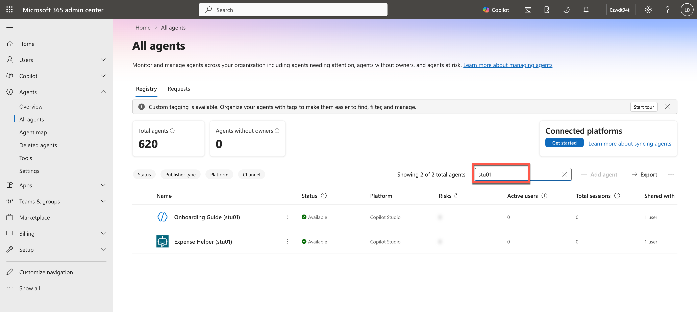

   The list holds every estate's agents (several hundred), and searching for your estate id finds only
   the few agents whose *names* carry it. Instead, choose **Export**, open the CSV in Excel, turn it into a table, then  filter its **Owner**
   column on `.<estate_id>@` — every account in your estate carries your estate id. 
   
   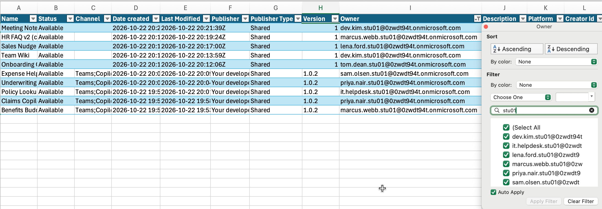

   Then, for each of your
   agents:
   - **Owner** → `owner_upn` (this export holds the UPN)
   - **Date created** → `created_utc`
   - **Last Modified** → `last_modified_utc` (this export's dates are UTC)
   - **Instructions** → `description`: write one line of your own from them, or use the agent's
     description where it has one.
   
   If you aren't in the tenant: review and count the rows in the filled-in
   [`agents-export.csv`]().

   The result should be similar to this:
   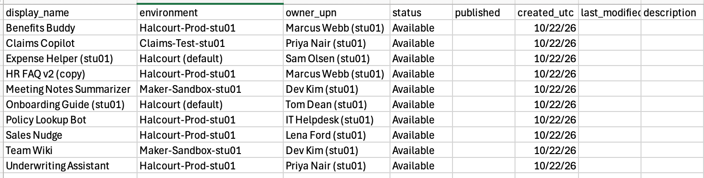

4. **OBSERVATIONS:** Look at the `environment` column. Note how many *distinct* environments the agents live in, then
   compare against your `environments-export.csv` from
   [Task 00-02](). Is every environment represented? Which
   environment types (Default, Production, Sandbox, Developer) are in scope?
5. **OBSERVATIONS:** Ask the question: in a real tenant, would this list contain *every* agent? Consider what any
   single inventory can miss: environments or sources you don't have permission to see, agent types that
   surface doesn't cover, agents too new to appear yet, and the same agent listed twice under different
   publishers. And a list names owners, but not whether those owners are still here, whose credentials
   each agent runs on, what it grounds on, or what it can reach. An agent in someone's personal environment
   can be listed and still reviewed by no one.

   Write down which of these would worry you most in a real tenant.
6. In your notes for this exercise, record your count and a one-line caveat about what it might be
   missing.

</details>

### 02: Who owns them?

An owner column looks like an answer. Cross-check it against the account data and watch it get slippery.

<details markdown="block">
<summary>Expand this section for detailed steps</summary>

1. In your `agents-export.csv`, read the `owner_upn` column for each agent. On its face, every agent has an owner.
2. Now look up each owner's account. Open the
   [Microsoft Entra admin center](https://entra.microsoft.com){:target="_blank"}, go to **Entra ID** →
   **Users**, and search for your estate id to list your estate's accounts.

   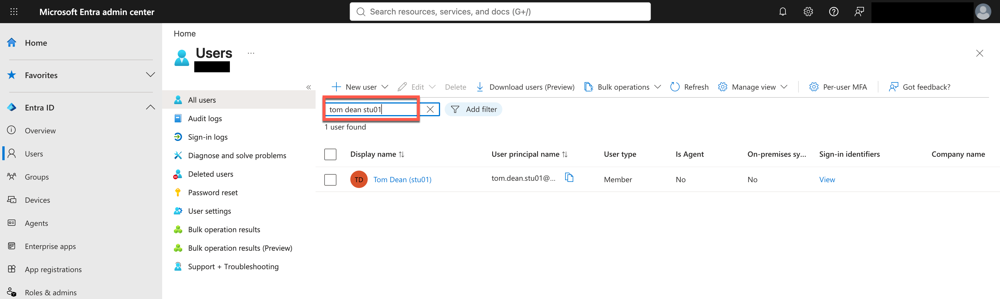

   The list shows each account, but not its **leave date** (the date HR recorded the person as gone) or
   its last sign-in. Get those for every account at once with the Azure CLI. In a terminal, sign in with
   your lab account; device-code sign-in lets you finish in the browser where you're already signed in to
   the lab:

   ```bash
   az login --use-device-code --allow-no-subscriptions
   ```

   Then run this command to display your user data in the terminal window, with your estate id in place of `<estate_id>`:

   ```bash
   az rest --method get --url 'https://graph.microsoft.com/v1.0/users?$select=userPrincipalName,displayName,accountEnabled,employeeLeaveDateTime,signInActivity&$top=999' --query "value[?contains(userPrincipalName, '.<estate_id>@')].{upn:userPrincipalName, name:displayName, enabled:accountEnabled, leaveDate:employeeLeaveDateTime, lastSignIn:signInActivity.lastSignInDateTime}" -o table
   ```

   Example output:
   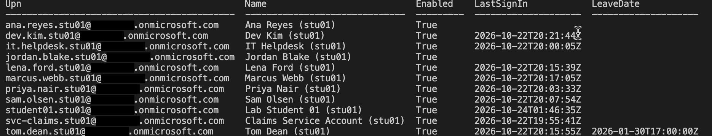


   Now, export that data to a CSV to make it easier to do the next step.

   ```bash
   az rest --method get --url 'https://graph.microsoft.com/v1.0/users?$select=userPrincipalName,displayName,accountEnabled,employeeLeaveDateTime,signInActivity&$top=999' --query "value[?contains(userPrincipalName, '.stu01@')].{upn:userPrincipalName, name:displayName, enabled:accountEnabled, leaveDate:employeeLeaveDateTime, lastSignIn:signInActivity.lastSignInDateTime}" -o json | python3 -c "import json,csv,sys; data=json.load(sys.stdin); w=csv.DictWriter(sys.stdout, fieldnames=['upn','name','enabled','leaveDate','lastSignIn']); w.writeheader(); w.writerows(data)" > users.csv
   ```

   Record each owner in your blank
   [`users-export.csv`]():
   - **upn** → `upn`
   - **name** → `display_name`
   - **enabled** → `account_enabled`
   - **leaveDate** → `employee_leave_date`
   - **lastSignIn** → `last_sign_in_utc`

   Then find the shared mailboxes. Open the
   [Exchange admin center](https://admin.exchange.microsoft.com){:target="_blank"}, go to
   **Recipients** → **Mailboxes**, filter to **Shared mailbox**, and search for your estate id. Set
   `is_shared_mailbox` to `TRUE` for any owner listed there, `FALSE` for the rest.

   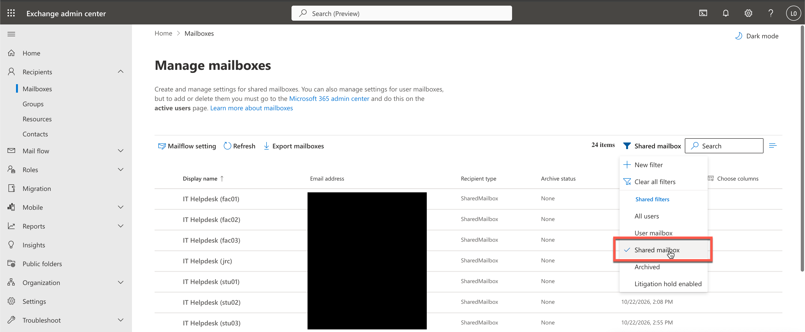

   `is_service_account` is optional: no tenant field marks it, so it's your judgement from the account's
   name and what it is used for.

   If you are doing this exercise without the tenant: take each `owner_upn` from the [`agents-export.csv`](), find the same UPN in the [`users-export.csv`]() and look at four columns:
   `account_enabled`, `employee_leave_date`, `is_service_account`, and `is_shared_mailbox`.

   The end result should look like this:
   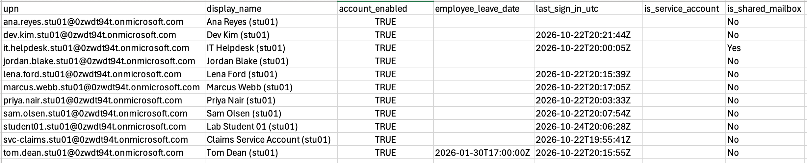


3. Flag any owner that is not a real, present, accountable person — someone who has **left** (a leave
   date, whether or not the account was disabled), a **disabled** account, a **service account**, or a
   **shared mailbox**. For each, ask: if this agent misbehaved tomorrow, who would you call? Note the
   flagged owners in your notes for this exercise; Exercise 02 turns them into findings.
4. Now find who owns the *connections* behind your agents. No portal page lists every connection in an
   environment, so ask the Power Platform admin API with the Azure CLI, still signed in as your lab
   account.

   List the environments. The list covers every estate's environments (dozens of them), so pick out
   `Halcourt (default)` and the ones ending in `-<estate_id>`. The table gives each environment's id, its
   name, and its Dataverse address, which step 6 uses:

   ```bash
   az rest --method get --url "https://api.bap.microsoft.com/providers/Microsoft.BusinessAppPlatform/scopes/admin/environments?api-version=2021-04-01" --resource https://service.powerapps.com/ --query "value[].{id:name, name:properties.displayName, dataverse:properties.linkedEnvironmentMetadata.instanceUrl}" -o table
   ```

   To list the connections in each of your environments you can substitute the environment id in the next comment, HOWEVER skip to the combined command following this one to produce a consolidated connections list:

   ```bash
   az rest --method get --url "https://api.powerapps.com/providers/Microsoft.PowerApps/scopes/admin/environments/<environment-id>/connections?api-version=2016-11-01" --resource https://service.powerapps.com/
   ```

   `Halcourt (default)` is shared by every estate and you want to filter so the list includes only the connections your estate's accounts own. To produce the consolidated connections list for your estate replace <estate-id> with your estate id and run this command: 

   ```bash
   ESTATE=stu01; echo "environment,connection,connector,ownerName,ownerUpn,sharedWith" > connections.csv; az rest --method get --url "https://api.bap.microsoft.com/providers/Microsoft.BusinessAppPlatform/scopes/admin/environments?api-version=2021-04-01" --resource https://service.powerapps.com/ --query "value[?contains(properties.displayName, '$ESTATE') || properties.displayName=='Halcourt (default)'].{id:name, name:properties.displayName}" -o json | python3 -c "import json,sys; [print(e['id']+'\t'+e['name']) for e in json.load(sys.stdin)]" | while IFS=$'\t' read -r env_id env_name; do az rest --method get --url "https://api.powerapps.com/providers/Microsoft.PowerApps/scopes/admin/environments/$env_id/connections?api-version=2016-11-01" --resource https://service.powerapps.com/ -o json | python3 -c "import json,sys; d=json.load(sys.stdin); [print('\t'.join([c['name'], c['properties'].get('apiId','').split('/')[-1], c['properties'].get('displayName',''), c['properties'].get('createdBy',{}).get('displayName',''), c['properties'].get('createdBy',{}).get('userPrincipalName','')])) for c in d.get('value',[])]" | while IFS=$'\t' read -r conn_name connector disp_name owner_name owner_upn; do [[ "$owner_upn" != *".$ESTATE@"* ]] && continue; shared=$(az rest --method get --url "https://api.powerapps.com/providers/Microsoft.PowerApps/scopes/admin/environments/$env_id/apis/$connector/connections/$conn_name/permissions?api-version=2016-11-01" --resource https://service.powerapps.com/ -o json | python3 -c "import json,sys; owner='$owner_upn'.lower(); d=json.load(sys.stdin); names=sorted(set(i['properties']['principal'].get('displayName','') for i in d.get('value',[]) if (i['properties']['principal'].get('email') or '').lower()!=owner)); print(';'.join(names))"); echo "\"$env_name\",\"$disp_name\",\"$connector\",\"$owner_name\",\"$owner_upn\",\"$shared\""; done; done >> connections.csv
   ```

   The result should look something like this: 

   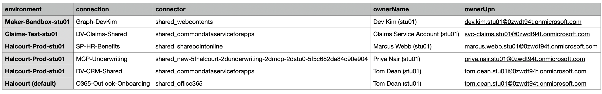
   
   Record each connection in your blank
   [`connections-export.csv`]():
   - `connection` → `connection_name`
   - the last segment of `connector` → `connector`, as its plain name:
     `shared_sharepointonline` is **SharePoint**, `shared_commondataserviceforapps` is
     **Microsoft Dataverse**, `shared_office365` is **Office 365 Outlook**, and
     `shared_onedriveforbusiness` is **OneDrive for Business**, and `shared_webcontents` is
     **Microsoft Graph**. An id starting `shared_new-` is a custom connector, with a generated id: write
     **MCP (custom)**. For any other, use the name the agent's tool shows in step 6.
   - `environment` → `environment`
   - `connection_owner_upn` → `connection_owner_upn`
   - `sharedWith` → `shared_with` 
   
   > NOTE: The query will only return with values if the connection is indeed shared. In this lab there will not be any data for this field but you still want the query to provide this on your own tenant in future. 
   
5. Match the connections to your agents. For each agent, **fill in the existing row** in your
   `connections-export.csv` for each connection it uses (`used_by_agent` and `auth_type`), and **add a
   row** only for a call that has no connection, such as an HTTP request or a flow.
   1. Open [Copilot Studio](https://copilotstudio.microsoft.com){:target="_blank"}.
   2. Select the environment switcher, at the bottom left just above your profile icon, and search it for
      your estate id. Pick the agent's environment. Hover over the switcher to confirm which environment
      you're in.
   3. Open **Agents**. In `Halcourt (default)`, search the list for your estate id.
   4. Open the agent. Its header shows the **Tools**, **Knowledge** and **Topics** tabs you use below.

   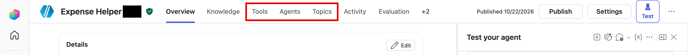

   {: .tip }
   > In some environments your account gets a reduced view of the agent: only **Evaluation** and
   > **Monitor** in its header, opening on its analytics. To reach the other pages, replace
   > `/analytics/summary` (or `/overview`) at the end of the address with:
   >
   > | Page | Replace with |
   > |---|---|
   > | Tools | `/actions` |
   > | Knowledge | `/knowledge` |
   > | Topics | `/tools` |

   The **Test your agent** pane may open with a consent prompt. Don't select **Confirm**; you aren't
   testing the agent here.

   An agent can have no tools, or no knowledge. Wait for the page to finish loading before you decide
   it's empty, because tools can take a few seconds to appear. A truly empty page isn't a mistake: note it
   and move on.

   - **Tools:** select each tool, and look at its page. Don't change anything, or select **Save** or
     **Delete**, even if they're active; you're only reading.
     1. Select **⋯** → **Open code view**. The tool's definition shows:
        - `connectionReference`: its middle part is the connector, in the same form as your
          `connector` column (for example `shared_commondataserviceforapps`); its last part is a label
          the maker gave the connection (for example `DVCRMShared`).
        - `mode`: `Maker` means the tool runs on **Maker-provided** credentials.

        An MCP tool's definition looks different (`InvokeExternalAgentTaskAction`, with
        `ModelContextProtocolMetadata`), but `connectionReference` and `mode` are in the same place. Its
        connector is a custom one, with a generated id starting `shared_new-`.

        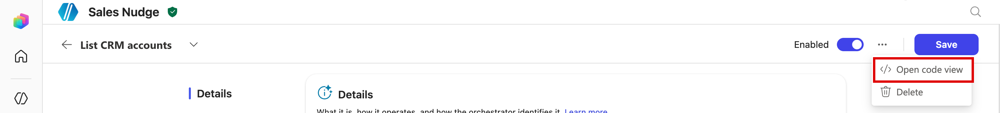

        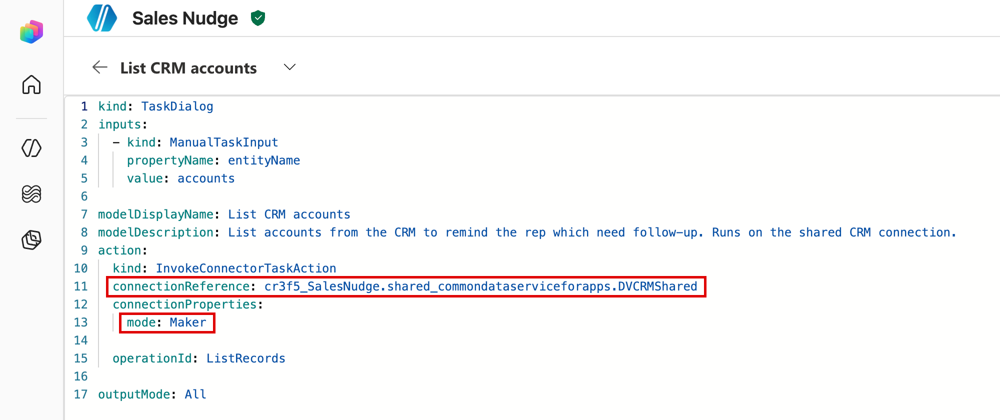

     2. Find the matching row in your `connections-export.csv`: the same connector, in the agent's
        environment. You kept only your estate's connections, so usually exactly one row fits. The label
        usually echoes the connection's name, but it's the maker's choice, not proof.
     3. In that row:
        - `used_by_agent`: the agent's name
        - `auth_type`: for `mode: Maker`, the tool carries the connection owner's credential, so look the
          owner up in your `users-export.csv`: `Service account` if they're a service account, otherwise
          `User (delegated)`. An MCP tool's connection holds one fixed token: `Static bearer token`. For
          any other mode, check **Additional details** → **Credentials to use** on the tool's page.

     If two tools run on the same connection, they share one row: name the agent once.

     The tool's page shows the same facts without code: the **Tool** field gives the connector's name and
     the action (the list in step 4 maps ids to names), and **Credentials to use** gives the credentials.

     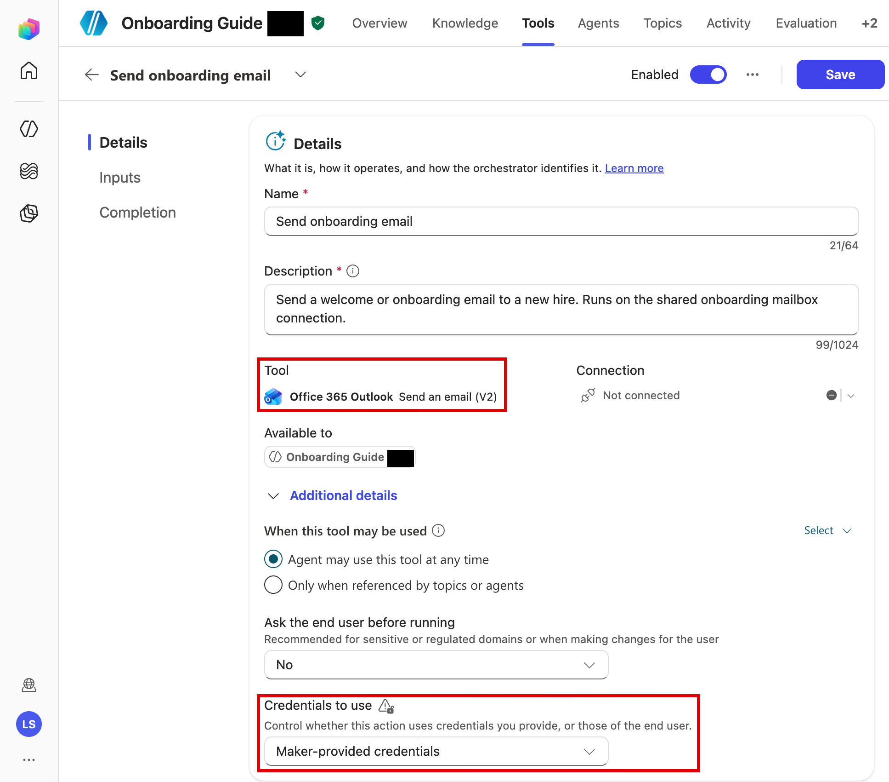

     As a viewer you'll see **Not connected** under **Connection**, and sometimes a red **No connection
     selected** there and in an error banner under **Inputs**. They're expected: you can't see another
     person's connection, so they say nothing about the agent.

     {: .tip }
     > Matching by connector and environment is a deduction. If two rows fit, the agent's definition in
     > the environment's Dataverse names the exact connection each tool is bound to.
   - **Knowledge:**
     1. Select each source. Its **Type**, on the right of its page, says what it reads (for example
        **SharePoint**), and its URL says where.

        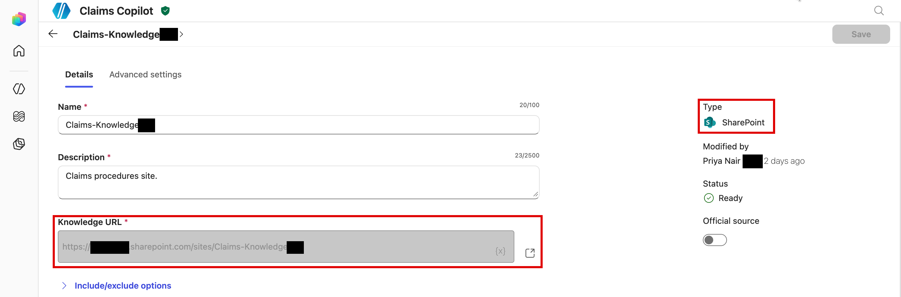

     2. A **SharePoint** source searches the site directly, with no connection, so it has no row: don't
        match it to a SharePoint connection, even if one exists in the agent's environment. Note the
        source's site in your notes instead. For any other type, look for a row with the same connector in
        the agent's environment, and if one fits, fill in its `used_by_agent` and `auth_type` as for a
        tool.

     An agent with no tools can still read data through its knowledge.
   - **Topics:**
     1. Keep the **Custom** filter, and skip the topics every agent starts with: **Greeting**,
        **Goodbye**, **Start Over**, and **Thank you**.
     2. Open each remaining topic by selecting its name (not **Details**), then select **More** →
        **Open code editor**. As a viewer you may see two red banners (*loadSolutionLayersError*, and
        *You can't create, edit, delete, or share in this environment*); they're expected.

        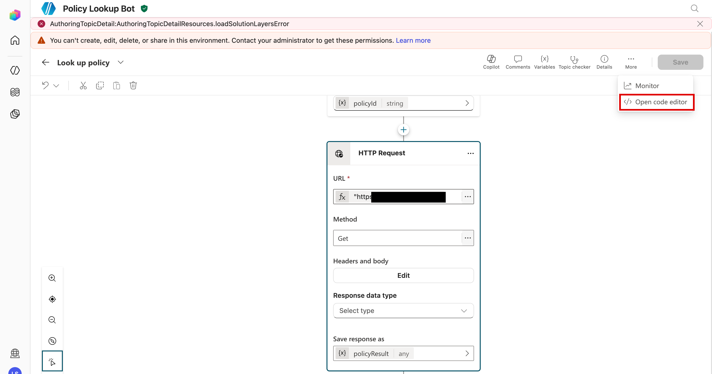

     3. Look in the code for two kinds of action, below.

     **`kind: HttpRequestAction`:** the agent calls a web address directly, with no connection, so the
     call would otherwise go unrecorded. Its `url` says where it goes, and its `headers` how it
     authenticates. A header carrying a key (such as `x-api-key` or `Authorization`) is a static
     credential: every chat sends the same one, and anyone who can view the agent can read it. Add a row:
     - `connection_name`: a label of your own
     - `connector`: `HTTP action`
     - `environment`: the agent's environment
     - `connection_owner_upn`: the agent's owner
     - `used_by_agent`: the agent's name
     - `auth_type`: `API key in action config` if a header carries a key

     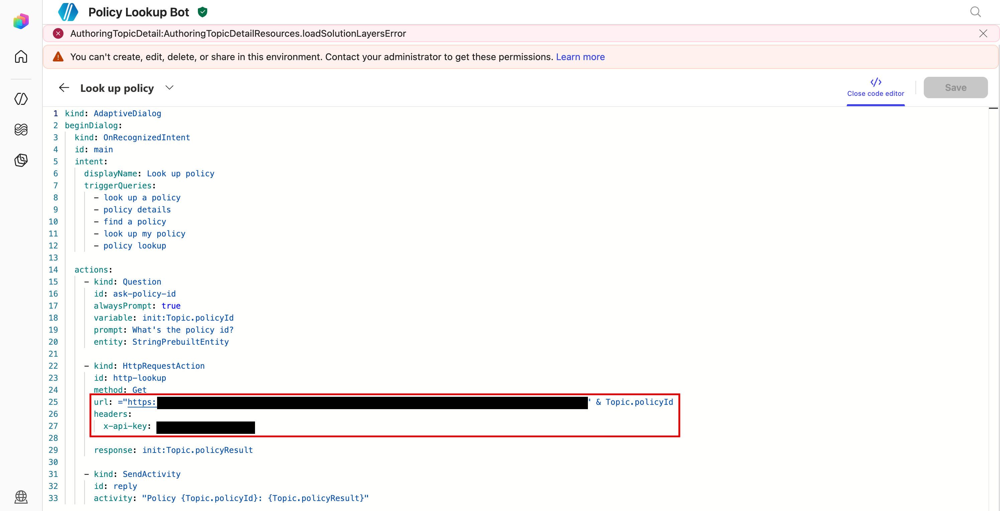

     **`kind: InvokeFlowAction`:** the agent runs a Power Automate cloud flow, and `flowId` says which.
     In this lab the flow isn't shared with your account, so you can't open it, and on the canvas its
     node shows *Flow not found or is turned off*. Read the flow's name and owner from the environment's
     Dataverse, with the Dataverse address from step 4 in place of `<dataverse>`:

     ```bash
     az rest --method get --url "<dataverse>api/data/v9.2/workflows(<flowId>)?\$select=name,connectionreferences&\$expand=owninguser(\$select=domainname)" --resource <dataverse>
     ```

     Add a row:
     - `connection_name`: the flow's `name`
     - `connector`: `Power Automate`
     - `environment`: the agent's environment
     - `connection_owner_upn`: `owninguser.domainname`
     - `used_by_agent`: the agent's name
     - `auth_type`: `Runs as owner`. By default a flow's actions use the connections it was built with,
       whoever starts it.

     The query shows who owns the flow, not which credential each action uses: a flow can be set to use
     the run-only user's connections instead, and you can't open it to check. A flow with no
     `connectionreferences` makes no connector calls of its own.

   Without the tenant: use the filled-in pack's
   [`connections-export.csv`]().
7. Compare each agent's `owner_upn` with the `connection_owner_upn` of the rows it uses. In your notes for
   this exercise, list each agent where the person who owns the *connection* is not the person who owns
   the *agent*, and check that connection owner's row in your `users-export.csv`: have they left, or is
   it a service account? A **Maker-provided** tool carries the connection owner's credential, whoever is
   chatting. If you're working in the tenant, add each connection owner who isn't in your
   `users-export.csv` yet.

   An HTTP request's row always matches, because you wrote the agent's owner there; its credential is
   the key in the topic, not anyone's account.
8. Hold these observations. You will not resolve them here — Exercise 02 turns them into named findings — but
   noticing that "owner" has several different meanings is the whole point.

</details>

### 03: What can they access?

This is the question the day is really about. Try to answer it for one agent and watch how many sources
you have to touch.

<details markdown="block">
<summary>Expand this section for detailed steps</summary>

1. Pick a single agent from your `agents-export.csv`.
2. Try to write one paragraph describing everything it can reach. Join three sources:
   - **Its rows in your `connections-export.csv`** (where `used_by_agent` is this agent): each row's
     connector, owner and `auth_type` say what it calls and whose credential carries the call. A knowledge
     source that reads through a connection has a row here too.
   - **Its knowledge sources:** reopen the agent's **Knowledge** page in Copilot Studio and note each
     source's type and URL, and match it to its row above if it has one (a SharePoint source doesn't). Without the tenant, the pack doesn't list
     knowledge sources: take what the agent's connection rows show, and record its sources as unknown.
   - **Its environment's DLP** in your `environments-export.csv`. A DLP policy governs which
     *connectors* the agent may use together; it doesn't limit what a knowledge source reads, or what a
     connection's owner can reach.
3. Notice what is *still* missing even after the joins: who can open the SharePoint site the agent
   grounds on, which Dataverse tables a connection can read, or what the API behind an HTTP request
   returns. That detail lives in the systems the agent reaches, not in the CSVs; it is what Exercises 02
   and 03 go get.
4. Write down the shortest honest answer you can give right now, and underline the parts you had to leave
   as "unknown — needs the systems the agent reaches."

</details>

## Summary

You just experienced the gap the rest of the workshop closes. Three plain questions — *how many, who owns
them, what can they access* — have no one-place answer, because an agent's real exposure is spread across
its environment, its connections, and its grounding. You also met the recurring subtlety in
"who owns them": an owner can be someone who has left, a disabled account, a service account, a shared mailbox, or someone
different from whoever owns the underlying connection. Keep your rough answers and your list of "unknowns"
— Exercise 02 (DISCOVER) turns the first two questions into a real inventory, and Exercise 03 (MAP) turns the
third into effective-access findings.
