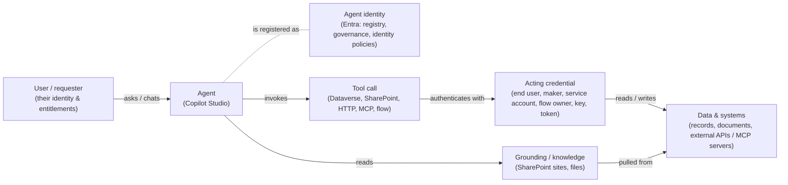

# Task 01-02 — The agent security model

## Introduction

To reason about an agent's security you need one picture in your head: the path a request travels and the
identities and systems it touches on the way. This task builds that picture. It is the mental model for
the entire day — every discovery, mapping, break, and control task in the later exercises is really just a
close look at one hop in this chain.

## Description

You will walk the reference architecture piece by piece — the **agent** and its Entra **identity**, the
**acting credential** behind each tool call, the **data and systems** those calls reach, and **grounding**
as a second, parallel path in — and attach the estate's real data to each piece so the concepts stop being
abstract. The single question you carry through every hop is: *whose authority is being exercised here,
and what does that authority reach?*

Here is the model:



### The identity hop

A **user** chats with an **agent**, and every agent also has its own **agent identity**: an Entra Agent ID,
created automatically for every agent built since May 2026 (older agents may have a legacy app
registration instead). Copilot Studio names it `<agent name> (Microsoft Copilot Studio)`: a service
principal with no app registration behind it. It is the agent's entry in the registry, and the principal
that governance, identity policies, and attached permissions target. It can be governed, targeted by
policy, and granted permissions independently of any human user.

But every tool call also carries an **acting credential**: the requesting user's (**End user**), the
maker's or connection owner's (**Maker-provided**), a service account's, a flow owner's, or a static key.
The agent's identity and the acting credential are related security objects, not interchangeable answers
to "who is acting?", and the acting credential is not necessarily the requesting user's. Whether the agent
checks the *user's* entitlement before acting is a separate design decision, and often it does not.

### The tool hop

Between the agent and real data sit connections, which hold credentials, and connectors and tools, which
do the work. Once a credential is stored, every call carries *its* reach, which may be far broader than
the task at hand.

### The grounding hop

Grounding is a second, separate way in: knowledge sources, commonly SharePoint sites, that the agent reads
to answer from your content. It brings two risks: **reach** (the whole site, not just the folder you
meant) and **content as instructions** (text in a source is fed to the model, so it can steer the agent).

## Success Criteria

- [ ] *(Live tenant only)* Your `agent-identities-export.csv` holds the Entra identity of each of your
      agents.
- [ ] You can name every hop in the model and say, in one sentence each, what it does.
- [ ] You can explain the difference between the **agent's** identity, the **acting credential** behind a
      tool call, and the **user's** identity, and why it matters *whose* authority a tool call runs under.
- [ ] You can point at where **stored credentials** live in the chain and name at least three auth types
      the estate actually uses.
- [ ] You can explain what **grounding** is and why it is a distinct ingress from the tool path.
- [ ] You can give a concrete example, from the estate, of each of: a Dataverse tool, a SharePoint
      grounding source, an HTTP/API action, and an MCP server.

## Learning Resources

- [Copilot Studio security and governance](https://learn.microsoft.com/microsoft-copilot-studio/security-and-governance){:target="_blank"}
- [Use connectors in Copilot Studio agents](https://learn.microsoft.com/microsoft-copilot-studio/advanced-connectors){:target="_blank"}
- [Conditional Access for agents](https://learn.microsoft.com/entra/identity/conditional-access/agent-id){:target="_blank"}
- [Dataverse security roles and privileges](https://learn.microsoft.com/power-platform/admin/security-roles-privileges){:target="_blank"}
- [View and filter agent identities in Microsoft Entra](https://learn.microsoft.com/entra/agent-id/agent-lists){:target="_blank"}
- [Add tools to custom agents in Copilot Studio](https://learn.microsoft.com/microsoft-copilot-studio/add-tools-custom-agent){:target="_blank"}
- [Knowledge sources in Copilot Studio](https://learn.microsoft.com/microsoft-copilot-studio/knowledge-copilot-studio){:target="_blank"}

## Key Tasks

### 01: The identity hop — agent identity vs acting credential

The most important idea in the whole model: the agent does not necessarily act as *you*.

<details markdown="block">
<summary>Expand this section for detailed steps</summary>

1. Open the [Microsoft Entra admin center](https://entra.microsoft.com){:target="_blank"}, go to
   **Entra ID** → **Agents** → **Agent identities**, and search for one of your agents, for example
   Benefits Buddy. You'll find several identities with the same name.

   That's a problem: an identity is named after its agent's display name, and display names aren't
   unique. Every estate in this tenant has a Benefits Buddy, and in a real tenant makers reuse names too.
   The name alone can't tell you which identity is your agent's.
2. Go from the agent's owner instead. Each identity's **sponsor** is the owner of its agent, so an owner's
   sponsored identities are exactly that owner's agents. For each owner in your `agents-export.csv`, run
   this with the owner's `owner_upn` in place of `<owner_upn>`:

   ```bash
   az rest --method get --url "https://graph.microsoft.com/beta/users/<owner_upn>/sponsorOf" --query "value[].{name:displayName, appId:appId, created:createdDateTime}" -o table
   ```

3. Record each identity in your blank
   [`agent-identities-export.csv`](),
   matching it to the agent by name:
   - the agent's `display_name` → `agent`
   - **name** → `entra_identity`
   - **appId** → `app_id`
   - **created** → `identity_created_utc`

   Without the tenant: the filled-in
   [`agent-identities-export.csv`]().
4. Write the review question next to this hop: *whose authority is this agent exercising when it acts?*
   You will answer it agent-by-agent in Exercise 03.

</details>

{: .important }
> Most MFA, legacy-auth, and Conditional Access baselines target *users*. An agent identity is targeted by
> Conditional Access for agents. And the runtime path you test may not use the agent identity at all: it
> may carry a user's credential, a stored connection, or a key. Exercise 05 tests this.

### 02: The tool hop — connections, connectors, and actions

Between the agent and real data sit connections (which hold credentials) and connectors/tools (which do
the work).

<details markdown="block">
<summary>Expand this section for detailed steps</summary>

1. Open your `connections-export.csv` and read the `auth_type` column across all rows. Note the different
   shapes of stored credential the estate uses — for example a maker's connection, a service-account
   connection, an API key held in a topic, and a flow that runs as its owner. Each is a different answer
   to "whose credential is this?" In the tenant, a tool's code view (`mode`) or its **Credentials to use**
   setting says whether it runs with the end user's credentials or the maker's. Two of those rows — the
   HTTP request and the flow — are not Power Platform connections at all: you found them inside the
   agent's topics, not in the list of connections. The CSV lists them beside the real connections so every
   credential sits in one file.
2. Map the tool categories onto your rows: **Dataverse** (reading and writing table rows), **HTTP
   requests** (a call to an external REST endpoint, from a topic), **MCP servers** (tools advertised by an
   external Model Context Protocol server, through a custom connector), and **flows** (a Power Automate
   flow run from a topic). Find one row for each. SharePoint isn't in this list: the estate's SharePoint
   access is grounding, which uses no connection — the next key task.

</details>

### 03: The grounding hop — knowledge as a second ingress

Grounding is how an agent "knows" things — and it is a separate door into the system, with its own risks.

<details markdown="block">
<summary>Expand this section for detailed steps</summary>

1. Note a practical gap: your CSVs tell you which connections an agent uses, but not its grounding. A
   SharePoint knowledge source has no row at all, because it uses no connection: it reads with the access
   of whoever is chatting. Its scope (which site, which folder) is on the agent's **Knowledge** page in
   Copilot Studio, as you saw in Task 01-01.

</details>

## Summary

You now have the model that frames the entire workshop: a request flows from the **user** to the
**agent**, which invokes tools whose calls each carry an **acting credential** to **data & systems**; the
agent's own Entra **identity** is what governance and identity policies target; and **grounding** is a
parallel path in that both widens reach and lets content act as instructions. The crucial move is
separating the **agent's** authority from the **user's**: every tool call carries an acting credential —
the user's, the maker's, a service account's, a key — and the agent may never check what the *requesting*
user is actually entitled to. Carry one question into every later task — *whose authority is this agent
exercising, and what can it reach when it does?* Next, you will use this model to find the trust
boundaries in the estate.
