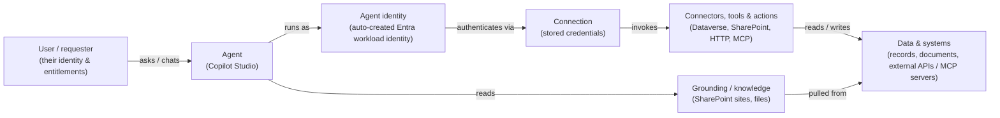

# Task 01-02 — The agent security model

## Introduction

To reason about an agent's security you need one picture in your head: the path a request travels and the
identities and systems it touches on the way. This task builds that picture. It is the mental model for
the entire day — every discovery, mapping, break, and control task in the later modules is really just a
close look at one hop in this chain.

## Description

You will walk the reference architecture hop by hop — **user → agent → identity → connectors/tools → data
& systems**, with **grounding** as a second, parallel ingress — and attach the estate's real data to each
hop so the concepts stop being abstract. The single question you carry through every hop is: *whose
authority is being exercised here, and what does that authority reach?*

Here is the model:

## Success Criteria

- [ ] You can name every hop in the model and say, in one sentence each, what it does.
- [ ] You can explain the difference between the **agent's** identity and the **user's** identity, and why
      it matters *whose* authority a tool call runs under.
- [ ] You can point at where **stored credentials** live in the chain and name at least three auth types
      the estate actually uses.
- [ ] You can explain what **grounding** is and why it is a distinct ingress from the tool path.
- [ ] You can give a concrete example, from the estate, of each of: a Dataverse tool, a SharePoint
      grounding source, an HTTP/API action, and an MCP server.

## Learning Resources

- [Copilot Studio security and governance](https://learn.microsoft.com/microsoft-copilot-studio/security-and-governance){:target="_blank"}
- [Manage connections and connectors in Power Platform](https://learn.microsoft.com/power-platform/admin/connections-connectors){:target="_blank"}
- [Conditional Access for workload identities](https://learn.microsoft.com/entra/identity/conditional-access/workload-identity){:target="_blank"}
- [Dataverse security roles and privileges](https://learn.microsoft.com/power-platform/admin/security-roles-privileges){:target="_blank"}

## Key Tasks

### 01: The identity hop — agent identity vs user identity

The most important idea in the whole model: the agent does not necessarily act as *you*.

Expand this section for detailed steps

1. Follow the two left-most edges of the diagram. A **user** chats with an **agent**; the agent then
   **runs as** its own **agent identity**. Since March 2026 that identity is an Entra workload identity
   created automatically for every new agent.
2. Open [`agent-identities-export.csv`]().
   Each agent maps to a distinct `entra_identity` and `app_id`. The pack labels each identity
   `cs-agent-<slug>-<env>`; in Entra, Copilot Studio names it `<agent name> (Microsoft Copilot Studio)` —
   a service principal created along with the agent, with no app registration behind it. These are real
   security principals — they authenticate and hold access independent of any human user.
3. Fix the key distinction in your mind: when the agent calls a tool, it may act as **its own identity**,
   as the **owner's** identity, or as a **shared/service account** — *not* necessarily as the requesting
   user's identity. Whether the agent checks the *user's* entitlement before acting is a separate design
   decision, and often it does not.
4. Write the review question next to this hop: *whose authority is this agent exercising when it acts?*
   You will answer it agent-by-agent in Module 3.

{: .important }
> Conditional Access, MFA, and legacy-auth policies are written for *user* sign-ins. A workload identity
> is a different kind of principal, and whether your existing CA policies touch it is something to verify
> in the tenant — it is exactly the gap Module 5 tests.

### 02: The tool hop — connections, connectors, and actions

Between the agent and real data sit connections (which hold credentials) and connectors/tools (which do
the work).

Expand this section for detailed steps

1. Follow the edges `agent identity → connection → connectors/tools → data & systems`. A **connection**
   stores the credential; a **connector, tool, or action** is the specific operation invoked with it.
2. Open [`connections-export.csv`]() and read the
   `auth_type` column across all rows. Note the different shapes of stored credential the estate uses —
   for example a delegated user connection, a service-account connection, an API key held in the action
   configuration, a static bearer token, and a flow that runs as its owner. Each is a different answer to
   "whose credential is this?" Three of those rows — the HTTP action, the MCP server and the flow — are
   not Power Platform connections at all. The pack lists them beside the real connections so every
   credential sits in one file; in the tenant you find them inside the agent and the flow, not in any list
   of connections.
3. Map the tool categories onto the estate's connectors: **Dataverse** (`List rows`, `Update` on tables
   like Claim and Customer), **SharePoint** (document and site access), **HTTP/API actions** (a call to
   an external REST endpoint), and **MCP servers** (tool schemas advertised by an external Model Context
   Protocol server). Find one row for each category in the CSV.
4. Notice what the connection grants: once the credential is stored, the tool call carries *that*
   credential's reach — which may be far broader than the task at hand. That over-reach is what Modules 3
   and 4 measure.

### 03: The grounding hop — knowledge as a second ingress

Grounding is how an agent "knows" things — and it is a separate door into the system, with its own risks.

Expand this section for detailed steps

1. Follow the `agent → grounding → data & systems` path. **Grounding** connects the agent to knowledge
   sources — commonly SharePoint sites and files — so it can answer from your content.
2. Understand the two properties that make grounding a security concern. First, **reach**: the agent can
   read whatever the grounding scope allows, which may be an entire site rather than the intended folder —
   and that can exceed what the *user* asking the question is allowed to see. Second, **content as
   instructions**: text pulled from a grounding source is fed into the model's context, so hidden or
   malicious content inside a document can influence the agent's behavior. Module 4 demonstrates both.
3. Note a practical gap: the artifact pack tells you *which connectors and identities* an agent has, but
   the exact grounding scope (which site, which subfolders) usually lives in the agent's configuration,
   not in a CSV. Add "grounding scope" to your list of things to confirm in the tenant during discovery.

## Summary

You now have the model that frames the entire workshop: a request flows **user → agent → identity →
connection → connector/tool → data & systems**, with **grounding** as a parallel ingress that both widens
reach and lets content act as instructions. The crucial move is separating the **agent's** authority from
the **user's**: an agent runs as its own identity, an owner, or a shared account, and it may never check
what the *requesting* user is actually entitled to. Carry one question into every later task — *whose
authority is this agent exercising, and what can it reach when it does?* Next, you will use this model to
find the trust boundaries in the estate.
