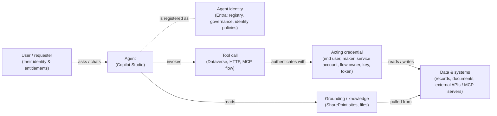

# Task 01-02 — The agent security model

## Introduction

To reason about an agent's security you need one picture in your head: the path a request travels and the
identities and systems it touches on the way. This task builds that picture. It is the mental model for
the entire day — every discovery, mapping, break, and control task in the later exercises is really just a
close look at one hop in this chain.

## Description

You will walk the reference architecture piece by piece — the **agent** and its Entra **identity**, the
**acting credential** behind each tool call, the **data and systems** those calls reach, and **grounding**
as a second, parallel path in — and attach your estate's real data to the identity and tool hops so the
concepts stop being abstract. The single question you carry through every hop is: *whose authority is being exercised here,
and what does that authority reach?*

Here is the model:



### The identity hop

A **user** chats with an **agent**, and every agent also has its own **agent identity**: an Entra Agent ID,
created automatically for every agent built since May 2026 (older agents may have a legacy app
registration instead). Copilot Studio names it `<agent name> (Microsoft Copilot Studio)`: a service
principal with no app registration behind it. It is the agent's entry in the registry, and the principal
that governance, identity policies, and attached permissions target. It can be governed, targeted by
policy, and granted permissions independently of any human user.

But every tool call also carries an **acting credential**: the requesting user's (**End user**), the
maker's or connection owner's (**Maker-provided**), a service account's, a flow owner's, or a static key or token.
The agent's identity and the acting credential are related security objects, not interchangeable answers
to "who is acting?", and the acting credential is not necessarily the requesting user's. Whether the agent
checks the *user's* entitlement before acting is a separate design decision, and often it does not.

The question this hop raises: *whose authority is this agent exercising when it acts?* You answer it
agent by agent in Exercise 03.

### The tool hop

Between the agent and real data sit connections, which hold credentials, and connectors and tools, which
do the work. Once a credential is stored, every call carries *its* reach, which may be far broader than
the task at hand.

The credential behind a call comes in several shapes, each a different answer to "whose credential is
this?":

- a maker's connection, used by every person who chats with the agent
- a service account's connection
- an API key pasted into a topic's HTTP request
- a token held by an MCP tool's connection, sent with every call
- a flow that runs as its owner

The HTTP request and the flow aren't Power Platform connections at all: you found them in the agent's
topics. Your `connections-export.csv` lists them beside the real connections so every credential sits in
one file.

### The grounding hop

Grounding is a second, separate way in: knowledge sources, commonly SharePoint sites, that the agent reads
to answer from your content. It brings two risks: **reach** (the whole site, not just the folder you
meant) and **content as instructions** (text in a source is fed to the model, so it can steer the agent).

Your CSVs show connections, not grounding: a SharePoint knowledge source has no row, because it uses no
connection. Its scope (which site, which folder) is on
the agent's **Knowledge** page in Copilot Studio, as you saw in Task 01-01.

## Success Criteria

- [ ] *(Live tenant only)* Your `agent-identities-export.csv` holds the Entra identity of each of your
      agents.
- [ ] You can name every hop in the model and say, in one sentence each, what it does.
- [ ] You can explain the difference between the **agent's** identity, the **acting credential** behind a
      tool call, and the **user's** identity, and why it matters *whose* authority a tool call runs under.
- [ ] You can point at where **stored credentials** live in the chain and name at least three auth types
      the estate actually uses.
- [ ] You can explain what **grounding** is and why it is a distinct ingress from the tool path.
- [ ] You can give a concrete example, from the estate, of each of: a Dataverse tool, a SharePoint
      grounding source, an HTTP/API action, and an MCP server.

## Learning Resources

- [Copilot Studio security and governance](https://learn.microsoft.com/microsoft-copilot-studio/security-and-governance){:target="_blank"}
- [Use connectors in Copilot Studio agents](https://learn.microsoft.com/microsoft-copilot-studio/advanced-connectors){:target="_blank"}
- [Conditional Access for agents](https://learn.microsoft.com/entra/identity/conditional-access/agent-id){:target="_blank"}
- [Dataverse security roles and privileges](https://learn.microsoft.com/power-platform/admin/security-roles-privileges){:target="_blank"}
- [View and filter agent identities in Microsoft Entra](https://learn.microsoft.com/entra/agent-id/agent-lists){:target="_blank"}
- [Add tools to custom agents in Copilot Studio](https://learn.microsoft.com/microsoft-copilot-studio/add-tools-custom-agent){:target="_blank"}
- [Knowledge sources in Copilot Studio](https://learn.microsoft.com/microsoft-copilot-studio/knowledge-copilot-studio){:target="_blank"}

## Key Tasks

### 01: The identity hop — agent identity vs acting credential

The most important idea in the whole model: the agent does not necessarily act as *you*.

<details markdown="block">
<summary>Expand this section for detailed steps</summary>

Without the tenant: read the filled-in pack's
[`agent-identities-export.csv`]() instead of
steps 1–3.

1. Open the [Microsoft Entra admin center](https://entra.microsoft.com){:target="_blank"}, go to
   **Entra ID** → **Agents** → **Agent identities**, and search for one of your agents, for example
   Benefits Buddy. You'll find several identities with the same name.

   That's a problem: an identity is named after its agent's display name, and display names aren't
   unique. Every estate in this tenant has a Benefits Buddy, and in a real tenant makers reuse names too.
   The name alone can't tell you which identity is your agent's.
2. Go from the agent's owner instead. Each identity's **sponsor** is the owner of its agent, so an owner's
   sponsored identities are exactly that owner's agents. For each owner in your `agents-export.csv`, run
   this with the owner's `owner_upn` in place of `<owner_upn>`:

   ```bash
   az rest --method get --url "https://graph.microsoft.com/beta/users/<owner_upn>/sponsorOf" --query "value[].{name:displayName, appId:appId, created:createdDateTime}" -o table
   ```

3. Record each identity in your blank
   [`agent-identities-export.csv`](),
   matching it to the agent by name. Publishing an agent again leaves its old identity behind, so if two
   identities match one agent, keep the one created last:
   - the agent's `display_name` → `agent`
   - **name** → `entra_identity`
   - **appId** → `app_id`
   - **created** → `identity_created_utc`

</details>

{: .important }
> A control that targets the agent's identity only matters if the call actually uses that identity; it
> may carry a user's credential, a stored connection or a key instead. Exercise 05 tests this.

### 02: The tool hop — connections, connectors, and actions

Between the agent and real data sit connections (which hold credentials) and connectors/tools (which do
the work).

<details markdown="block">
<summary>Expand this section for detailed steps</summary>

1. In your `connections-export.csv`, find one row for each kind of tool call:
   - **Dataverse** (`shared_commondataserviceforapps`): reading and writing table rows
   - **HTTP request:** a call to an external REST endpoint, from a topic
   - **MCP server** (`shared_new-…`): tools advertised by an external Model Context Protocol server,
     through a custom connector
   - **Flow:** a Power Automate flow run from a topic
2. For each of the four, use its `connection_owner_upn` and `auth_type` to answer: whose credential
   carries the call, and is it the person chatting with the agent?
3. Look at your answers together. If none of them is the person chatting, every one of these agents
   acts with someone else's authority. Anyone who can chat with it can make its tools act with that
   credential's authority, whatever they're entitled to themselves. That's the gap Exercise 03 measures.

SharePoint isn't in this list: the estate's SharePoint access is grounding, which uses no connection
(see *The grounding hop*, above).

</details>

## Summary

You now have the model that frames the workshop:

- A **user** chats with an **agent**.
- The agent invokes **tool calls**, each carrying an **acting credential** to **data and systems**.
- The agent's own Entra **identity** is what governance and identity policies target.
- **Grounding** is a parallel way in, which widens reach and lets content act as instructions.

The crucial move is separating the agent's authority from the user's. Every tool call carries an acting
credential (the maker's, a service account's, a key, a flow owner's), and in this estate none of them is
the person chatting. Carry one question into every later task: *whose authority is this agent
exercising, and what can it reach when it does?*

Next, you use this model to find the trust boundaries in the estate.
