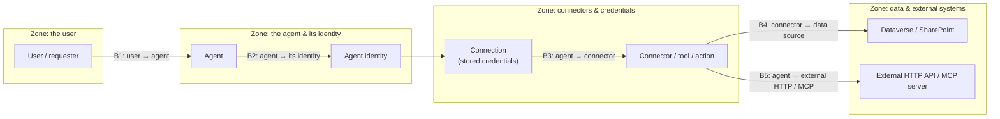

# Task 01-03 — Find the trust boundaries

## Introduction

A trust boundary is any point where a request moves from one zone of control into another — where the
thing on one side does not, and should not, simply trust the thing on the other. Security lives at those
crossings. Now that you have the agent model, you can locate its boundaries and, for a specific agent,
sketch exactly where trust is crossed. That sketch is the seed of the inventory you build next and the
threat model you build in Module 4.

## Description

Using the model from the previous task, you will mark the estate's five recurring trust boundaries, then
pick **one or two agents** from your CSVs and trace each request through them — naming, at every
crossing, whose authority applies on each side and what could go wrong if the boundary is not enforced.
You will capture the result as a small per-agent table (your trust-boundary sketch).

The five boundaries, laid over the model:

- **B1 — user → agent:** untrusted user input (and, via grounding, untrusted content) enters the agent.
- **B2 — agent → its identity:** the agent acts under an identity that may not be the user's; authority
  can change hands here.
- **B3 — agent → connector:** the tool call carries a *stored credential*, whose reach may exceed the task.
- **B4 — connector → data source:** the credential meets in-tenant data (Dataverse rows, SharePoint sites)
  that may have no row-level scoping.
- **B5 — agent → external HTTP / MCP:** the request leaves the tenant to an external API or MCP server,
  gated only by whatever auth that integration was built with.

## Success Criteria

- [ ] You can name all five trust boundaries and, for each, say what is on either side and why the
      boundary matters.
- [ ] You have produced a trust-boundary sketch for **one or two** specific agents in the estate.
- [ ] For each sketched agent you have identified, at **B2**, *whose* identity the agent acts as (the
      user, the owner, a service account, or the connection owner).
- [ ] For each sketched agent you have marked which boundaries are present (for example, an agent with no
      external HTTP/MCP call has no B5).
- [ ] You have kept the sketch to reuse in the Module 2 inventory and the Module 4 threat model.

## Learning Resources

- [Copilot Studio security and governance](https://learn.microsoft.com/microsoft-copilot-studio/security-and-governance){:target="_blank"}
- [Use connectors in Copilot Studio agents](https://learn.microsoft.com/microsoft-copilot-studio/advanced-connectors){:target="_blank"}
- [Power Platform environments overview](https://learn.microsoft.com/power-platform/admin/environments-overview){:target="_blank"}
- [Add tools to custom agents in Copilot Studio](https://learn.microsoft.com/microsoft-copilot-studio/add-tools-custom-agent){:target="_blank"}

## Key Tasks

### 01: Mark the five boundaries on the model

Before touching a specific agent, make the boundaries concrete in your own words.

Expand this section for detailed steps

1. Redraw the model from the previous task (or reuse the diagram above) and draw a cut line at each of the
   five crossings B1–B5.
2. At each cut, write two short notes: *what is on each side*, and *what stops the left side from simply
   trusting the right*. For B1 that might be "user input / model context — nothing validates intent." For
   B4 it might be "connector credential / Dataverse rows — is there row-level security?"
3. Keep this annotated model handy; you will apply it to real agents next.

### 02: Sketch the boundaries for one agent

Pick a first agent and trace a single request all the way through, boundary by boundary.

Expand this section for detailed steps

1. Choose one agent from your `agents-export.csv`. A good first pick is one whose connection uses a
   straightforward delegated user credential, so the crossings are easy to read.
2. Assemble its facts from your CSVs: its `owner_upn` (`agents-export.csv`), its `entra_identity`
   (`agent-identities-export.csv`), and its connection, connector, and `auth_type`
   (`connections-export.csv`). Without the tenant, these are the filled-in files in the
   [artifact pack](#the-artifact-pack).
3. Fill in a row per boundary. A workable sketch table:

   | Boundary | Present? | On each side | Whose authority applies | What could cross that shouldn't |
   |---|---|---|---|---|
   | B1 user → agent | | requesting user / agent | the user asks; the agent decides | malicious input or grounded content |
   | B2 agent → identity | | agent / its acting identity | user? owner? service account? | authority the user does not personally hold |
   | B3 agent → connector | | agent / stored credential | the credential's scope | reach beyond the task |
   | B4 connector → data | | credential / Dataverse or SharePoint | the data source's access model | rows/files the user cannot see |
   | B5 agent → external | | agent / external API or MCP | whatever the integration's auth grants | inputs or returns beyond the intended call |

4. The B2 row is the one to get right: use the connection's `auth_type` and `connection_owner_upn` to
   decide whether the agent effectively acts as the **user**, the **owner**, a **service account**, or a
   **connection owner who differs from the agent owner**. In the tenant, check it against the tool's
   credentials setting (Copilot Studio → the agent → **Tools** → the tool → **Details** → **Additional details**:
   **End user** or **Maker-provided**). Write that
   answer explicitly.

### 03: Do a second agent and compare

One agent teaches the method; a contrasting second one teaches why boundaries differ.

Expand this section for detailed steps

1. Pick a second agent whose shape is deliberately different from your first — for example one whose
   `auth_type` in your `connections-export.csv` is a service account, a static key/bearer token, or a flow
   that runs as its owner, rather than a delegated user connection.
2. Produce the same five-row sketch. Pay attention to where the two agents diverge: does the second one
   have a **B5** (external HTTP/MCP) that the first lacks? At **B2**, does it act as a non-user identity?
   At **B4**, does the data source appear to have any row-level scoping?
3. For each agent, write the single sentence that matters most: *whose authority is this agent exercising,
   and what can it reach when it does?*
4. Keep both sketches. In Module 2 they anchor the agent's inventory row; in Module 4 the boundary you
   were most worried about becomes the scenario you actually test.

{: .caution }
> You are only *observing and sketching* here — do not try to exercise any boundary against the live
> tenant in this exercise. Everything you sketch runs against a training estate that was deliberately
> built to be broken; controlled break scenarios come later, in Module 4.

## Summary

You mapped the estate's five recurring trust boundaries — user → agent, agent → identity, agent →
connector, connector → data source, and agent → external HTTP/MCP — and traced one or two real agents
across them. The crossings that carry the most risk are the ones where authority changes hands (B2) and
where a stored credential meets unscoped data or an external endpoint (B4, B5). Your per-agent sketches
are not throwaway: they become inventory rows in Module 2 and threat-model scenarios in Module 4. From
here on, whenever you meet a new agent, you already know the question to ask at every boundary — *whose
authority, and what can it reach?*
