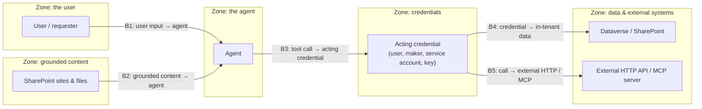

# Task 01-03 — Find the trust boundaries

## Introduction

A trust boundary is any point where a request moves from one zone of control into another — where the
thing on one side does not, and should not, simply trust the thing on the other. Security lives at those
crossings. Now that you have the agent model, you can locate its boundaries and, for a specific agent,
sketch exactly where trust is crossed. That sketch is the seed of the inventory you build next and the
threat model you build in Exercise 04.

## Description

Using the model from the previous task, you will mark the estate's five recurring trust boundaries, then
pick **one or two agents** from your CSVs and trace each request through them — naming, at every
crossing, whose authority applies on each side and what could go wrong if the boundary is not enforced.
You will capture the result as a small per-agent table (your trust-boundary sketch).

The five boundaries, laid over the model:

The agent's Entra identity isn't on this diagram: it isn't a hop the request crosses — it's what governance
and identity policies target.

- **B1 — user input → agent:** untrusted user input enters the agent.
- **B2 — grounded content → agent context:** text retrieved from grounding sources enters the model's
  context, where it can be read as instructions.
- **B3 — tool call → acting credential:** the agent hands its call to a connection, key or flow owner.
  On one side, what the person asked for; on the other, whose authority the call will use, which may not
  be the asker's. Authority changes hands here, before the call reaches any system.
- **B4 — credential → in-tenant data:** the credential's reach meets Dataverse rows or SharePoint sites
  where record-level access (ownership, business units, teams, sharing) may not narrow it — and that
  reach may exceed the task.
- **B5 — call → external HTTP / MCP:** the request leaves the tenant to an external API or MCP server,
  gated only by whatever auth that integration was built with.

## Success Criteria

- [ ] You can name all five trust boundaries and, for each, say what is on either side and why the
      boundary matters.
- [ ] You have produced a trust-boundary sketch for **one or two** specific agents in the estate.
- [ ] For each sketched agent you have identified, at **B3**, *whose* credential each tool call carries
      (the user's, the owner's, a service account's, a connection owner's, or a static key or token).
- [ ] For each sketched agent you have marked which boundaries are present (for example, an agent with no
      grounding has no B2, and one with no external HTTP/MCP call has no B5).
- [ ] You compared your sketches with the suggested ones for Benefits Buddy and Claims Copilot.
- [ ] You have kept the sketch to reuse in the Exercise 02 inventory and the Exercise 04 threat model.

## Learning Resources

- [Copilot Studio security and governance](https://learn.microsoft.com/microsoft-copilot-studio/security-and-governance){:target="_blank"}
- [Use connectors in Copilot Studio agents](https://learn.microsoft.com/microsoft-copilot-studio/advanced-connectors){:target="_blank"}
- [Power Platform environments overview](https://learn.microsoft.com/power-platform/admin/environments-overview){:target="_blank"}
- [Add tools to custom agents in Copilot Studio](https://learn.microsoft.com/microsoft-copilot-studio/add-tools-custom-agent){:target="_blank"}

## Key Tasks

### 01: Mark the five boundaries on the model

Before touching a specific agent, make the boundaries concrete in your own words.

Expand this section for detailed steps

1. On paper if you have it, or as notes in a text file, list the five crossings B1–B5 (or redraw the
   diagram above and draw a cut line at each).
2. At each crossing, write two short notes: *what is on each side*, and *what stops the left side from simply
   trusting the right*. For B1 that might be "user input / model context — nothing validates intent." For
   B4 it might be "acting credential / Dataverse rows — does record-level access narrow what it reaches?"
   "Nothing yet — to be tested" is a valid note: at this point you've proven no control at most
   crossings. Exercise 05 tests what's there.
3. Keep this annotated model handy; you will apply it to real agents next.

Reveal the suggested boundary notes

Write your own notes first, then compare.

- **B1 — user input → agent.** One side, the person chatting; the other, the agent and its model. What
  stops it: the model's built-in safety filtering, and whatever the agent's instructions say. Neither has
  been tested yet; until it is, treat it as nothing.
- **B2 — grounded content → agent.** One side, whoever can write to the grounding source; the other, the
  model's context. What stops it: nothing in the agent checks retrieved text for instructions. Whoever
  can edit the source can steer the agent.
- **B3 — tool call → acting credential.** One side, what the person asked for; the other, whose authority
  the call will use (a maker's connection, a service account, a key, a flow owner). What stops it: nothing
  checks that the person chatting is entitled to that authority. This is where authority changes hands.
- **B4 — credential → in-tenant data.** One side, the acting credential; the other, Dataverse rows or
  SharePoint files. What stops it: only that credential's own permissions — its role, and any record-level
  sharing. Nothing narrows it to the task or to the asker.
- **B5 — call → external.** One side, the agent's call; the other, an external API or MCP server. What
  stops it: only whatever authentication the integration was built with, often one static key shared by
  every call.

Exercise 05 tests which controls actually close these.

### 02: Sketch the boundaries for one agent

Pick a first agent and trace a single request all the way through, boundary by boundary.

Expand this section for detailed steps

1. Choose one agent from your `agents-export.csv`. A good first pick is an agent with few moving
   parts, such as one that only answers from knowledge, so the crossings are easy to read.
2. Assemble its facts from your CSVs:
   - its `owner_upn`, from your `agents-export.csv`
   - its `entra_identity`, from your `agent-identities-export.csv`
   - its tool calls: the rows in your `connections-export.csv` whose `used_by_agent` is this agent, with
     their connector and `auth_type`. No rows means the agent makes no tool calls.

   Don't match connections by owner. A maker can own connections none of their agents use: Marcus Webb
   owns `SP-HR-Benefits`, but no agent's definition references it.

   Without the tenant, these are the filled-in files in the
   [artifact pack](#the-artifact-pack).
3. Fill in a row per boundary. Mark a boundary **No** when the agent has no path through it (for example,
   no tools means no B3), not when there's no control. A workable sketch table:

   | Boundary | Crossed by this agent? | On each side | Whose authority applies | What could cross that shouldn't |
   |---|---|---|---|---|
   | B1 user input → agent | | requesting user / agent | the user asks; the agent decides | malicious or manipulative input |
   | B2 grounded content → agent | | grounding source / model context | whoever can write to the source | instructions hidden in retrieved content |
   | B3 tool call → acting credential | | what the asker requested / whose credential the call carries | user? maker? service account? key? | authority the user does not personally hold |
   | B4 credential → in-tenant data | | credential / Dataverse or SharePoint | the credential's scope and the data's access model | rows or files beyond the task, or that the user cannot see |
   | B5 call → external | | agent / external API or MCP | whatever the integration's auth grants | inputs or returns beyond the intended call |

   For B3, name whose credential the call carries, from the row's `auth_type` and `connection_owner_upn`.

Reveal a suggested sketch for Benefits Buddy

Benefits Buddy lives in `Halcourt-Prod` and is owned by Marcus Webb. It has no tools, and no rows in
`connections-export.csv`. It is grounded on the `HR-Benefits` SharePoint site, and SharePoint knowledge
uses no connection: it searches the site with the access of whoever is chatting.

| Boundary | Crossed by this agent? | On each side | Whose authority applies | What could cross that shouldn't |
|---|---|---|---|---|
| B1 user input → agent | Yes | any employee who can chat / Benefits Buddy | the asking employee asks; the agent decides | manipulative questions that pull the agent off its benefits job |
| B2 grounded content → agent | Yes | the `HR-Benefits` site / model context | anyone who can write to `HR-Benefits`; the site is searched with the asker's own access | files the site overshares, now surfaced in an answer, and instruction-like text read as if it were policy |
| B3 tool call → acting credential | No | — | — | — (no tools) |
| B4 credential → in-tenant data | No | — | — | — (no tool calls, so no acting credential) |
| B5 call → external | No | — | — | — (no HTTP request or MCP server) |

**In one sentence:** Benefits Buddy exercises no authority but the asker's own, so its risk lies in what
the `HR-Benefits` site overshares and in what that site's content can instruct the model to do.

### 03: Do a second agent and compare

One agent teaches the method; a contrasting second one teaches why boundaries differ.

Expand this section for detailed steps

1. Pick a second agent whose shape is deliberately different from your first — for example one whose
   `auth_type` in your `connections-export.csv` is a service account, a static key/bearer token, or a flow
   that runs as its owner, rather than a delegated user connection.
2. Produce the same five-row sketch. Pay attention to where the two agents diverge: does the second one
   have a **B5** (external HTTP/MCP) that the first lacks? At **B3**, does its call carry a non-user
   credential? At **B4**, does anything in record-level access (ownership, business units, teams, sharing)
   narrow what the credential reaches?
3. For each agent, write the single sentence that matters most: *whose authority is this agent exercising,
   and what can it reach when it does?*
4. Keep both sketches. In Exercise 02 they anchor the agent's inventory row; in Exercise 04 the boundary you
   were most worried about becomes the scenario you actually test.

Reveal a suggested sketch for Claims Copilot

Claims Copilot lives in `Claims-Test`, a sandbox, and is owned by Priya Nair. Its one connection is
`DV-Claims-Shared`: Microsoft Dataverse, owned by `svc-claims`, `auth_type` **Service account**. `users-export.csv` marks `svc-claims` as a service account. Its tools list Claim and
Customer rows; it has no tool that writes. It is grounded on the `Claims-Knowledge` SharePoint site.

| Boundary | Crossed by this agent? | On each side | Whose authority applies | What could cross that shouldn't |
|---|---|---|---|---|
| B1 user input → agent | Yes | anyone who can chat / Claims Copilot | the asking user asks; the agent decides | requests for claims or customers that aren't the asker's |
| B2 grounded content → agent | Yes | the `Claims-Knowledge` site / model context | anyone who can write to `Claims-Knowledge` | instruction-like text in a claims procedure |
| B3 tool call → acting credential | Yes | Claims Copilot / the `DV-Claims-Shared` connection | `svc-claims`'s — a service account, not the asking user and not Priya | the service account's authority, used by whoever is chatting |
| B4 credential → in-tenant data | Yes | `svc-claims` / Dataverse `Claim` and `Customer` | whatever `svc-claims`'s Dataverse role grants | claim and customer rows beyond the asker's own work |
| B5 call → external | No | — | — | — (no HTTP action or MCP server) |

The contrast with Benefits Buddy sits at B3: Benefits Buddy has none, and reads as the asker; Claims
Copilot's calls carry a service account's credential, so nothing at that hop ties what the agent does to
who is asking. Whether record-level access narrows B4 depends on
`svc-claims`'s role, which you map in Exercise 03.

**In one sentence:** Claims Copilot exercises the `svc-claims` service account's Dataverse authority, so
anyone who chats with it can read Claim and Customer rows as far as that account's role allows.

{: .caution }
> You are only *observing and sketching* here — do not try to exercise any boundary against the live
> tenant in this exercise. Everything you sketch runs against a training estate that was deliberately
> built to be broken; controlled break scenarios come later, in Exercise 04.

## Summary

You mapped the estate's five recurring trust boundaries — user input → agent, grounded content → agent,
tool call → acting credential, credential → in-tenant data, and call → external HTTP/MCP — and traced one
or two real agents across them. The crossings that carry the most risk are the ones where authority
changes hands (B3) and where a stored credential meets unscoped data or an external endpoint (B4, B5).
Your per-agent sketches are not throwaway: they become inventory rows in Exercise 02 and threat-model
scenarios in Exercise 04. From here on, whenever you meet a new agent, you already know the question to ask
at every boundary — *whose authority, and what can it reach?*
