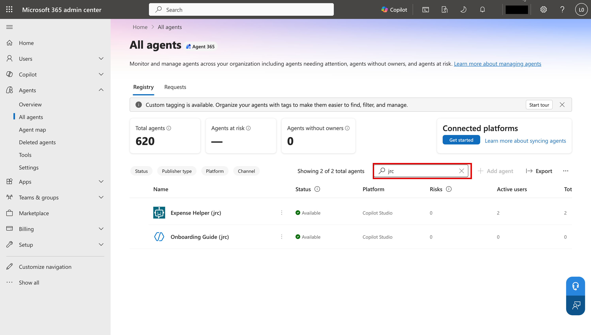
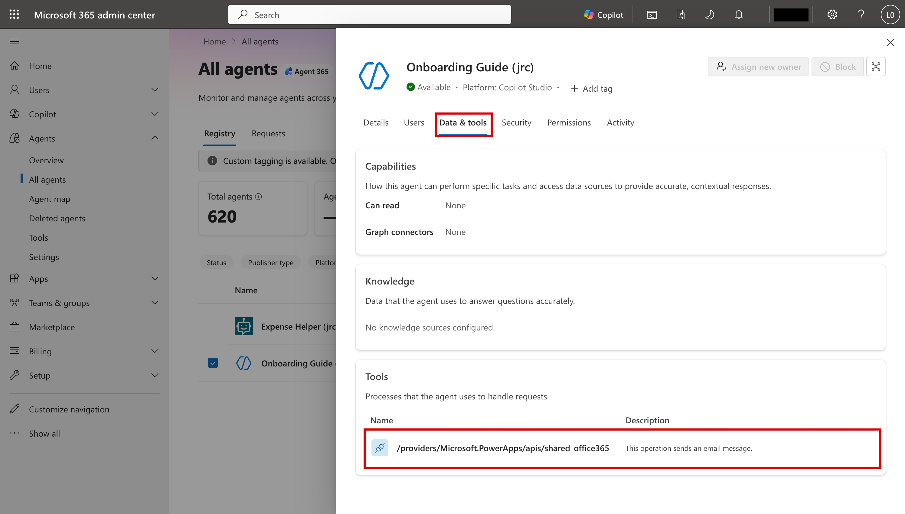
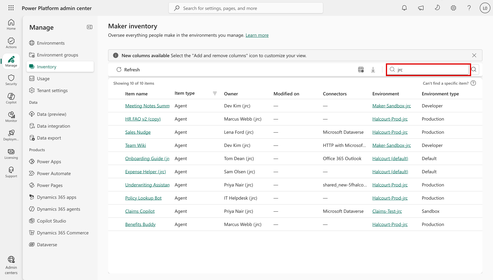

# Task 02-01 — Where agents hide: discovery surfaces

## Introduction

You cannot secure what you cannot see. Before you build the inventory, you need to know **where** agents
show up, and — more importantly — where they **don't**. Every discovery surface has a viewport and a
blind spot. If you inventory from one surface only, you will confidently miss the agents that matter most:
the ones in personal and "test" environments that a routine review skips, and the ones that run on a
connection someone else owns, which the surface never shows you.

## Description

You will walk the discovery surfaces available for a Copilot Studio estate, and for each one record two
things: **what it reveals** and **what it misses**. You then name the blind spots explicitly and decide
which surface you will actually build the Halcourt Mutual inventory from. For this lab that is the live
tenant: the CSVs you filled in from it, checked against its portals. If you can't reach the tenant, work
from the filled-in **artifact pack** and read each surface's description instead of opening it.

## Success Criteria

- [ ] You can list the discovery surfaces available for a Copilot Studio estate and state, for each, what it reveals.
- [ ] For each surface you have recorded at least one thing it **misses**.
- [ ] You have named the blind spots that matter most for this estate, with the evidence for each.
- [ ] You can state the difference between an **agent owner** and a **connection owner**, and why a surface that lists only the agent owner doesn't show who owns the connections the agent uses.
- [ ] You have chosen the surface(s) you will build the inventory from, and know what you fall back to if the tenant is unavailable.

## Learning Resources

- [Power Platform environments overview](https://learn.microsoft.com/power-platform/admin/environments-overview){:target="_blank"}
- [Power Platform inventory](https://learn.microsoft.com/power-platform/admin/power-platform-inventory){:target="_blank"}
- [View and filter agent identities in Microsoft Entra](https://learn.microsoft.com/entra/agent-id/agent-lists){:target="_blank"}
- [Agent registry in the Microsoft 365 admin center](https://learn.microsoft.com/microsoft-365/admin/manage/agent-registry){:target="_blank"}
- [Copilot Studio security and governance](https://learn.microsoft.com/microsoft-copilot-studio/security-and-governance){:target="_blank"}
- [Use connectors in Copilot Studio agents](https://learn.microsoft.com/microsoft-copilot-studio/advanced-connectors){:target="_blank"}
- [Activity logging for Power Platform](https://learn.microsoft.com/power-platform/admin/logging-powerapps){:target="_blank"}

## Key Tasks

### 01: Map the discovery surfaces

Work through each surface below. For each, open it (or read its description) and write down, in your notes,
what it shows you and what it leaves out.

Expand this section for detailed steps

1. **The agent registry.** In the [Microsoft 365 admin center](https://admin.microsoft.com){:target="_blank"},
   go to **Agents** → **All agents**.
   1. Select the **Agents without owners** card. The list filters to what it counts. Note how many, then
      select **Total agents** to get the full list back: the cards are pre-set filters.

      

   2. Search for your estate id. Which of your agents does it find?

      

   3. Open **Onboarding Guide (`<estate_id>`)** → **Data & tools**. Does it match the tool you recorded in
      Task 01-01? Then open **Expense Helper (`<estate_id>`)** → **Data & tools**.

      

2. **Power Platform admin center — Inventory.** In the
   [Power Platform admin center](https://admin.powerplatform.microsoft.com){:target="_blank"}, go to
   **Manage** → **Inventory**. Filter **Item type** to **Agent**, then search for your estate id.

   

   

   - How many of your agents does it find?
   - What does **Owner** show for Sales Nudge, whose connection belongs to someone else?
   - What does **Connectors** show for Expense Helper and Policy Lookup Bot?
3. **Agent identities.** You used **Entra ID** → **Agents** → **Agent identities** in Task 01-02. What
   does the list tell you about where your agents live, or what they can reach?
4. **Your five CSVs.** What do they show that no single portal shows on one screen? What don't they hold?

Reveal the suggested reveals and misses

Write your own notes first, then compare.

- **The agent registry.**
  - *Reveals:* a tenant-wide catalog of agents, with summary cards that act as pre-set filters and, per
    agent, its description, publish status, last update, and **Data & tools**.
  - *Misses:* **Agents without owners** shows 0 although Tom Dean has left: it counts only agents whose
    owner account was deleted. Searching for your estate id finds only the agents whose names carry it.
    **Data & tools** shows a tool's connector (`shared_office365`), but not which connection or whose
    credential, and nothing for calls inside topics: that's why Expense Helper's is empty.
- **Power Platform admin center — Inventory.**
  - *Reveals:* all ten of your agents, because its search also matches owner and environment names, with
    **Owner**, **Connectors**, **Environment** and **Environment type**, and a CSV download.
  - *Misses:* **Owner** is the agent's owner (Lena Ford, not Tom Dean, for Sales Nudge). **Connectors**
    shows a dash for calls inside topics (Expense Helper's flow, Policy Lookup Bot's HTTP request).
    **Modified on** shows a dash for agents.
- **Agent identities.**
  - *Reveals:* each agent's Entra identity, which outlives a departed owner.
  - *Misses:* the list holds every estate's agents, and a name doesn't tell you which identity is yours;
    only the sponsor lookup from Task 01-02 does. Even then, an identity doesn't show where its agent
    lives or what it can reach. An identity with no matching agent is something to investigate:
    deleting an agent deletes its identity too.
- **Your five CSVs.**
  - *Reveals:* everything lined up in one place: owner, connection owner, `auth_type`, identity and
    environment, including the calls inside topics that neither portal shows.
  - *Misses:* grounding, which has no column, and anything that changed since you gathered them.

### 02: Name the blind spots

A surface tour is only useful if you can say where each one goes dark. Record these blind spots against
the Halcourt Mutual estate specifically.

Expand this section for detailed steps

1. Look at each environment's `type` and `maker_access` in your `environments-export.csv`. Which would a
   "review the production environments" pass skip, and why?

   

   
Reveal the suggested answer

   It skips three of the four: `Maker-Sandbox` (Developer, one maker's own), `Claims-Test` (Sandbox), and
   `Halcourt (default)`, where anyone can build. Only `Halcourt-Prod` gets reviewed. Access widens the gap:
   a script or query that reads agents environment by environment sees only the environments where your
   account holds a role, and a Developer environment's only administrator is its maker. An empty result
   can mean *no access*, not *no agents*.

   

2. Which two blind spots have you already met, in Task 01-01?

   

   
Reveal the suggested answer

   An agent's owner isn't always its connection's owner (Task 01-01, step 7), so a surface that lists only
   agent owners hides who else is accountable. And HTTP requests and flows aren't connections at all
   (step 6), so a surface that lists only connections misses them. Task 02-03 hunts the owner mismatch.

   

3. Which of your agents might nobody realize exists, and why?

   

   
Reveal the suggested answer

   **Onboarding Guide**, whose owner has left, and **Team Wiki**, in Dev Kim's own Developer environment.
   No surface flags "nobody realizes this exists": it's a candidate you corroborate with the responsible
   team, not something a lookup proves.

   

4. Decide your working inventory: build it from your CSVs (note when you gathered them), and check
   material facts against the live surfaces, which also show each agent's grounding. Without the tenant,
   build it from the filled-in artifact pack.

{: .note }
> The point of a surface inventory is not to pick the "best" tool. It is to understand that each tool has a
> blind spot, so you can deliberately cover the gaps. Your five CSVs, lined up, exist precisely
> because no single live view puts owner, connection owner, identity, and environment in one place.

## Summary

You mapped the discovery surfaces for a Copilot Studio estate — the Microsoft 365 admin center agent
registry, the Power Platform admin center inventory, agent identities, and your five CSVs — and recorded
what each one reveals and misses. You named the blind spots that will bite hardest at Halcourt Mutual,
with the evidence for each. With your working inventory chosen, you are ready to combine the CSVs into a
single inventory.
