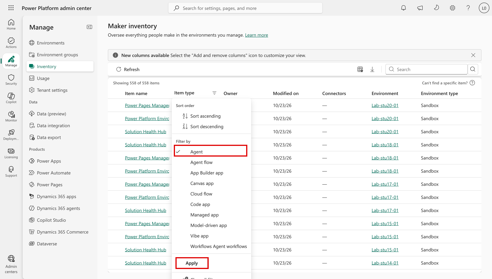

# Task 02-01 — Where agents hide: discovery surfaces

## Introduction

You cannot secure what you cannot see. Before you build the inventory, you need to know **where** agents
show up, and — more importantly — where they **don't**. Every discovery surface has a viewport and a
blind spot. If you inventory from one surface only, you will confidently miss the agents that matter most:
the ones in personal and "test" environments that a routine review skips, and the ones that run on a
connection someone else owns, which the surface never shows you.

## Description

You will walk the discovery surfaces available for a Copilot Studio estate, and for each one record two
things: **what it reveals** and **what it misses**. You then name the blind spots explicitly and decide
which surface you will actually build the Halcourt Mutual inventory from. For this lab that is the live
tenant: the CSVs you filled in from it, checked against its portals. If you can't reach the tenant, work
from the filled-in **artifact pack** and read each surface's description instead of opening it.

## Success Criteria

- [ ] You can list the discovery surfaces available for a Copilot Studio estate and state, for each, what it reveals.
- [ ] For each surface you have recorded at least one thing it **misses**.
- [ ] You have named the blind spots that matter most for this estate, with the evidence for each.
- [ ] You can state the difference between an **agent owner** and a **connection owner**, and why a surface that lists only the agent owner doesn't show who owns the connections the agent uses.
- [ ] You have chosen the surface(s) you will build the inventory from, and know what you fall back to if the tenant is unavailable.

## Learning Resources

- [Power Platform environments overview](https://learn.microsoft.com/power-platform/admin/environments-overview){:target="_blank"}
- [Power Platform inventory](https://learn.microsoft.com/power-platform/admin/power-platform-inventory){:target="_blank"}
- [CoE Starter Kit](https://learn.microsoft.com/power-platform/guidance/coe/starter-kit){:target="_blank"}
- [View and filter agent identities in Microsoft Entra](https://learn.microsoft.com/entra/agent-id/agent-lists){:target="_blank"}
- [Agent registry in the Microsoft 365 admin center](https://learn.microsoft.com/microsoft-365/admin/manage/agent-registry){:target="_blank"}
- [Copilot Studio security and governance](https://learn.microsoft.com/microsoft-copilot-studio/security-and-governance){:target="_blank"}
- [Use connectors in Copilot Studio agents](https://learn.microsoft.com/microsoft-copilot-studio/advanced-connectors){:target="_blank"}
- [Activity logging for Power Platform](https://learn.microsoft.com/power-platform/admin/logging-powerapps){:target="_blank"}

## Key Tasks

### 01: Map the discovery surfaces

Work through each surface below. For each, open it (or read its description) and write down, in your notes,
what it shows you and what it leaves out.

<!--  -->

Expand this section for detailed steps

1. **Microsoft 365 admin center — the agent registry.** In the **Microsoft 365 admin center** at
   `https://admin.microsoft.com`, go to **Agents** → **All agents** → **Registry**. Microsoft Agent 365
   builds its fleet governance on this registry, and the lab tenant has Agent 365 licensing, so the views
   described here are available to you. Start here: it is the preferred surface for this workshop.
   This reveals a tenant-wide catalog of agents with summary cards, including **Agents without owners**.
   Select an agent: its **Details** tab shows its description, publish status, and when it was last
   updated, and **Data & tools** lists its knowledge sources and tools. What it misses: **Agents without
   owners** counts only agents whose owner account was deleted. An agent whose owner is disabled won't
   appear there, so check each owner's account status yourself. And **Data & tools** can be empty, so
   check an agent's knowledge and tools in Copilot Studio rather than trusting an empty list.
2. **Power Platform admin center (PPAC) — Inventory.** In PPAC, go to **Manage** → **Inventory** and
   filter to Copilot Studio agents (**Manage** → **Copilot Studio** lists them too). This reveals the agents
   in the environments the admin center enumerates, with columns such as **Owner**, **Created on**,
   **Environment type**, and **Connectors**, and **Download** exports the list as a CSV. What it misses: it
   only shows what you can see and what you filter to — it is easy to review `Halcourt-Prod` and never look
   at `Maker-Sandbox` or the `Halcourt (default)` environment where anyone can build. Its **Owner** is the
   agent's owner, not the owner of the connections the agent uses, and its **Modified on** column shows a
   dash (–) for agents.
3. **CoE Starter Kit inventory.** The Center of Excellence Starter Kit syncs an inventory of makers,
   apps, flows, and agents into Dataverse and surfaces it in dashboards. This is the closest thing to a
   single pane. What it misses: it only inventories what its sync **reaches** and is **configured** for —
   environments excluded from the sync, or added after the last run, are simply absent, and it reports the
   *agent* owner, not the identity a connection runs as.
4. **Microsoft Graph — agent identities.** In
   [Graph Explorer](https://developer.microsoft.com/graph/graph-explorer){:target="_blank"}, run
   `GET https://graph.microsoft.com/v1.0/servicePrincipals/microsoft.graph.agentIdentity`, or open the
   **Microsoft Entra admin center** at `https://entra.microsoft.com` and go to **Entra ID** → **Agents** →
   **Agent identities**. Copilot Studio agents created since May 2026 get an Entra Agent ID, named
   `<agent name> (Microsoft Copilot Studio)`; the lab tenant's agents show up this way. Older agents may
   still use a legacy app registration: a service principal tagged `AgentCreatedBy:CopilotStudio`. To
   match an identity to its agent, use the GUID in Copilot Studio under the agent → **Settings** →
   **Advanced** → **Metadata**. This reveals the agent identities themselves — useful when an agent exists
   but its owner is gone. What it misses: an identity in Graph does not tell you which environment the
   agent lives in, what it grounds on, or what connections it uses; you have to correlate it back to the
   estate. Deleting an agent deletes its identity too, so match every identity against your agent
   inventory. Treat an identity with no matching agent as something to investigate — a legacy app
   registration, a migration, a failed cleanup — not as a deleted agent's leftover.
5. **Your five CSVs.** The CSVs you filled in from the tenant in Exercises 00 and 01 — or, without the tenant,
   the filled-in artifact pack: [`agents-export.csv`](),
   [`connections-export.csv`](),
   [`agent-identities-export.csv`](),
   [`users-export.csv`](), and
   [`environments-export.csv`](). Together they
   are a point-in-time evidence set across all four environments: mostly values read from the portals and
   APIs, plus some you wrote yourself (descriptions, `is_service_account`, `auth_type`, and the HTTP, MCP
   and flow rows). They reveal the joins no single live surface shows you in one place. What they miss: a
   snapshot can go stale, it only contains what was gathered, and an agent's grounding, tool credentials
   and topics stay inside the agent.

### 02: Name the blind spots

A surface tour is only useful if you can say where each one goes dark. Record these blind spots against
the Halcourt Mutual estate specifically.

Expand this section for detailed steps

1. **Check which environments a routine review covers.** Look at each environment's `type` and
   `maker_access` in your `environments-export.csv`. Which would a "review the production environments"
   pass skip, and why?

   Access is part of this blind spot. Anything that reads agent records environment by environment — a
   script, `pac`, a Dataverse query — sees only the environments where your account holds a security role.
   A Developer environment's only System Administrator is the maker who owns it. An empty result can mean
   *no access*, not *no agents*.
2. **Agent owner is not connection owner.** Open your `connections-export.csv` next to your
   `agents-export.csv`. The agent has an `owner_upn`; each connection has its own `connection_owner_upn`.
   These are frequently **different people**. A surface that lists only the agent owner tells you who
   built the bot. It doesn't show who owns the connections the agent uses, and those owners are
   accountable too. Whose credential actually acts on a call is Exercise 03's question. Note this
   distinction now — Task 02-03 turns it into a hunt.
3. **Some agents are in nobody's mental inventory.** An agent can be published and active while the person
   who would review it is gone, or while it sits in an environment no one governs. No surface flags "nobody
   realizes this exists" for you — it's a candidate you corroborate, not something a lookup proves.
4. **Some credentials are not connections.** In Copilot Studio, an agent's HTTP request nodes and MCP calls
   live in its topics: open its **Topics** page to see them, because the **Tools** page doesn't show them.
   That is where the API key and the bearer token live — inside the agent's own configuration, where no
   connections list shows them. An inventory built from connections alone misses exactly the static secrets. Three rows in
   your `connections-export.csv` — the HTTP action, the MCP server and the Power Automate flow — are not
   Power Platform connections; they sit beside the real ones so every credential is in one file.
5. **Decide your working inventory.** For this lab, build it from your CSVs — the evidence you gathered
   from the tenant; note when you gathered it — and corroborate material facts against the live surfaces
   (PPAC, Copilot Studio, Entra, the agent registry), which also fill in what the CSVs can't hold. If you
   can't reach the tenant, build it from the filled-in artifact pack, which covers every step offline.

{: .note }
> The point of a surface inventory is not to pick the "best" tool. It is to understand that each tool has a
> blind spot, so you can deliberately cover the gaps. The joins across your five CSVs exist precisely
> because no single live view puts owner, connection owner, identity, and environment in one place.

## Summary

You mapped the discovery surfaces for a Copilot Studio estate — the Microsoft 365 admin center agent
registry, PPAC, the CoE Starter Kit, Microsoft Graph for agent identities, and your five CSVs — and recorded
what each one reveals and misses. You named the blind spots that will bite hardest at Halcourt Mutual,
with the evidence for each. With your working inventory chosen, you are ready to join the CSVs into a
single inventory.
