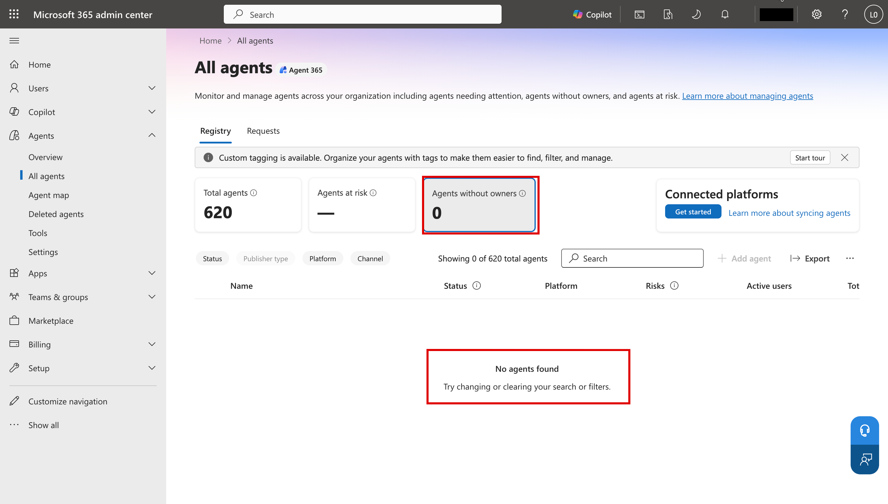

# Task 02-01 — Where agents hide: discovery surfaces

## Introduction

You cannot secure what you cannot see. Before you build the inventory, you need to know **where** agents
show up, and — more importantly — where they **don't**. Every discovery surface has a viewport and a
blind spot. If you inventory from one surface only, you will confidently miss the agents that matter most:
the ones in personal and "test" environments that nobody registered, and the ones whose real authority
lives in a connection the surface never shows you.

## Description

You will walk the discovery surfaces available for a Copilot Studio estate, and for each one record two
things: **what it reveals** and **what it misses**. You then name the blind spots explicitly and decide
which surface you will actually build the Halcourt Mutual inventory from. For this lab that is the live
tenant: the CSVs you filled in from it, checked against its portals. If you can't reach the tenant, work
from the filled-in **artifact pack** and read each surface's description instead of opening it.

## Success Criteria

- [ ] You can list the discovery surfaces available for a Copilot Studio estate and state, for each, what it reveals.
- [ ] For each surface you have recorded at least one thing it **misses**.
- [ ] You have named the personal / sandbox environment blind spot in your own words.
- [ ] You can state the difference between an **agent owner** and a **connection owner**, and why a surface that shows only one hides authority.
- [ ] You have chosen the surface(s) you will build the inventory from, and know what you fall back to if the tenant is unavailable.

## Learning Resources

- [Power Platform environments overview](https://learn.microsoft.com/power-platform/admin/environments-overview){:target="_blank"}
- [Power Platform inventory](https://learn.microsoft.com/power-platform/admin/power-platform-inventory){:target="_blank"}
- [CoE Starter Kit](https://learn.microsoft.com/power-platform/guidance/coe/starter-kit){:target="_blank"}
- [View and filter agent identities in Microsoft Entra](https://learn.microsoft.com/entra/agent-id/agent-lists){:target="_blank"}
- [Agent registry in the Microsoft 365 admin center](https://learn.microsoft.com/microsoft-365/admin/manage/agent-registry){:target="_blank"}
- [Copilot Studio security and governance](https://learn.microsoft.com/microsoft-copilot-studio/security-and-governance){:target="_blank"}
- [Use connectors in Copilot Studio agents](https://learn.microsoft.com/microsoft-copilot-studio/advanced-connectors){:target="_blank"}
- [Activity logging for Power Platform](https://learn.microsoft.com/power-platform/admin/logging-powerapps){:target="_blank"}

## Key Tasks

### 01: Map the discovery surfaces

Work through each surface below. For each, open it (or read its description) and write down, in your notes,
what it shows you and what it leaves out.

<!--  -->

Expand this section for detailed steps

1. **Power Platform admin center (PPAC) — Inventory.** In PPAC, go to **Manage** → **Inventory** and
   filter to Copilot Studio agents (**Manage** → **Copilot Studio** lists them too). This reveals the agents
   in the environments the admin center enumerates, with columns such as **Owner**, **Created on**,
   **Environment type**, and **Connectors**, and **Download** exports the list as a CSV. What it misses: it
   only shows what you can see and what you filter to — it is easy to review `Halcourt-Prod` and never look
   at `Maker-Sandbox` or the `Halcourt (default)` environment where anyone can build. Its **Owner** is the
   agent's owner, not the owner of the connections the agent uses, and its **Modified on** column shows a
   dash (–) for agents.
2. **CoE Starter Kit inventory.** The Center of Excellence Starter Kit syncs an inventory of makers,
   apps, flows, and agents into Dataverse and surfaces it in dashboards. This is the closest thing to a
   single pane. What it misses: it only inventories what its sync **reaches** and is **configured** for —
   environments excluded from the sync, or added after the last run, are simply absent, and it reports the
   *agent* owner, not the identity a connection runs as.
3. **Microsoft Graph — agent and workload identities.** In
   [Graph Explorer](https://developer.microsoft.com/graph/graph-explorer){:target="_blank"}, run
   `GET https://graph.microsoft.com/v1.0/servicePrincipals/microsoft.graph.agentIdentity`, or open the
   **Microsoft Entra admin center** at `https://entra.microsoft.com` and go to **Entra ID** → **Agents** →
   **Agent identities**. Since agents began getting auto-created Entra identities, each one shows up as a
   service principal named `<agent name> (Microsoft Copilot Studio)`, with no app registration behind it.
   This reveals the workload identities themselves — useful when an agent exists but its owner is gone.
   What it misses: an identity in Graph does not tell you which environment the agent lives in, what it
   grounds on, or what connections it uses; you have to correlate it back to the estate. And it
   over-counts: deleting an agent — even deleting its whole environment — does not remove the agent's
   identity. Each rebuild of this lab's estate left the previous build's identities behind, so Graph can
   list identities for agents that no longer exist.
4. **Agent 365 admin experience — the agent registry.** In the **Microsoft 365 admin center** at
   `https://admin.microsoft.com`, go to **Agents** → **All agents** → **Registry**. This reveals a
   tenant-wide catalog of agents with summary cards, including **Agents without owners**. Select an
   agent: its **Details** tab shows its description, publish status, and when it was last updated, and
   **Data & tools** lists its knowledge sources and tools. What it misses: an agent counts as ownerless
   only once its creator's account is **deleted** — an owner whose account is merely disabled doesn't
   count. And **Data & tools** can be empty, so check an agent's knowledge and tools in Copilot Studio
   rather than trusting an empty list.
5. **Your five CSVs.** The CSVs you filled in from the tenant in Modules 0 and 1 — or, without the tenant,
   the filled-in artifact pack: [`agents-export.csv`](),
   [`connections-export.csv`](),
   [`agent-identities-export.csv`](),
   [`users-export.csv`](), and
   [`environments-export.csv`](). Together they
   are a point-in-time snapshot across all four environments. They reveal the joins no single live surface
   shows you in one place. What they miss: a snapshot can go stale, it only contains what was gathered, and
   an agent's grounding, tool credentials and topics stay inside the agent.

### 02: Name the blind spots

A surface tour is only useful if you can say where each one goes dark. Record these blind spots against
the Halcourt Mutual estate specifically.

Expand this section for detailed steps

1. **Personal and sandbox environments are the primary blind spot.** In your `environments-export.csv`,
   note that `Maker-Sandbox` is a **Developer** (individual-maker) environment and `Halcourt (default)`
   allows **all users** to build. Agents born in these are exactly the ones a "review the production
   environments" pass will never see. Write down: which environments would a casual review skip, and why?

   Access is part of this blind spot. Anything that reads agent records environment by environment — a
   script, `pac`, a Dataverse query — sees only the environments where your account holds a security role.
   A Developer environment's only System Administrator is the maker who owns it, and in this lab's tenant
   the admin — holding only Environment Maker and Basic User in the default environment — read zero agents
   there. An empty result can mean *no access*, not *no agents*.
2. **Agent owner is not connection owner.** Open your `connections-export.csv` next to your
   `agents-export.csv`. The agent has an `owner_upn`; each connection has its own `connection_owner_upn`.
   These are frequently **different people**. A surface that lists only the agent owner tells you who
   built the bot, not whose authority it exercises when it acts. Note this distinction now — Task 02-03
   turns it into a hunt.
3. **Some agents are in nobody's mental inventory.** An agent can be published and active while the person
   who would review it is gone, or while it sits in an environment no one governs. No surface flags "nobody
   realizes this exists" for you — it falls out of the joins you are about to build.
4. **Some credentials are not connections.** In Copilot Studio, an agent's HTTP request nodes and MCP calls
   live in its topics: open its **Topics** page to see them, because the **Tools** page doesn't show them.
   That is where the API key and the bearer token live — inside the agent's own configuration, where no
   connections list shows them. An inventory built from connections alone misses exactly the static secrets. Three rows in
   your `connections-export.csv` — the HTTP action, the MCP server and the Power Automate flow — are not
   Power Platform connections; they sit beside the real ones so every credential is in one file.
5. **Decide your source of truth.** For this lab, build the inventory from your CSVs — the tenant's data,
   as you gathered it — and use the live surfaces (PPAC, Copilot Studio, Entra, the agent registry) to
   corroborate them and to fill in what they can't hold. If you can't reach the tenant, build it from the
   filled-in artifact pack, which covers every step offline.

{: .important }
> The exact 2026 admin surfaces — the precise Agent 365 governance views, how the CoE Starter Kit reports
> newly auto-created agent identities, and how Graph exposes agent workload identities — are still
> evolving. Treat any specific screen described here as something to **verify in your own tenant**, and
> fall back to the artifact pack as the surface that always works.

{: .note }
> The point of a surface inventory is not to pick the "best" tool. It is to understand that each tool has a
> blind spot, so you can deliberately cover the gaps. The joins across your five CSVs exist precisely
> because no single live view puts owner, connection owner, identity, and environment in one place.

## Summary

You mapped the discovery surfaces for a Copilot Studio estate — PPAC, the CoE Starter Kit, Microsoft Graph
for workload identities, the Agent 365 admin experience, and your five CSVs — and recorded what each one
reveals and misses. You named the two blind spots that will bite hardest at Halcourt Mutual: personal and
sandbox environments, and the gap between the agent owner and the connection owner. With your source of
truth chosen, you are ready to join the CSVs into a single inventory.
