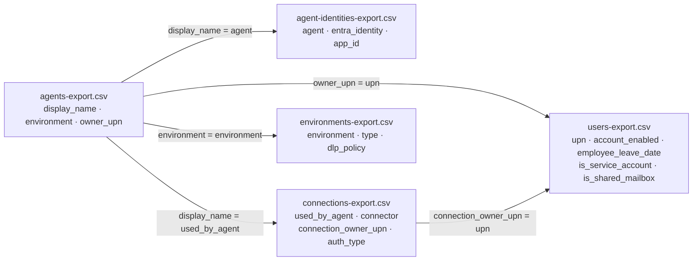

# Task 02-02 — Build the inventory

## Introduction

No single CSV tells the whole story. `agents-export.csv` gives you names and owners but not what they run as;
`connections-export.csv` gives you the connections but not whether a DLP policy governs them;
`users-export.csv` tells you whether an owner is still with the company, and whether their account is enabled.
The inventory you need comes from **lining them up** — and the discipline is to account for **every column for every
agent, across all four environments**, without skipping the sandbox and default environments where the
interesting agents hide.

## Description

You will line up your five CSVs by the columns they share and use them to fill the
[Agent Estate Inventory]() — one row per agent —
then open each agent in Copilot Studio for the one thing the CSVs can't tell you: its grounding.
Without the tenant, you record it as unknown — the pack doesn't hold it. Every agent in your
`agents-export.csv` gets a row, including the ones in `Claims-Test` and `Maker-Sandbox`. You are not
flagging problems yet (that is Task 02-03); you are producing a complete, corroborated record of what
exists and what each agent is wired to.

## Success Criteria

- [ ] Your inventory has exactly one row per agent in your estate, and every agent is present.
- [ ] All four environments are represented — you did not drop the sandbox or default-environment agents.
- [ ] Each row's **Identity** column names the agent's Entra identity.
- [ ] Each row's **Calls** column covers every call row the agent has, including agents that have **more than one**.
- [ ] Each row records the **owner** and whether that owner has left (a leave date), and whether the account
      is enabled, service, or shared.
- [ ] Each row records the agent's **purpose**, and its **environment type, whether it's managed, and whether DLP applies**.
- [ ] Each row records a **data-sensitivity classification** based on what the agent can reach, not what
      it was meant to touch.

## Learning Resources

- [Use connectors in Copilot Studio agents](https://learn.microsoft.com/microsoft-copilot-studio/advanced-connectors){:target="_blank"}
- [Power Platform environments overview](https://learn.microsoft.com/power-platform/admin/environments-overview){:target="_blank"}
- [Security roles and privileges (Dataverse)](https://learn.microsoft.com/power-platform/admin/security-roles-privileges){:target="_blank"}
- [Copilot Studio security and governance](https://learn.microsoft.com/microsoft-copilot-studio/security-and-governance){:target="_blank"}
- [Add tools to custom agents in Copilot Studio](https://learn.microsoft.com/microsoft-copilot-studio/add-tools-custom-agent){:target="_blank"}
- [Knowledge sources in Copilot Studio](https://learn.microsoft.com/microsoft-copilot-studio/knowledge-copilot-studio){:target="_blank"}

## Key Tasks

### 01: Line up the exports

Your five CSVs share columns. Learn which columns match and lining them up becomes mechanical. The diagram
below shows how they connect; the agent name is the spine, and everything hangs off it.

<!--  -->

Expand this section for detailed steps

1. Open your five CSVs side by side. Every agent's row in `agents-export.csv` leads to its identity, its
   call rows, its owner's account and its environment, as the diagram shows. Two things to watch:
   - **The connection owner gets its own lookup** in `users-export.csv`, separate from the agent owner.
   - **An agent can have several call rows** in `connections-export.csv`. Keep every one.

### 02: Fill every inventory column for every agent

Work down the agent list and complete the template row by row. Map each inventory column to its source so
nothing is left blank and nothing is invented. Every cell gets the observed value, `Not applicable`, or
`Unknown — follow up`, plus a note of where the value came from.

Expand this section for detailed steps

1. **Agent** — `display_name` from your `agents-export.csv`, with `(published)` if `published` is yes.
2. **Purpose** — the agent's `description`, shortened to what it does.
3. **Environment (type · managed · DLP)** — the agent's `environment`, and that environment's `type`,
   `managed` and `dlp_policy` from your `environments-export.csv` (for example,
   `Claims-Test (Sandbox · unmanaged · no DLP)`).
4. **Owner (status)** — the agent's `owner_upn`, and that person's row in your `users-export.csv`: a leave
   date, `account_enabled`, service account or shared mailbox (for example,
   `tom.dean, left 2026-01-30, still enabled`).
5. **Identity** — `entra_identity` from your `agent-identities-export.csv`.
6. **Calls (tool, topic or flow)** — every tool, every HTTP request in a topic, and every flow, one per
   line: one line per row in your `connections-export.csv` whose `used_by_agent` is this agent: the connection, its `auth_type`, and its owner, with that owner's status if they differ from
   the agent's owner. `None` if there are no rows.
7. **Grounding** — open the agent's **Knowledge** page in
   [Copilot Studio](https://copilotstudio.microsoft.com){:target="_blank"}, as you did for Claims Copilot
   in Task 01-01, or its **Data & tools** tab in the agent registry. Record each source, or `None`.
   Without the tenant, record "Unknown — needs the agent's Knowledge page".
8. **Data sensitivity** — classify the agent by the *most sensitive* data it can reach through its
   grounding or any of its tool calls: PII, compensation, internal, or public/none. When in doubt,
   classify up. Without the tenant, grounding is unknown, so classify from the tool calls alone and say
   so.
9. **Cover every environment.** Confirm you have rows for agents in `Halcourt (default)`, `Halcourt-Prod`,
   `Claims-Test`, **and** `Maker-Sandbox`. If your count of environments is fewer than four, you dropped
   one — the sandbox and default agents are the ones most often missed and most worth finding.

Reveal the suggested inventory

Fill your own rows first, then compare. Owners are shown by their short names.

| Agent | Purpose | Environment (type · managed · DLP) | Owner (status) | Calls (connection · `auth_type` · connection owner) | Grounding | Data sensitivity |
|---|---|---|---|---|---|---|
| Benefits Buddy (published) | answers benefits and open-enrollment questions | Halcourt-Prod (Production · managed · DLP) | marcus.webb, active | None | `HR-Benefits` site | Compensation (HR/benefits site) |
| Claims Copilot (published) | helps claims adjusters look up and update claims (its tools only read) | Claims-Test (Sandbox · unmanaged · no DLP) | priya.nair, active | `DV-Claims-Shared` · Service account · svc-claims, a service account | `Claims-Knowledge` site | PII (Dataverse `Customer`) |
| Policy Lookup Bot (published) | looks up policy details by policy id | Halcourt-Prod (Production · managed · DLP) | it.helpdesk, shared mailbox | HTTP request · API key in action config · it.helpdesk | None | Unknown: what the Policy API returns (Exercise 03) |
| Underwriting Assistant (published) | helps underwriters price risk | Halcourt-Prod (Production · managed · DLP) | priya.nair, active | `MCP-Underwriting` · Static bearer token · priya.nair | None | Internal (pricing data) |
| Expense Helper (published) | submits expenses and runs them through approval | Halcourt (default) (Default · unmanaged · no DLP) | sam.olsen, active | the expense flow · Runs as owner · sam.olsen | None | Internal (expense approvals) |
| Onboarding Guide (published) | answers new-hire questions and sends welcome emails | Halcourt (default) (Default · unmanaged · no DLP) | tom.dean, left 2026-01-30, still enabled | `O365-Outlook-Onboarding` · User (delegated) · tom.dean (left) | None | Internal (sends mail as Tom) |
| Team Wiki (published) | Dev Kim's wiki bot, searching every site he can reach | Maker-Sandbox (Developer · unmanaged · no DLP) | dev.kim, active | `Graph-DevKim` · User (delegated) · dev.kim | `HR-Benefits` and `Claims-Knowledge` sites | Compensation (HR/benefits site; classify up) |
| Sales Nudge (published) | reminds sales reps about open accounts and leads | Halcourt-Prod (Production · managed · DLP) | lena.ford, active | `DV-CRM-Shared` · User (delegated) · tom.dean (left, still enabled) | None | PII (CRM accounts) |
| HR FAQ v2 (copy) (published) | answers HR FAQ questions from the published FAQ | Halcourt-Prod (Production · managed · DLP) | marcus.webb, active | None | `HR FAQ` library in the `HR-Benefits` site | Internal (all-staff FAQ) |
| Meeting Notes Summarizer (published) | summarizes Dev Kim's own meeting notes | Maker-Sandbox (Developer · unmanaged · no DLP) | dev.kim, active | None | *DevKim-OneDrive-Notes* | Unknown until you check what it holds |

The **Identity** column is each agent's `<agent name> (Microsoft Copilot Studio)` identity from your
`agent-identities-export.csv`.

{: .tip }
> This is five files lined up on shared columns. A spreadsheet `XLOOKUP` (or `VLOOKUP`) on the columns
> above turns it into minutes of work and makes the one-to-many connection rows obvious.
> Keep the agent name as the column you match everything to.
> Lookups need an exact match: a trailing space or a missing dot (`Halcourt (default) `, `marcuswebb`)
> makes a row come back empty. If a lookup returns nothing, check the text before you conclude the
> value is missing.

{: .note }
> Classify by what the agent can *reach*, not what it was meant to touch — the gap is the finding. An
> agent that can reach the Dataverse `Customer` table (SSN, DOB) or an HR/benefits site handles PII or
> compensation data; an agent grounded only on content every employee can already read handles internal
> content. Later exercises use this classification to decide which agents need sensitivity labels, DLP,
> and a higher bar for promotion to production.

{: .note }
> Record what you observe, not what you conclude. A sensitivity class is a record of what the agent can
> reach, not a verdict. Resist the urge to write "orphaned" or "risky" in a cell yet — Task 02-03 is where
> the matches become findings. A clean record now makes the hunt honest.

## Summary

You lined up your five CSVs and filled a complete inventory row for every agent across all four
environments. Crucially, you captured the **connection owner** as a separate fact from the agent owner,
kept every tool call for agents with more than one, and classified each agent by the most sensitive data
it can reach. That complete record is what the next task hunts through for the agents that are actually a
problem.
