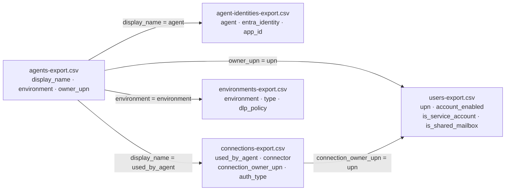

# Task 02-02 — Build the inventory

## Introduction

No single export tells the whole story. `agents-export.csv` gives you names and owners but not what they
run as; `connections-export.csv` gives you the connections but not which environment governs them;
`users-export.csv` tells you whether an owner's account is even still enabled. The inventory you need lives
in the **joins** — and the discipline is to fill **every column for every agent, across all four
environments**, without skipping the sandbox and default environments where the interesting agents hide.

## Description

You will line up the five artifact-pack CSVs by their shared keys and use them to fill the
[Agent Estate Inventory]() — one row per agent.
Every agent in `agents-export.csv` gets a row, including the ones in `Claims-Test` and `Maker-Sandbox`. You
are not flagging problems yet (that is Task 02-03); you are producing a complete, corroborated record of
what exists and what each agent is wired to.

## Success Criteria

- [ ] Your inventory has exactly one row per agent in `agents-export.csv`, and every agent is present.
- [ ] All four environments are represented — you did not drop the sandbox or default-environment agents.
- [ ] Each row's **Identity** column is filled from `agent-identities-export.csv`.
- [ ] Each row's **Connections / Connectors / auth** columns are filled from `connections-export.csv`, including agents that have **more than one** connection.
- [ ] Each row records the **owner** and whether that owner's account is enabled, service, or shared, from `users-export.csv`.
- [ ] Each row records the **environment type and whether DLP applies**, from `environments-export.csv`.

## Learning Resources

- [Connections and connectors in Power Platform](https://learn.microsoft.com/power-platform/admin/connections-connectors){:target="_blank"}
- [Power Platform environments overview](https://learn.microsoft.com/power-platform/admin/environments-overview){:target="_blank"}
- [Security roles and privileges (Dataverse)](https://learn.microsoft.com/power-platform/admin/security-roles-privileges){:target="_blank"}
- [Copilot Studio security and governance](https://learn.microsoft.com/microsoft-copilot-studio/security-and-governance){:target="_blank"}

## Key Tasks

### 01: Line up the exports

The five CSVs share keys. Learn the keys and the join becomes mechanical. The diagram below shows how they
connect; the agent name is the spine, and everything hangs off it.

Expand this section for detailed steps

1. **Join by agent.** `agents-export.csv` `display_name` matches `agent-identities-export.csv` `agent` and
   `connections-export.csv` `used_by_agent`. This attaches each agent's Entra workload identity and its
   connection(s).
2. **Join by owner.** `agents-export.csv` `owner_upn` matches `users-export.csv` `upn`. This tells you
   whether the agent's owner account is `account_enabled`, and whether it is flagged
   `is_service_account` or `is_shared_mailbox`.
3. **Join the connection owner too — separately.** `connections-export.csv` `connection_owner_upn` also
   matches `users-export.csv` `upn`. **Do this join on its own**: the connection owner is often a different
   person from the agent owner, and their account status matters just as much.
4. **Join by environment.** `agents-export.csv` `environment` matches `environments-export.csv`
   `environment`. This tells you the environment `type`, whether it is `managed`, and whether a `dlp_policy`
   is applied.
5. **Watch for one-to-many.** An agent can own **more than one** connection — the `used_by_agent` column
   can list the same agent on multiple connection rows. Capture every connection; do not stop at the first
   match.

### 02: Fill every inventory column for every agent

Work down the agent list and complete the template row by row. Map each inventory column to its source so
nothing is left blank and nothing is invented.

Expand this section for detailed steps

1. **Agent, Environment, Owner, Status** — straight from `agents-export.csv`
   (`display_name`, `environment`, `owner_upn`, `status`).
2. **Identity** — from `agent-identities-export.csv` (`entra_identity`, and `app_id` if you want the exact
   principal). This is the workload identity Module 3 will teach you to enumerate.
3. **Connections / Connectors** — from `connections-export.csv` (`connection_name`, `connector`). List all
   connections for the agent.
4. **Tools / actions** and **External systems** — infer from the connector plus what you know about the
   agent's purpose (an HTTP action reaches an external API; an MCP server exposes a set of tools; a Power
   Automate flow runs with its owner's authority). Record the connector and auth type (`auth_type`) as
   your evidence.
5. **Grounding / data** — record the data source the connector implies (a SharePoint connection grounds on
   a site; a Dataverse connection reaches tables). You will sharpen "how much of it" in Module 3.
6. **Permissions (summary)** — a first-pass reading of reach: the connector, the `auth_type`, the
   `connection_owner_upn`, and whether the connection is `shared_with` a group. Keep it short; this is the
   seed for the access map, not the full analysis.
7. **Cover every environment.** Confirm you have rows for agents in `Halcourt (default)`, `Halcourt-Prod`,
   `Claims-Test`, **and** `Maker-Sandbox`. If your count of environments is fewer than four, you dropped
   one — the sandbox and default agents are the ones most often missed and most worth finding.

{: .tip }
> This is a five-way join. A spreadsheet with `VLOOKUP`/`XLOOKUP` (or `pandas.merge`, or a quick SQL
> `JOIN`) on the keys above turns it into minutes of work and makes the one-to-many connection rows obvious.
> Keep the agent name as your primary key.

{: .note }
> Record what you observe, not what you conclude. Resist the urge to write "orphaned" or "risky" in a cell
> yet — Task 02-03 is where the joins become findings. A clean record now makes the hunt honest.

## Summary

You joined the five exports on their shared keys — agent name, owner UPN, connection owner UPN, and
environment — and filled a complete inventory row for every agent across all four environments. Crucially,
you captured the **connection owner** as a separate fact from the agent owner, and you kept every connection
for agents wired to more than one. That complete record is the substrate for the next task, where the
joins start revealing which agents are actually a problem.
