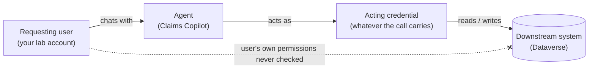

# Task 03-01 — Whose identity is acting?

## Introduction

When a user chats with an agent, the identity that actually touches SharePoint, Dataverse, an API, or an
MCP server is frequently **not** the user's. Which credential a call carries depends on how the tool
authenticates (**End user** or **Maker-provided**) and on the connection, flow, key or token behind it.
The connection owner is who created the connection, not necessarily who acts. Getting this wrong is the
root of every confused-deputy finding later in the workshop, so you establish it first: for each agent,
**who is the actor?**

## Description

You already recorded each agent's acting credential in Task 01-01 (`auth_type` and connection owner in
your `connections-export.csv`), and its owner's status in your Exercise 02 inventory. Here you put names
to what you recorded: you separate the agent's own Entra identity from the credential its calls carry, sort
the estate's credentials into their kinds, and say, for each agent, whose authority it exercises. Without
the tenant, the filled-in `connections-export.csv`, `agent-identities-export.csv` and `users-export.csv`
cover the whole task.

## Success Criteria

- [ ] You can name the kinds of **acting credential** a runtime path can carry — end user, maker or
  connection owner, service account, flow owner, API key, bearer token — and explain how they differ from
  the agent's own **Entra identity**.
- [ ] For each agent in your inventory, you recorded the acting credential on every runtime path — tool,
  HTTP request, MCP tool, or flow — and cited the setting or configuration that shows it.
- [ ] Where the acting credential isn't the requesting user's, you named whose it is.
- [ ] Wherever a person or service account owns the credential, you checked that account's status.
- [ ] Any path you couldn't trace is recorded as `Unknown`, with the check that would settle it.

## Learning Resources

- [Copilot Studio security and governance](https://learn.microsoft.com/microsoft-copilot-studio/security-and-governance){:target="_blank"}
- [Use connectors in Copilot Studio agents](https://learn.microsoft.com/microsoft-copilot-studio/advanced-connectors){:target="_blank"}
- [Conditional Access for agents](https://learn.microsoft.com/entra/identity/conditional-access/agent-id){:target="_blank"}
- [Dataverse security roles and privileges](https://learn.microsoft.com/power-platform/admin/security-roles-privileges){:target="_blank"}
- [View and filter agent identities in Microsoft Entra](https://learn.microsoft.com/entra/agent-id/agent-lists){:target="_blank"}
- [Add tools to custom agents in Copilot Studio](https://learn.microsoft.com/microsoft-copilot-studio/add-tools-custom-agent){:target="_blank"}
- [Create and manage connections in Copilot Studio](https://learn.microsoft.com/microsoft-copilot-studio/authoring-connections){:target="_blank"}

## Key Tasks

### 01: Separate the agent's identity from the acting credential

Expand this section for detailed steps

1. Open your `agent-identities-export.csv` from Task 01-02. Each agent has its own Entra identity,
   `<agent name> (Microsoft Copilot Studio)`: a principal in Entra, and what governance and identity
   policies target. It exists for every agent, benign or not, but it is not what most calls carry. That is
   the acting credential.
2. Open your `connections-export.csv` from Task 01-01. Its `auth_type` column already names the acting
   credential behind each call, in one of five patterns:
   - **User (delegated)** — the tool runs on the delegated credentials of whoever created the connection
     (the `connection_owner_upn`), not the requesting user's.
   - **Service account** — the connection acts as a non-human account provisioned to run automation.
   - **Runs as owner** — a Power Automate flow executes with its owner's authority.
   - **API key in action config** — an HTTP request authenticates with a static key in its headers. The
     *key* is the identity to the API.
   - **Static bearer token** — an MCP tool runs on a connection that holds one fixed token. The *token* is
     the identity to the MCP server.

   A SharePoint knowledge source has no row: it searches the site with no connection, and whose access it
   reads with stays Unknown until Exercise 04.
3. Which of the five patterns does your estate use, and on which agent?

   

   
Reveal the suggested answer

   All five:
   - **User (delegated):** Sales Nudge and Onboarding Guide (Tom Dean's connections), Team Wiki (Dev
     Kim's).
   - **Service account:** Claims Copilot (`svc-claims`).
   - **Runs as owner:** Expense Helper (Sam Olsen's flow).
   - **API key in action config:** Policy Lookup Bot.
   - **Static bearer token:** Underwriting Assistant.

   

### 02: Trace the acting credential for each agent

Expand this section for detailed steps

1. For each agent, read its **Tool calls** column in your Exercise 02 inventory. Is the acting credential
   the requesting user's, or someone or something else's? Name whose, and the connection owner's status.
   An agent with no tool calls has no acting credential to name.

   

   
Reveal the suggested answer

   None of them is the requesting user's:
   - **Claims Copilot:** `svc-claims`, a service account.
   - **Policy Lookup Bot:** a static API key; no person stands behind it.
   - **Underwriting Assistant:** a static token on Priya Nair's connection.
   - **Expense Helper:** Sam Olsen, through his flow.
   - **Onboarding Guide** and **Sales Nudge:** Tom Dean, who has left but is still enabled.
   - **Team Wiki:** Dev Kim.
   - **Benefits Buddy**, **HR FAQ v2 (copy)** and **Meeting Notes Summarizer:** no tool calls. Their
     SharePoint knowledge has no connection; whose access it reads with is Unknown until Exercise 04.

   

The pattern you are looking for — the agent reaching a resource as an identity that is *not* the person who
asked:

<!--  -->

{: .important }
> Check every connection owner's account status. A departed or disabled owner is a lifecycle warning: verify
> whether the connection still succeeds. A disabled owner's OAuth connections — the ones signed in as that
> person — stop at their next token refresh; a leaver whose account was never disabled keeps them working, and
> the agent keeps that person's authority with no one accountable for what it does.

## Summary

You separated the actors. Every agent carries its own auto-created Entra identity: an Entra Agent ID, or a
legacy app registration for older agents. But what *reaches data* is the credential each call carries — a
maker-provided connection, a service account, a flow owner, or a static key or token — and it is not
necessarily the person chatting's. You traced that acting credential for each agent, and checked the account
behind it wherever there is one. Hold onto those traces: in the next task you ask what each of those
credentials is actually *authorized* to do.
