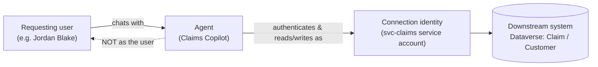

# Task 03-01 — Whose identity is acting?

## Introduction

When a user chats with an agent, the identity that actually touches SharePoint, Dataverse, an API, or an
MCP server is frequently **not** the user's. Copilot Studio agents reach downstream systems through
*connections*, and a connection authenticates as whatever it was built to authenticate as — a connection
owner, a service account, or a static credential. Getting this wrong is the root of every confused-deputy
finding later in the workshop, so you establish it first: for each agent, **who is the actor?**

## Description

You will enumerate the identity types in play across the Halcourt estate, then trace, for a set of agents,
which identity actually authenticates to each downstream system. The primary evidence is
`connections-export.csv` (the `connection_owner_upn`, `auth_type`, and `shared_with` columns) and
`agent-identities-export.csv` (each agent's auto-created Entra identity), cross-checked against
`users-export.csv` to see whether an owner's account is even enabled. You may confirm any of this in the
Power Platform admin center, but you do not need the tenant to complete the task.

## Success Criteria

- [ ] You can name the five identity types an agent can act as: the **agent identity** (auto-created in
  Entra), a **delegated user context**, a **service identity** (service account), a **connection owner
  identity**, and a **static API/tool credential**.
- [ ] For each named agent (Claims Copilot, Policy Lookup Bot, Onboarding Guide, Sales Nudge, Underwriting
  Assistant, Expense Helper, Benefits Buddy) you recorded the acting identity for every connection it uses.
- [ ] You identified **at least three** agents where the acting identity is not the requesting user, and
  named the identity that acts instead.
- [ ] You flagged every connection whose owner's account is **disabled** in `users-export.csv`, and named
  which agents still run on it.
- [ ] You noted that none of the connections in the pack use **end-user (on-behalf-of) authentication** —
  so the requesting user's identity is, by default, *not* the actor.

## Learning Resources

- [Copilot Studio security and governance](https://learn.microsoft.com/microsoft-copilot-studio/security-and-governance){:target="_blank"}
- [Connections and connectors in Power Platform](https://learn.microsoft.com/power-platform/admin/connections-connectors){:target="_blank"}
- [Conditional Access for workload identities](https://learn.microsoft.com/entra/identity/conditional-access/workload-identity){:target="_blank"}
- [Dataverse security roles and privileges](https://learn.microsoft.com/power-platform/admin/security-roles-privileges){:target="_blank"}

## Key Tasks

### 01: Enumerate the identity types an agent can act as

Expand this section for detailed steps

1. Open `agent-identities-export.csv`. Every agent has its own **auto-created Entra identity**, with an
   `app_id`. The pack labels it `cs-agent-<slug>-<env>`; in Entra it is the service principal
   `<agent name> (Microsoft Copilot Studio)`. This is the agent's *workload* identity — a first-class
   principal in Entra, the thing that carries the agent's own token. Note that it exists for every agent,
   benign or not.
2. Open `connections-export.csv` and study the `auth_type` column. It tells you *how each connection
   authenticates*, and therefore which identity actually reaches the downstream system. You will see five
   distinct patterns across the estate:
   - **User (delegated)** — the connection acts as the person who created it (the `connection_owner_upn`),
     using their delegated permissions. Not the chatting user — the *owner*.
   - **Service account** — the connection acts as a non-human account provisioned to run automation.
   - **Runs as owner** — a Power Automate flow executes with the flow owner's connections and permissions.
   - **API key in action config** — an HTTP action authenticates with a static key stored in the action's
     header configuration. The *key* is the identity to the API.
   - **Static bearer token** — the agent's MCP calls carry a fixed shared token. The *token* is the
     identity to the MCP server.

   The last three are not Power Platform connections — a cloud flow, an HTTP request and an MCP call. The
   pack lists them beside the real connections so you can compare every credential in one place; in the
   tenant you find them inside the flow and the agent, not in a connections list.
3. Write the five identity types in your notes with one estate example of each drawn from the CSV. These are
   the only kinds of actor you will meet for the rest of the day.

### 02: Trace the acting identity for each agent

Expand this section for detailed steps

1. For each agent below, filter `connections-export.csv` on `used_by_agent`. An agent can have more than
   one connection (Onboarding Guide has two), so capture every row.
2. For each connection, record three things: the **connector**, the **`connection_owner_upn`**, and the
   **`auth_type`**. Then state the acting identity in one line — for example, *"reads SharePoint as
   marcus.webb (delegated), not as the chatting employee."*
3. Cross-check each `connection_owner_upn` against `users-export.csv`. Look at `account_enabled`,
   `is_service_account`, and `is_shared_mailbox`. An owner who is a service account, a shared mailbox, or a
   **disabled** account is a signal that no single accountable person is behind the agent's actions.
4. Mark, for each agent, whether the acting identity is the **requesting user** or **someone/something
   else**. In this estate the honest answer is almost always "someone else" — trace it and name who.
5. Optional (tenant): for the rows that are real Power Platform connections, confirm in the Power Platform
   admin center that each one's owner and auth type match the export. Two things to know when you look:
   - A connection's own sharing list can be empty where the pack shows `shared_with`: Power Platform won't
     share an OAuth connection such as Dataverse with a group. The connection reaches people through the
     agent instead — a tool that runs on the maker's credentials lends the connection to everyone who can
     chat with the agent.
   - Whether a tool acts with the chatting user's credentials or the maker's is a setting on the agent's
     tool in Copilot Studio, not on the connection. That is where an end-user-auth ("authenticate
     individually") configuration would show up if one existed.

The pattern you are looking for — the agent reaching a resource as an identity that is *not* the person who
asked:

{: .important }
> Two connections in the pack — `SP-Onboarding` and `O365-Outlook-Onboarding` — plus the CRM connection
> `DV-CRM-Shared` are owned by an account whose `account_enabled` is `FALSE`. The agents that use them are
> still published and still functioning. When a connection's owner has left but the connection lives on,
> the agent keeps acting with a departed person's authority and nobody is accountable for what it does.

## Summary

You separated the actors. Every agent carries its own auto-created Entra identity, but the identity that
*reaches data* is usually the connection's — a delegated owner, a service account, or a static credential —
not the person chatting. You traced that acting identity for each agent, and you found the cases where it is
a service account, a shared mailbox, or a **disabled** account. Hold onto those traces: in the next task you
ask what each of those identities is actually *authorized* to do.
