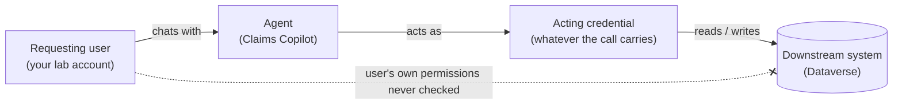

# Task 03-01 — Whose identity is acting?

## Introduction

When a user chats with an agent, the identity that actually touches SharePoint, Dataverse, an API, or an
MCP server is frequently **not** the user's. Which credential a call carries depends on how the tool
authenticates (**End user** or **Maker-provided**) and on the connection, flow, key or token behind it.
The connection owner is who created the connection, not necessarily who acts. Getting this wrong is the
root of every confused-deputy finding later in the workshop, so you establish it first: for each agent,
**who is the actor?**

## Description

You will enumerate the identity types in play across the Halcourt estate, then trace, for a set of agents,
which credential each downstream system actually sees. In the tenant, the evidence is in
Copilot Studio (each agent's tools, topics and connections) and the Microsoft Entra admin center (each
agent's auto-created identity), together with what you recorded in your `connections-export.csv` (the
`connection_owner_upn`, `auth_type`, and `shared_with` columns), cross-checked against your
`users-export.csv` to see whether an owner's account is even enabled. Without the tenant, the filled-in
`connections-export.csv`, `agent-identities-export.csv`, and `users-export.csv` cover the whole task.

## Success Criteria

- [ ] You can name the kinds of **acting credential** a runtime path can carry — end user, maker or
  connection owner, service account, flow owner, API key, bearer token — and explain how they differ from
  the agent's own **Entra identity**.
- [ ] For each agent in your inventory, you recorded the acting credential on every runtime path — tool,
  HTTP request, MCP tool, or flow — and cited the setting or configuration that shows it.
- [ ] Where the acting credential isn't the requesting user's, you named whose it is.
- [ ] Wherever a person or service account owns the credential, you checked that account's status.
- [ ] Any path you couldn't trace is recorded as `Unknown`, with the check that would settle it.

## Learning Resources

- [Copilot Studio security and governance](https://learn.microsoft.com/microsoft-copilot-studio/security-and-governance){:target="_blank"}
- [Use connectors in Copilot Studio agents](https://learn.microsoft.com/microsoft-copilot-studio/advanced-connectors){:target="_blank"}
- [Conditional Access for agents](https://learn.microsoft.com/entra/identity/conditional-access/agent-id){:target="_blank"}
- [Dataverse security roles and privileges](https://learn.microsoft.com/power-platform/admin/security-roles-privileges){:target="_blank"}
- [View and filter agent identities in Microsoft Entra](https://learn.microsoft.com/entra/agent-id/agent-lists){:target="_blank"}
- [Add tools to custom agents in Copilot Studio](https://learn.microsoft.com/microsoft-copilot-studio/add-tools-custom-agent){:target="_blank"}
- [Create and manage connections in Copilot Studio](https://learn.microsoft.com/microsoft-copilot-studio/authoring-connections){:target="_blank"}
- [Manage Power Automate flows in the Power Platform admin center](https://learn.microsoft.com/power-platform/admin/manage-power-automate){:target="_blank"}

## Key Tasks

### 01: Separate the agent's identity from the acting credential

Expand this section for detailed steps

1. In the **Microsoft Entra admin center** at `https://entra.microsoft.com`, go to **Entra ID** →
   **Agents** → **Agent identities**. Every agent has its own **auto-created Entra identity**, named after
   the agent: `<agent name> (Microsoft Copilot Studio)`. Agents created since May 2026 get an **Entra
   Agent ID**. Older agents may instead have a legacy app registration: a service principal tagged
   `AgentCreatedBy:CopilotStudio`. To match an identity to its agent, use the agent's `applicationId` from
   the Dataverse `bots` table, as in Task 01-02. This identity is a principal in Entra, and what
   governance and identity policies target. It exists for every agent, benign or not, but it is not what
   most tool calls carry: that is the acting credential, next.

   Without the tenant: `agent-identities-export.csv`, which labels each identity `cs-agent-<slug>-<env>`
   and gives its `app_id`.
2. Work out *how each connection authenticates*, and therefore which credential actually reaches the
   downstream system. Two things decide it: who owns the connection (the `connection_owner_upn` in your
   `connections-export.csv`) and whose credentials the tool that uses it runs with. In **Copilot Studio**
   at `https://copilotstudio.microsoft.com`, pick the agent's environment in the environment switcher,
   open **Agents** → the agent → **Tools** (as a viewer, replace `/overview` in the address with
   `/actions`), select a tool, and read under
   **Details** → **Additional details** whether it uses **End user** or **Maker-provided** credentials. The `auth_type` column in your
   `connections-export.csv` names the combination. You will see five distinct patterns across the estate:
   - **User (delegated)** — a maker-provided user connection: the tool uses the delegated credentials of
     whoever created the connection (the `connection_owner_upn`), not the requesting user's. (With **End
     user** credentials, each person would use their own.)
   - **Service account** — the connection acts as a non-human account provisioned to run automation.
   - **Runs as owner** — a Power Automate flow executes with the flow owner's connections and permissions.
   - **API key in action config** — an HTTP action authenticates with a static key stored in the action's
     header configuration. The *key* is the identity to the API.
   - **Static bearer token** — the agent's MCP tool runs on a connection that holds one fixed token, and
     every call carries it. The *token* is the identity to the MCP server.

   The flow and the HTTP request are not Power Platform connections, so in the tenant you find them inside the
   flow and the agent, not in a connections list. The HTTP request lives in the agent's **Topics**
   (address ends in `/tools`), not on its **Tools** page: open the topic that makes the call and read the node's headers. The
   MCP server *is* on the **Tools** page, as a **Model Context Protocol** tool; its connection is in the
   connections list, but nothing there says the credential is one token shared by every call. For the flow,
   open the **Power Platform admin center** and go to **Manage** → **Environments** → the environment →
   **Resources** → **Flows** → the flow → **Details**, which shows its connections and owners. Your
   `connections-export.csv` lists them beside the other connections, so you can compare every credential in
   one place.

   Without the tenant: `connections-export.csv`, `auth_type`.
3. Write the kinds of acting credential in your notes, with an estate example of each you found, and note
   the agent identity separately. These are the kinds of authority you will meet for the rest of the day.

### 02: Trace the acting credential for each agent

Expand this section for detailed steps

1. For each agent named in the Success Criteria, list every connection it uses. In Copilot Studio, open
   each tool on the agent's **Tools** page: its **Details** show the connector it runs on. Match those to
   the connections call from [Task 01-01](), which gives each
   connection's owner and status. Then open its **Knowledge** page (`/knowledge`): a knowledge source reads
   through a connection too, even on an agent with no tools. Match each source to its connection as in
   Task 01-01, and where a viewer can't confirm the binding, cite the `used_by_agent` in
   `connections-export.csv` rather than guessing from the connector type. Its HTTP request or flow, if it
   has any, are where you found them in Key Task 01. An agent can have more than one connection, so
   capture every one. Without the
   tenant: `connections-export.csv`, filtered on `used_by_agent`.
2. For each connection, record three things from your `connections-export.csv`: the **connector**, the
   **`connection_owner_upn`**, and the **`auth_type`**. Then state the acting credential in one line — for
   example, *"reads SharePoint as `<connection owner>` (delegated), not as the chatting employee."* Two
   things to know when you look in the tenant:
   - A connection's own sharing list can be empty where the filled-in pack shows `shared_with`: Power
     Platform won't share an OAuth connection such as Dataverse with a group. The connection reaches people
     through the agent instead — a tool that runs on the maker's credentials lends the connection to
     everyone who can chat with the agent.
   - Whether a tool acts with the chatting user's credentials or the maker's is a setting on the agent's
     tool in Copilot Studio — its credentials setting (**Details** → **Additional details**) — not on the connection. That is where
     end-user authentication (**End user**) would show up if a tool used it.
3. Cross-check each `connection_owner_upn` against your `users-export.csv`: `account_enabled`,
   `employee_leave_date`, `is_service_account`, and `is_shared_mailbox`. In the tenant, the user's
   **Overview** in the Microsoft Entra admin center (**Entra ID** → **Users**) shows whether the account is
   enabled, the users query from Task 01-01 gives any leave date (`employeeLeaveDateTime`), and the **Exchange
   admin center** at `https://admin.exchange.microsoft.com` lists shared mailboxes under **Recipients** →
   **Mailboxes**, filtered to shared. An owner who is a service account, a shared mailbox, someone who has
   **left**, or a **disabled** account is a signal that no single accountable person is behind the agent's
   actions.
4. Mark, for each agent, whether the acting credential is the **requesting user's** or **someone or
   something else's**. Name whose, citing the setting that shows it. If you can't tell, record `Unknown`
   and name the check that would settle it — for a tool, its credentials setting under **Details** →
   **Additional details**; for an HTTP request, the node in the topic that makes it.

The pattern you are looking for — the agent reaching a resource as an identity that is *not* the person who
asked:

<!--  -->

{: .important }
> Check every connection owner's account status. A departed or disabled owner is a lifecycle warning: verify
> whether the connection still succeeds. A disabled owner's OAuth connections — the ones signed in as that
> person — stop at their next token refresh; a leaver whose account was never disabled keeps them working, and
> the agent keeps that person's authority with no one accountable for what it does.

## Summary

You separated the actors. Every agent carries its own auto-created Entra identity: an Entra Agent ID, or a
legacy app registration for older agents. But what *reaches data* is the credential each call carries — a
maker-provided connection, a service account, a flow owner, or a static key or token — and it is not
necessarily the person chatting's. You traced that acting credential for each agent, and checked the account
behind it wherever there is one. Hold onto those traces: in the next task you ask what each of those
credentials is actually *authorized* to do.
