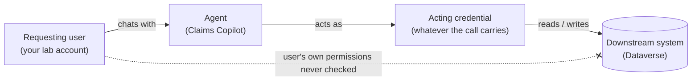
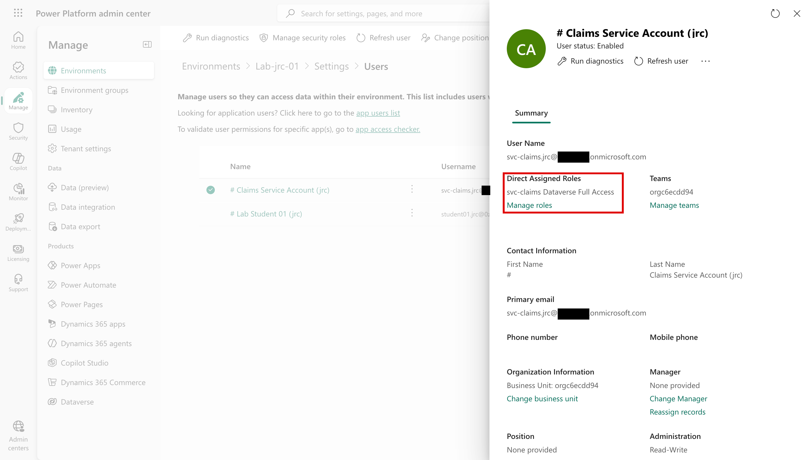
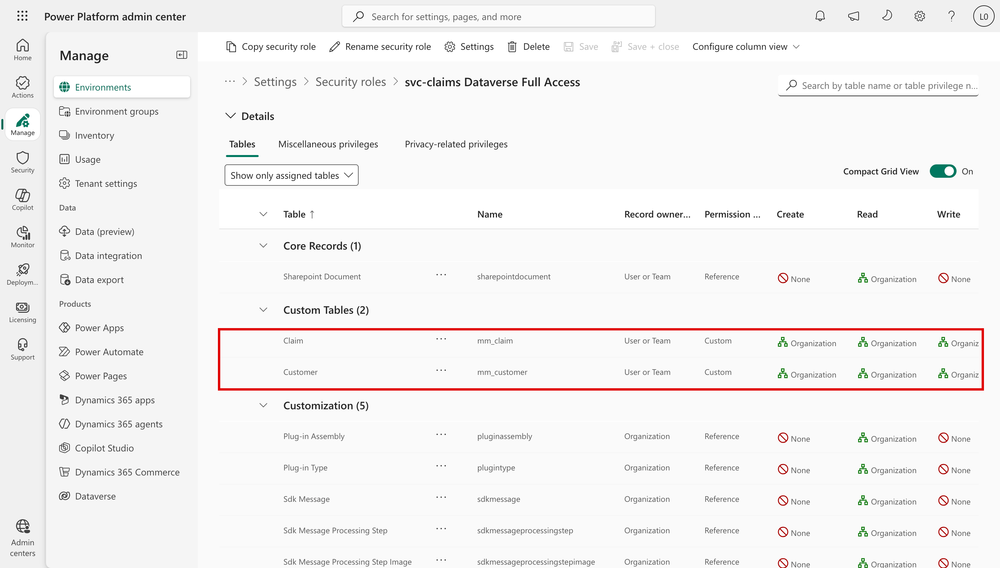

# Task 03-01 — Whose authority, and what may it do?

## Introduction

How do you know what an agent can do? You need two answers. First, **whose authority** its calls carry:
the person chatting, the maker, a service account, a key. It's rarely the person chatting. Second, **what
that authority is permitted to do**, and where that decision is made: a Dataverse role, a site's
permissions, an API's own rules. Those decisions are scattered across very different systems, and each
has to be inspected on its own terms. Look in the wrong place, and you'll conclude an agent is safe when
it isn't.

## Description

You will take each downstream path an agent uses and locate the exact control surface where authorization
is decided for that path — Dataverse record-level access, a SharePoint permission, a connector's granted
scopes, the API behind an HTTP action's credential, or the server behind an MCP tool. You will separate
"authenticated" from "authorized," and you will flag every path where the authorization decision collapses
into a single shared credential (meaning there is no per-user check at all). Your `connections-export.csv`
gives you the connector and auth type. The *depth* of each grant (a role's breadth, a site's membership, a
key's server-side scope) you read in the tenant where a portal shows it; where none does, or you're working
without the tenant, you record it as an open question.

Every agent has its own Entra identity, `<agent name> (Microsoft Copilot Studio)`, which you recorded in
your `agent-identities-export.csv` in Task 01-02. It's a principal in Entra, and what governance and
identity policies target. It exists for every agent, benign or not, but it is not what most calls carry.
That is the **acting credential**, which the `auth_type` column of your `connections-export.csv` names in
one of five patterns:

- **User (delegated)** — the tool runs on the delegated credentials of whoever created the connection
  (the `connection_owner_upn`), not the requesting user's.
- **Service account** — the connection acts as a non-human account provisioned to run automation.
- **Runs as owner** — a Power Automate flow executes with its owner's authority.
- **API key in action config** — an HTTP request authenticates with a static key in its headers. The
  *key* is the identity to the API.
- **Static bearer token** — an MCP tool runs on a connection that holds one fixed token. The *token* is
  the identity to the MCP server.

A SharePoint knowledge source has no row: it searches the site with no connection, and whose access it
reads with stays Unknown until Exercise 04.

The pattern you are looking for — the agent reaching a resource as an identity that is *not* the person who
asked:

Where authorization is decided depends on the kind of path:

| Path (connector) | Where authorization is actually decided | How to confirm |
|---|---|---|
| Dataverse | The **effective record access** of the account behind the acting credential: its security roles' privilege depth on each table the agent reads, combined with record ownership, business units, teams, sharing, and hierarchy or column security where they apply. A role with organization-level read on a table ignores who asked. | Power Platform admin → Environment → Security roles for that account; check table privileges and access level (User / Business Unit / Organization), and whether ownership, business units, or sharing narrow the records. |
| SharePoint / site grounding | A knowledge source searches the site with no connection. Whose access decides what it returns, the maker's or the asker's, is Unknown until Exercise 04 tests it. Then: that account's **permissions on the site or library**, and **how much of the site the agent grounds on** (whole site vs. a scoped library). | What it grounds on, from the agent's **Knowledge** page in Copilot Studio; then that account's permissions on the site or library in SharePoint. |
| Connector scope | The **delegated OAuth scopes** granted when the connection was created — the connector's own permission surface. | The connection's consented permissions; the connector reference in Copilot Studio. |
| HTTP / API action | **Entirely on the API side**, against whatever credential the action sends. A single static key means every caller presents the same principal: unless the API checks the end user, the key's allowed scope is everyone's scope. | The action's header/credential config; the API's own authorization model and what that key is scoped to. |
| MCP / tool | The **server-side authorization** tied to the bearer token decides what may be called. The **tool schema the server advertises** is the capability surface — which operations exist — not a control: a tool broader than the agent's need widens what that credential can be steered to do. | Enumerate the MCP server's advertised tools; check what the shared token is permitted to invoke. |
| Power Automate flow | The **flow owner's** permissions on the target system, exercised for anyone who triggers the flow. | The flow's connections and the owner's rights on the target. |

## Success Criteria

- [ ] You can explain the difference between an agent's Entra identity and its acting credential.
- [ ] For each agent, you named whose credential its calls carry.
- [ ] For each path type — Dataverse, SharePoint/site grounding, connector scope, HTTP/API action, MCP tool
  — you wrote down **where** authorization is decided and **how** you would confirm it.
- [ ] You identified every path in the estate where authorization reduces to a **single shared credential**
  (service account, delegated owner, static API key, or static bearer) with no per-user authorization.
- [ ] For each Dataverse-backed agent you described the **effective record access** of the account behind
  the acting credential — its security roles' privilege depth, and anything that narrows records
  (ownership, business units, teams, sharing) — or marked it as an open question to verify.
- [ ] You distinguished a coarse, environment-level gate (DLP: *which connectors may be used*) from a
  fine-grained data grant (*what the connector may reach once used*), and noted that the first does not
  bound the second.

## Learning Resources

- [Dataverse security roles and privileges](https://learn.microsoft.com/power-platform/admin/security-roles-privileges){:target="_blank"}
- [Use connectors in Copilot Studio agents](https://learn.microsoft.com/microsoft-copilot-studio/advanced-connectors){:target="_blank"}
- [Data loss prevention policies for Power Platform](https://learn.microsoft.com/power-platform/admin/wp-data-loss-prevention){:target="_blank"}
- [Purview sensitivity labels](https://learn.microsoft.com/purview/sensitivity-labels){:target="_blank"}
- [Copilot Studio security and governance](https://learn.microsoft.com/microsoft-copilot-studio/security-and-governance){:target="_blank"}

## Key Tasks

### 01: Name the acting credential

Expand this section for detailed steps

1. In your `connections-export.csv`, read the `auth_type` column. Which of the five patterns does your
   estate use, and on which agent?

   

   
Reveal the suggested answer

   All five:
   - **User (delegated):** Sales Nudge and Onboarding Guide (Tom Dean's connections), Team Wiki (Dev
     Kim's).
   - **Service account:** Claims Copilot (`svc-claims`).
   - **Runs as owner:** Expense Helper (Sam Olsen's flow).
   - **API key in action config:** Policy Lookup Bot.
   - **Static bearer token:** Underwriting Assistant.

   

2. For each agent, read its **Tool calls** column in your Exercise 02 inventory. Is the acting credential
   the requesting user's, or someone or something else's? Name whose, and the connection owner's status.
   An agent with no tool calls has no acting credential to name.

   

   
Reveal the suggested answer

   None of them is the requesting user's:
   - **Claims Copilot:** `svc-claims`, a service account.
   - **Policy Lookup Bot:** a static API key; no person stands behind it.
   - **Underwriting Assistant:** a static token on Priya Nair's connection.
   - **Expense Helper:** Sam Olsen, through his flow.
   - **Onboarding Guide** and **Sales Nudge:** Tom Dean, who has left but is still enabled.
   - **Team Wiki:** Dev Kim.
   - **Benefits Buddy**, **HR FAQ v2 (copy)** and **Meeting Notes Summarizer:** no tool calls. Their
     SharePoint knowledge has no connection; whose access it reads with is Unknown until Exercise 04.

   

{: .important }
> Check every connection owner's account status. A departed or disabled owner is a lifecycle warning: verify
> whether the connection still succeeds. A disabled owner's OAuth connections — the ones signed in as that
> person — stop at their next token refresh; a leaver whose account was never disabled keeps them working, and
> the agent keeps that person's authority with no one accountable for what it does.

### 02: Map where authorization is decided, path by path

Expand this section for detailed steps

1. For each line in your inventory's **Tool calls** column, find its row in the table above: where is
   authorization decided for that agent? If you can't see it (a site's membership, a key's server-side
   scope), record `Unknown` in your notes, with the open question and the check that would settle it.
   Those notes become the **Unknowns** of your Access Maps in Task 03-03.

   For example: "Policy Lookup Bot: the policy API's rules for its key. Unknown; the check would be the
   API owner's configuration for that key."

   

   
Reveal the suggested answer

   - **Claims Copilot:** `svc-claims`'s Dataverse role on `Claim` and `Customer`. You read it in step 2.
   - **Sales Nudge:** Tom Dean's Dataverse roles in `Halcourt-Prod`. `Unknown`.
   - **Onboarding Guide:** the Office 365 Outlook connector's scopes on Tom's mailbox: it can send mail as
     him. How far beyond that is `Unknown`.
   - **Team Wiki:** whatever Dev Kim can read through Microsoft Graph. Its breadth is `Unknown`.
   - **Policy Lookup Bot:** the policy API's rules for that key. `Unknown`: you can't see them.
   - **Underwriting Assistant:** the MCP server's rules for its token. `Unknown`.
   - **Expense Helper:** Sam Olsen's authority as the flow's owner. The flow makes no connector calls,
     so it decides the approval itself.
   - **Benefits Buddy, HR FAQ v2 (copy), Meeting Notes Summarizer:** no tool calls. Whose access their
     knowledge reads with is `Unknown` until Exercise 04.

   

2. Find out what `svc-claims`, Claims Copilot's acting credential, is allowed to read and write. Your own
   lab environment carries a copy of that account and its role, and you're its administrator there, so
   you can open the role.
   1. Open the [Power Platform admin center](https://admin.powerplatform.microsoft.com){:target="_blank"}
      and go to **Manage** → **Environments** → your lab environment.
   2. Go to **Settings** → **Users + permissions** → **Users**, search for your estate id, and select
      **Claims Service Account (`<estate_id>`)**. Its **Summary** lists its **Direct Assigned Roles**: note
      them.

      

   3. Go to **Settings** → **Users + permissions** → **Security roles**, search for the role's name, and
      open it. On its **Tables** tab, find the **Claim** and **Customer** rows under **Custom Tables**, and
      read the **Create**, **Read** and **Write** columns; scroll right for the rest. Each shows **None**,
      **User**, **Business Unit**, **Parent: Child Business Units** or **Organization**. **Organization**
      means every row in the environment.

      

   4. Record it in one line: "Claims Copilot's authorization is what `svc-claims`'s role grants on `Claim`
      and `Customer`: <scope>."

   Sales Nudge is the estate's other Dataverse agent, on Tom Dean's connection. Your lab environment
   doesn't copy it: record its scope as `Unknown`, as in step 1.

### 03: Is anyone checking the person chatting?

Expand this section for detailed steps

1. For each path in your path map, ask: does anything check what the person chatting is allowed to do?
   Label it:
   - **per-user** — the requester's own access is checked before the call runs;
   - **shared credential** — one identity's grant applies to everyone who can use the agent; or
   - **Unknown** — with the check that would settle it.

   

   
Reveal the suggested answer

   Every tool-call path in the estate is **shared credential**: none checks the requester. The three
   knowledge-only agents are **Unknown** until Exercise 04 shows whose access their search uses.

   

{: .warning }
> A shared credential — a service account, a maker's connection, an API key, a bearer token, a flow
> owner — gives every caller of that path the same principal. The downstream system still decides what
> that principal may do; if nothing checks the person chatting, every user of the agent gets whatever the
> credential can reach. That's the gap you'll exploit in Exercise 04 and try to close in Exercise 05. And
> anyone who can view or export the agent may be able to read a key or token stored in it.

{: .note }
> DLP and environment policy are real controls, but they answer a **coarser** question than the one here:
> *which connectors may be used in this environment.* They do not bound what an allowed connector may reach
> once it is used. A Dataverse connector permitted by DLP can still carry an over-broad security role — the
> two decisions live in different places.

## Summary

You located the authorization decision point for every path an agent uses, and you learned that it is never
in one place: a Dataverse role and record-level access here, a SharePoint permission there, the API behind
an HTTP action's key, the server behind an MCP token. You named whose authority each agent's calls carry, and
flagged the paths where one shared credential stands in for everyone. Whose authority (Key Task 01) and what it may do (Key Tasks 02–03) are the two inputs you now combine into
effective access.
