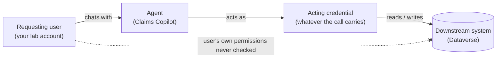

# Task 03-01 — Whose authority, and what may it do?

## Introduction

Before you can ask what an agent's calls are authorized to do, you need to know whose authority they
carry. That's rarely the person chatting. Then comes **authorization**: what that actor is permitted to
do, and, critically, **where that decision is actually made**. Authentication proves the actor is who it
claims. Authorization decides what it may then reach. For agents, the authorization decision is scattered
across several very different places, and each one has to be inspected on its own terms. If you look in
the wrong place, you will conclude an agent is safe when it is not.

## Description

You will take each downstream path an agent uses and locate the exact control surface where authorization
is decided for that path — Dataverse record-level access, a SharePoint permission, a connector's granted
scopes, the API behind an HTTP action's credential, or the server behind an MCP tool. You will separate
"authenticated" from "authorized," and you will flag every path where the authorization decision collapses
into a single shared credential (meaning there is no per-user check at all). Your `connections-export.csv`
gives you the connector and auth type. The *depth* of each grant (a role's breadth, a site's membership, a
key's server-side scope) you read in the tenant where a portal shows it; where none does, or you're working
without the tenant, you record it as an open question.

Every agent has its own Entra identity, `<agent name> (Microsoft Copilot Studio)`, which you recorded in
your `agent-identities-export.csv` in Task 01-02. It's a principal in Entra, and what governance and
identity policies target. It exists for every agent, benign or not, but it is not what most calls carry.
That is the **acting credential**, which the `auth_type` column of your `connections-export.csv` names in
one of five patterns:

- **User (delegated)** — the tool runs on the delegated credentials of whoever created the connection
  (the `connection_owner_upn`), not the requesting user's.
- **Service account** — the connection acts as a non-human account provisioned to run automation.
- **Runs as owner** — a Power Automate flow executes with its owner's authority.
- **API key in action config** — an HTTP request authenticates with a static key in its headers. The
  *key* is the identity to the API.
- **Static bearer token** — an MCP tool runs on a connection that holds one fixed token. The *token* is
  the identity to the MCP server.

A SharePoint knowledge source has no row: it searches the site with no connection, and whose access it
reads with stays Unknown until Exercise 04.

## Success Criteria

- [ ] You can explain the difference between an agent's Entra identity and its acting credential.
- [ ] For each agent, you named whose credential its calls carry.
- [ ] For each path type — Dataverse, SharePoint/site grounding, connector scope, HTTP/API action, MCP tool
  — you wrote down **where** authorization is decided and **how** you would confirm it.
- [ ] You identified every path in the estate where authorization reduces to a **single shared credential**
  (service account, delegated owner, static API key, or static bearer) with no per-user authorization.
- [ ] For each Dataverse-backed agent you described the **effective record access** of the account behind
  the acting credential — its security roles' privilege depth, and anything that narrows records
  (ownership, business units, teams, sharing) — or marked it as an open question to verify.
- [ ] You distinguished a coarse, environment-level gate (DLP: *which connectors may be used*) from a
  fine-grained data grant (*what the connector may reach once used*), and noted that the first does not
  bound the second.

## Learning Resources

- [Dataverse security roles and privileges](https://learn.microsoft.com/power-platform/admin/security-roles-privileges){:target="_blank"}
- [Use connectors in Copilot Studio agents](https://learn.microsoft.com/microsoft-copilot-studio/advanced-connectors){:target="_blank"}
- [Data loss prevention policies for Power Platform](https://learn.microsoft.com/power-platform/admin/wp-data-loss-prevention){:target="_blank"}
- [Purview sensitivity labels](https://learn.microsoft.com/purview/sensitivity-labels){:target="_blank"}
- [Copilot Studio security and governance](https://learn.microsoft.com/microsoft-copilot-studio/security-and-governance){:target="_blank"}

## Key Tasks

### 01: Name the acting credential

Expand this section for detailed steps

1. Which of the five patterns does your estate use, and on which agent?

   

   
Reveal the suggested answer

   All five:
   - **User (delegated):** Sales Nudge and Onboarding Guide (Tom Dean's connections), Team Wiki (Dev
     Kim's).
   - **Service account:** Claims Copilot (`svc-claims`).
   - **Runs as owner:** Expense Helper (Sam Olsen's flow).
   - **API key in action config:** Policy Lookup Bot.
   - **Static bearer token:** Underwriting Assistant.

   

2. For each agent, read its **Tool calls** column in your Exercise 02 inventory. Is the acting credential
   the requesting user's, or someone or something else's? Name whose, and the connection owner's status.
   An agent with no tool calls has no acting credential to name.

   

   
Reveal the suggested answer

   None of them is the requesting user's:
   - **Claims Copilot:** `svc-claims`, a service account.
   - **Policy Lookup Bot:** a static API key; no person stands behind it.
   - **Underwriting Assistant:** a static token on Priya Nair's connection.
   - **Expense Helper:** Sam Olsen, through his flow.
   - **Onboarding Guide** and **Sales Nudge:** Tom Dean, who has left but is still enabled.
   - **Team Wiki:** Dev Kim.
   - **Benefits Buddy**, **HR FAQ v2 (copy)** and **Meeting Notes Summarizer:** no tool calls. Their
     SharePoint knowledge has no connection; whose access it reads with is Unknown until Exercise 04.

   

The pattern you are looking for — the agent reaching a resource as an identity that is *not* the person who
asked:

{: .important }
> Check every connection owner's account status. A departed or disabled owner is a lifecycle warning: verify
> whether the connection still succeeds. A disabled owner's OAuth connections — the ones signed in as that
> person — stop at their next token refresh; a leaver whose account was never disabled keeps them working, and
> the agent keeps that person's authority with no one accountable for what it does.

### 02: Map where authorization is decided, path by path

Expand this section for detailed steps

1. For each agent, list its downstream paths (one per connection from Key Task 01). Then, for each path, fill
   in the authorization decision point using this map:

   | Path (connector) | Where authorization is actually decided | How to confirm |
   |---|---|---|
   | Dataverse | The **effective record access** of the account behind the acting credential: its security roles' privilege depth on each table the agent reads, combined with record ownership, business units, teams, sharing, and hierarchy or column security where they apply. A role with organization-level read on a table ignores who asked. | Power Platform admin → Environment → Security roles for that account; check table privileges and access level (User / Business Unit / Organization), and whether ownership, business units, or sharing narrow the records. |
   | SharePoint / site grounding | A knowledge source searches the site with no connection. Whose access decides what it returns, the maker's or the asker's, is Unknown until Exercise 04 tests it. Then: that account's **permissions on the site or library**, and **how much of the site the agent grounds on** (whole site vs. a scoped library). | What it grounds on, from the agent's **Knowledge** page in Copilot Studio; then that account's permissions on the site or library in SharePoint. |
   | Connector scope | The **delegated OAuth scopes** granted when the connection was created — the connector's own permission surface. | The connection's consented permissions; the connector reference in Copilot Studio. |
   | HTTP / API action | **Entirely on the API side**, against whatever credential the action sends. A single static key means every caller presents the same principal: unless the API checks the end user, the key's allowed scope is everyone's scope. | The action's header/credential config; the API's own authorization model and what that key is scoped to. |
   | MCP / tool | The **server-side authorization** tied to the bearer token decides what may be called. The **tool schema the server advertises** is the capability surface — which operations exist — not a control: a tool broader than the agent's need widens what that credential can be steered to do. | Enumerate the MCP server's advertised tools; check what the shared token is permitted to invoke. |
   | Power Automate flow | The **flow owner's** permissions on the target system, exercised for anyone who triggers the flow. | The flow's connections and the owner's rights on the target. |

2. For each path, write the specific answer for the specific agent — not the generic row. For a
   Dataverse-backed agent, that means naming the account behind the acting credential and the security
   roles it holds.

   For Claims Copilot's account, `svc-claims`, do this in **your own lab environment**. It carries a copy
   of that account and its role, and you are its administrator, so the role editor opens for you there
   whether or not your lab account has a licence. Your environment copies only the Claims set-up: for any
   other Dataverse-backed agent, read the account's roles in the agent's own environment, and if the role
   editor won't open for you there, record the scope as `Unknown`, as in step 3. In the **Power Platform
   admin center**, go to **Manage** → **Environments** → your environment (or the agent's) → **Settings** → **Users + permissions** → **Users**, open that account, and choose
   **Manage security roles** to see its roles; open a role under **Security roles** and read the
   **scope** of each grant on each table (own records, business unit, or organization), not just whether
   it is ticked. Then state: *"authorization = the effective record access of
   `<account behind the credential>` on the tables the agent reads."* Your `connections-export.csv` names
   the actor; the role sizes the grant.
3. Where you cannot see the depth of a grant — a site's membership, a key's server-side scope, or, without
   the tenant, a role's breadth — that is not a dead end. Record it as `Unknown`, with the **open question**
   and the check that would settle it: for example, "role breadth unknown from export; open the account's
   security roles in the Power Platform admin center and read the access level on each table." An unknown
   grant is a finding.

### 03: Separate "authenticated" from "authorized"

Expand this section for detailed steps

1. Go back through your path map and mark each path with one of two labels: **per-user authorization** (the
   requesting user's own entitlement is checked before the action runs) or **shared-credential
   authorization** (one identity's grant applies to everyone who can use the agent).
2. For each path in your map, ask: *does anything check what the person chatting is personally allowed to
   do?* If the only gate is the shared credential, write "no per-user authorization" against that path. If
   you can't tell, write `Unknown` and name the check that would settle it — for a tool or knowledge source,
   its authentication setting in Copilot Studio; for an HTTP request or MCP tool, the API's or server's own
   authorization for that credential.
3. Note the difference in blast radius between the two labels. A shared-credential path grants **every**
   user of the agent whatever the credential holds. That is the mechanism you will exploit conceptually in
   Exercise 04 and try to close in Exercise 05.

{: .warning }
> A static credential — an API key in an action header, a shared bearer token, a service account — gives every
> caller of that path the same authenticated principal. The downstream service still decides what that
> principal may do; if it performs no per-user check, every agent user inherits the credential's allowed
> scope. And anyone who can export or view the agent may be able to read the credential itself.

{: .note }
> DLP and environment policy are real controls, but they answer a **coarser** question than the one here:
> *which connectors may be used in this environment.* They do not bound what an allowed connector may reach
> once it is used. A Dataverse connector permitted by DLP can still carry an over-broad security role — the
> two decisions live in different places.

## Summary

You located the authorization decision point for every path an agent uses, and you learned that it is never
in one place: a Dataverse role and record-level access here, a SharePoint permission there, the API behind
an HTTP action's key, the server behind an MCP token. You separated authentication from authorization, and
you flagged the paths where authorization has collapsed into a single shared credential with no per-user
check. Whose authority (Key Task 01) and what it may do (Key Tasks 02–03) are the two inputs you now combine into
effective access.
