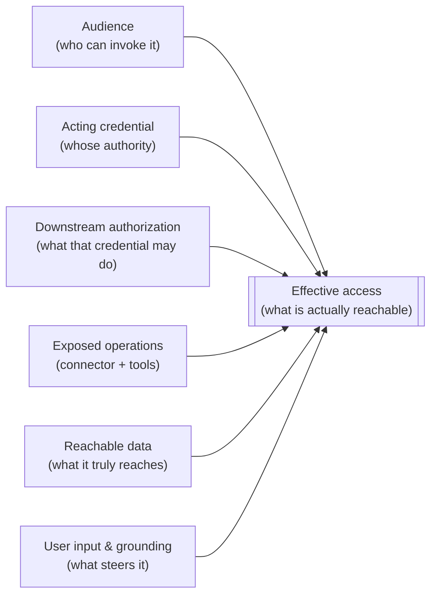

# Task 03-02 — Effective access: map three agents

## Introduction

Whose authority an agent's calls carry, and what that authority may do, are inputs. **Effective access**
is the output: what an agent can actually obtain or cause once every layer is combined. An agent can look
harmless at every layer and still be dangerous when the layers stack: a benign-sounding purpose, a normal
connector, a routine credential and an ordinary chat box can compose into "any employee can read data they
are not entitled to." In this task you apply the whole chain to three agents, and answer the one question
an Access Map exists for: **can this agent obtain data, or cause an action, that its intended users could
not?** The three agents cover three different kinds of path: a Dataverse connection, an HTTP action, and
SharePoint grounding.

## Description

Take **Claims Copilot**, **Policy Lookup Bot**, and **Benefits Buddy**. For each, copy a fresh block from
the [Access Map template](), fill the layer cells
from your inventory and the tenant, citing the rows of your CSVs that support each cell, then decide
whether the agent exceeds its intended users and classify the gap. Draw your own conclusions first, then
compare each map with the suggested one after its Key Task. Where you can't determine something, write
`Unknown` in the cell and record, in the map's **Unknowns** section, the open question, your risk
hypothesis if it resolves broadly, and the evidence that would settle it. A map that keeps facts and
hypotheses apart is a legitimate, honest map.

Effective access is where six layers overlap:

> **Effective access = who can invoke the agent, the credential it acts with, what that credential is
> authorized to do, the operations its tools expose, and the data they reach — steered by user input and
> grounding.**

- **Audience** — who can invoke the agent at all (its sharing and channels). In this lab, treat every
  agent as available to every employee.
- **Acting credential** — whose authority each call carries (Task 03-01, Key Task 01): the end user's,
  the maker's or connection owner's, a service account's, a flow owner's, or a static key or token.
- **Downstream authorization** — what the downstream system lets that credential do, and where that is
  decided (Task 03-01).
- **Exposed operations** — what the connector and tools actually let the agent do (read rows, update
  status, send mail, call an endpoint, invoke an MCP tool).
- **Reachable data** — what can genuinely be read or written through those operations.
- **User input and grounding** — what the chatting user can supply that flows into a call (a record id, a
  query string, free text that becomes a parameter), and the grounded content the agent treats as
  authoritative.

The map's question has two parts:
- **Data reach:** is the *reachable data* behind the acting credential larger than what the intended user
  is personally entitled to? If yes, you have an over-broad-access path.
- **Action authority:** can the agent *cause* something — a write, an approval, an outbound mail — that the
  requesting user has no authority to perform? If yes, you have a confused-deputy path, where the user
  borrows the acting credential's authority.

Keep "who is asking" and "who is acting" apart. When they differ, the gap between them is exactly the risk:
an agent whose acting credential reaches no further than its least-privileged user has no gap, however
scary it sounds; one whose credential reaches further is a finding, however dull it sounds.

## Success Criteria

- [ ] You can explain, with an example, why inspecting a single layer (owner, or connector, or purpose)
  misses the risk that only appears when the layers combine.
- [ ] A completed **Agent Access Map** block for each of the three agents, with every layer row holding a
  value or `Unknown` (acting credential, user context, permission scopes, connector permissions,
  tool/action authorization, accessible data, untrusted input paths).
- [ ] For each agent you named the **intended users** and answered **"Can it exceed them?"** with a concrete
  *how* when the answer is yes.
- [ ] For each agent you recorded its **actual audience**, a representative requester, and that requester's
  direct entitlement (or `Unknown`) before deciding whether it exceeds its intended users.
- [ ] For each agent you marked the **type of gap** — excessive permission, confused deputy, both, or none —
  and justified it in one line.
- [ ] Every unknown has an open question, a risk hypothesis, and the evidence that would verify it — none is
  recorded as fact.
- [ ] You can state, for each agent, whether "who is asking" and "who is acting" are the same identity.
- [ ] You compared each map with the suggested one and noted where yours differed and why.

## Learning Resources

- [Use connectors in Copilot Studio agents](https://learn.microsoft.com/microsoft-copilot-studio/advanced-connectors){:target="_blank"}
- [Dataverse security roles and privileges](https://learn.microsoft.com/power-platform/admin/security-roles-privileges){:target="_blank"}
- [Copilot Studio security and governance](https://learn.microsoft.com/microsoft-copilot-studio/security-and-governance){:target="_blank"}
- [Conditional Access for agents](https://learn.microsoft.com/entra/identity/conditional-access/agent-id){:target="_blank"}
- [Add tools to custom agents in Copilot Studio](https://learn.microsoft.com/microsoft-copilot-studio/add-tools-custom-agent){:target="_blank"}
- [Make HTTP requests in Copilot Studio](https://learn.microsoft.com/microsoft-copilot-studio/authoring-http-node){:target="_blank"}

## Key Tasks

{: .note }
> Without the tenant, record these as `Unknown`, each with its open question and check: Claims Copilot's
> role scope (check: `svc-claims`'s security role) and its tools' operations (check: each tool's code
> view); where Policy Lookup Bot's policy id comes from (check: its topic's code); and, for Benefits Buddy,
> what it grounds on and whose access the search uses (checks: its **Knowledge** page; Exercise 04).

### 01: Map Claims Copilot

Expand this section for detailed steps

1. Copy a fresh block from the [Agent Access Map]()
   template. Set **Agent = Claims Copilot**, and copy its environment and **Identity** from your
   inventory.
2. **Acting credential + user context:** copy its line from your inventory's **Calls** column: the
   connection, its `auth_type` and its owner. Does the agent act with the chatting user's credential, or the connection's?
3. **Permission scopes:** copy your one-line result for `svc-claims`'s role from Task 03-01 (Key Task 02,
   step 2).
4. **Connector + tool authorization:** in [Copilot Studio](https://copilotstudio.microsoft.com){:target="_blank"},
   open each tool's code view (**⋯** → **Open code view**, as in Task 01-01) and record the operation it
   calls. Does any of them write? Operations named **List…** or **Get…** read; **Create…**, **Update…**
   and **Delete…** write. A write is action authority, not just read reach.
5. **Accessible data:** what the acting credential can read or write, given its role (step 3) and its
   tools (step 4). Note any personal data.
6. **Untrusted input paths:** the chat (for example, a claim id), which flows into the Dataverse calls.
7. **Answer the question:**
   1. Intended users: claims adjusters. Actual audience: every employee (the lab's premise).
   2. Your representative requester: your own lab account (Jordan Blake without the tenant).
   3. Their direct entitlement: that account's own Dataverse roles in the same environment, or `Unknown`.
   4. Can a requester reach or change claims they couldn't directly? If yes, record how, and mark the
      gap type.

Reveal the suggested Claims Copilot map

**Agent:** Claims Copilot  **Environment:** `Claims-Test`

**Agent identity:** Claims Copilot (Microsoft Copilot Studio)

| Layer | Suggested value |
|---|---|
| Acting credential | The shared Dataverse connection `DV-Claims-Shared`, owned by the service account `svc-claims` (`auth_type` = Service account). The agent acts as `svc-claims`, not as the chatting user. |
| User context | None. Nothing checks the requester's own Dataverse access. |
| Permission scopes | `svc-claims` holds a broad custom role, `svc-claims Dataverse Full Access`: create, read, write, append, assign and share on **all** `Claim` and `Customer` rows (organization depth). Nothing in record-level access (ownership, business units, teams, sharing) narrows the records. The task needs only the requesting adjuster's own claims. |
| Connector permissions | Microsoft Dataverse, through the `DV-Claims-Shared` connection. |
| Tool / action authorization | `List rows` on `Claim` and `Customer`, and nothing that writes. The agent's reach is read-only even though `svc-claims`'s role could write: a tool added later would inherit that write authority. |
| Accessible data | Every claim and every customer record, read only through the agent's tools. `Customer` holds personal data (SSN, date of birth). The role's write privileges stay in Permission scopes: unused today. |
| Untrusted input paths | The chat (a claim id or customer detail flows into the Dataverse calls), and the `Claims-Knowledge` grounding, which `Claims-Adjusters` can edit. |

| Who | Suggested value |
|---|---|
| Intended users | Claims adjusters. |
| Actual audience | Wider than the adjusters: every employee (the lab's premise), including Jordan Blake. |
| Representative requester | Your own lab account in the tenant; Jordan Blake without it. |
| Requester's direct entitlement | Almost nothing. No access to claims or customer records of their own. |

- **Can it exceed its intended users?** Yes. Any employee can ask the agent for any claim or customer record.
  The calls run as `svc-claims`, whose role reaches every row, and nothing checks who is asking. The agent
  only reads today, but the role could also change any claim: a write tool added later would hand that to
  every employee too.
- **Type of gap:** Both. Excessive permission, because `svc-claims` reaches every row when the task needs one
  adjuster's claims. Confused deputy, because the agent uses that authority for requesters who lack it.
- **Unknowns the offline route should end with:** the role scope of `svc-claims` on `Claim` and `Customer`;
  which operations the tools call, and whether any writes; Jordan's direct
  entitlement. Each carries the hypothesis and check from the steps above.

### 02: Map Policy Lookup Bot

Expand this section for detailed steps

1. Copy a fresh block. Set **Agent = Policy Lookup Bot**, and copy its environment, **Identity** and
   **Owner (status)** from your inventory. Does one accountable person stand behind it?
2. **Acting credential:** copy its line from your inventory's **Calls** column: an HTTP request in a
   topic, with an API key in its headers. Whose identity does the policy API see, and is it the same for
   every user?
3. **Permission scopes / accessible data:** copy its decision point from your Task 03-01 path map: the
   policy API's rules for that key, `Unknown`. Accessible data is whatever the key can reach: record your
   risk hypothesis.
4. **Untrusted input paths:** from the topic's code you saw in Task 01-01, where does the policy id come
   from, and does anything check it against the asker's entitlement? Its `method` tells you whether it
   reads or writes: `Get` reads; `Post`, `Put`, `Patch` and `Delete` write. If you look at the key in the
   topic's code, don't copy its value.
5. **Answer the question:**
   1. Intended users: people looking up policies they're entitled to. Actual audience: every employee.
   2. Same requester as in Key Task 01.
   3. Can a user reach policies, or other records, beyond their own entitlement? If yes, record how, and
      mark the gap type.
   4. Second-order risk: who else can read a key stored in the agent?

Reveal the suggested Policy Lookup Bot map

**Agent:** Policy Lookup Bot  **Environment:** `Halcourt-Prod`

**Agent identity:** Policy Lookup Bot (Microsoft Copilot Studio)

**Owner:** the IT Helpdesk shared mailbox (`is_shared_mailbox` = TRUE). No one person is accountable for the
agent.

| Layer | Suggested value |
|---|---|
| Acting credential | A static API key in the HTTP request's headers (`auth_type` = API key in action config). The policy API sees the key, and the same key for every user. |
| User context | None. Nothing checks the chatting user's own entitlement before the call goes out. |
| Permission scopes | Decided by the policy API, not the agent. The API is a facilitator-controlled training endpoint, so you can't inspect its authorization: keep this `Unknown` in your map. By the estate's design, the key is a single full-scope key: it reaches `/policy/{id}`, `/policy/all` and `/customer/{id}`. In a real estate, the check is the API owner's configuration for that key. |
| Connector permissions | No connector: a Copilot Studio HTTP action calling the policy endpoint. No connection identity stands behind it, only the key. |
| Tool / action authorization | The action calls `GET /policy/{id}`. The key itself authorizes more than that one call. |
| Accessible data | Any customer's policy. With the full-scope key, also every policy and customer records, which hold personal data. |
| Untrusted input paths | The chat. The `{id}` in the call comes straight from the user's message, and nothing validates it against the asker's entitlement. |

| Who | Suggested value |
|---|---|
| Intended users | People looking up policies they are entitled to. |
| Actual audience | Every employee (the lab's premise), including Jordan Blake. |
| Representative requester | Your own lab account in the tenant; Jordan Blake without it. |
| Requester's direct entitlement | Almost nothing. They hold no credential for the policy API. |

- **Can it exceed its intended users?** Yes. A user can put another customer's policy id in the chat, and the
  agent fetches it with the key. The same key reaches every policy and customer records, so the input is a
  path toward those too.
- **Type of gap:** Both. Excessive permission, because a full-scope key backs a lookup that needs one
  policy. Confused deputy, because the key acts for every user and nothing checks the asker.
- **Second-order risk:** the key sits in the agent's configuration. Anyone who can view or export the agent
  can read it and call the API directly, outside the agent.
- **Unknowns the offline route should end with:** what the key can reach on the policy API (this stays
  `Unknown` with the tenant too); where the `{id}` comes from, and whether anything checks it; the requester's direct entitlement.

### 03: Map Benefits Buddy

Expand this section for detailed steps

1. Copy a fresh block. Set **Agent = Benefits Buddy**, and copy its environment and **Identity** from your
   inventory.
2. **Acting credential + user context:** no calls, and its SharePoint knowledge uses no connection.
   Record whose permissions it reads with as `Unknown until Exercise 04`.
3. **Permission scopes / accessible data:** copy what it grounds on from your inventory's **Grounding**
   column. A source whose address ends at `/sites/<name>` grounds on the whole site; one that continues to
   a library or folder grounds only there. What it can reach depends on whose access the search uses.
   Record both: "If it reads as the maker (Marcus Webb): anything Marcus can open on the site. If it reads
   as the asker: only what the asker can already open."
4. **Untrusted input paths:** every place content enters its reasoning: the chat, and every grounded
   document. Your Task 01-03 sketch named these as B1 and B2.
5. **Answer the question:**
   1. Intended users: employees asking benefits questions. Actual audience: every employee.
   2. Same requester as in Key Task 01.
   3. Can it surface content the requester couldn't open directly? The honest answer here is "Possibly":
      it depends on whose access the search uses, which Exercise 04 tests. Say which way each
      possibility falls.

Reveal the suggested Benefits Buddy map

**Agent:** Benefits Buddy  **Environment:** `Halcourt-Prod`

**Agent identity:** Benefits Buddy (Microsoft Copilot Studio)

| Layer | Suggested value |
|---|---|
| Acting credential | None stored: the knowledge source searches the `HR-Benefits` site directly, with no connection. Whose access decides what it returns, the maker's (Marcus Webb) or the asker's, is Unknown until Exercise 04 tests it. |
| User context | Unknown until Exercise 04. If the search reads as the asker, their own SharePoint permissions decide what it returns; if as the maker, nothing checks the asker. |
| Permission scopes | If it reads with the maker's access: Marcus is in `HR-Team`, a member (edit) of the `HR-Benefits` site. He can read the whole site, including the `Leadership/` folder. `Leadership/` stops inheriting permissions and drops the site's visitors. |
| Connector permissions | None: SharePoint knowledge only, with no connection. No tools or custom actions. |
| Tool / action authorization | Read only. No write tools and no custom actions. |
| Accessible data | The whole `HR-Benefits` site is grounded, not a scoped library. That includes `Leadership/`, which holds executive compensation bands. |
| Untrusted input paths | The chat, and every grounded document. `HR-Team` members can edit what the agent ingests as authoritative. Exercise 04 tests whether a document can steer it. |

| Who | Suggested value |
|---|---|
| Intended users | Employees asking benefits questions. |
| Actual audience | Every employee (the lab's premise), including Jordan Blake. |
| Representative requester | Your own lab account in the tenant; Jordan Blake without it. |
| Requester's direct entitlement | A visitor (read) on `HR-Benefits` through `All-Employees`, but no access to `Leadership/`. |

- **Can it exceed its intended users?** Possibly. An employee can ask about compensation; if the source
  reads with the maker's access, the agent can surface content from `Leadership/`, which Marcus can read
  and the asker can't open. Exercise 04 tests which it is.
- **Type of gap:** Depends on whose access the search uses, which Exercise 04 decides. If the maker's:
  excessive permission, since whole-site grounding is wider than a benefits FAQ needs, and Both is
  defensible, since the three deputy conditions in the tip below hold for reads too. If the asker's:
  none, since it returns only what the asker can already open.
- **Unknowns the offline route should end with:** whose access the knowledge source reads with; what
  Marcus can see on the HR site; which folders are grounded (offline only: live, the address shows the
  whole site); the requester's direct access to the site.

<!--  -->

{: .note }
> This is an **analysis** exercise on the facilitator's intentionally-vulnerable training estate — you are
> mapping reach, not exploiting it. You will actually exercise these paths, safely and by observation, in
> Exercise 04. For now, the deliverable is an honest map: what each agent *could* reach, and whether that
> exceeds its users.

{: .tip }
> A confused deputy needs all three: a requester can invoke the path; the acting credential holds authority
> the requester lacks; and no per-user check blocks the operation. Test each one — a service account or a
> shared connection is a reason to look, not a verdict.

## Summary

You produced the Exercise 03 deliverable: an Access Map for three agents, every layer filled with a value or
`Unknown`, and every unknown carried as an open question with a hypothesis and a check rather than as fact.
Along the way you answered the question that drove the whole exercise — for each agent, can it obtain data
or cause an action its intended users could not — and you classified the gaps as excessive permission,
confused deputy, both, or none. Then you compared each map with the suggested one and noted where yours
differed and why. Carry these maps into Exercise 04: the agents where "who is acting" outruns "who is
asking" are exactly the ones you will break next.
