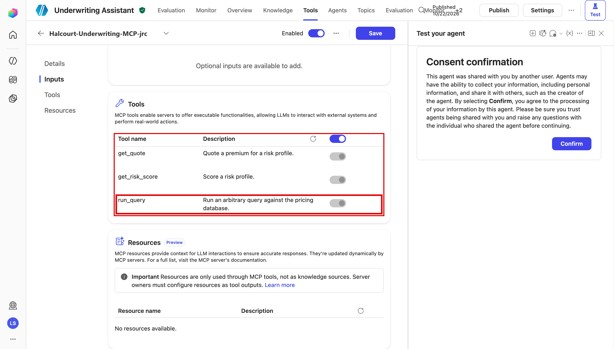

# Task 04-03 — Excessive connector & tool permissions

## Introduction

Over-permission is a **blast-radius multiplier**. An agent needs one operation; the connector or tool it
runs on grants many. Nothing looks wrong until something goes wrong — an injection (Scenario A), a confused
deputy (Scenario D), or just a curious user — and then the damage is bounded by *what was granted*, not by
*what was intended*. This scenario is about measuring that gap precisely, so that in Exercise 05 you can test
whether a control actually closes it.

## Description

You will examine two grants. **Claims Copilot** runs on a shared Dataverse connection; its task is to read
the requesting adjuster's *own* claims, and you will measure how much the connection's principal can
actually reach. **Underwriting Assistant** needs quotes and risk scores; you will compare the MCP tools its
server exposes, and the agent has switched on, with that need.

For each, you state the operation actually needed, enumerate what is actually granted, and record the
multiplier. **Observe and record only** — do not run destructive Dataverse writes or arbitrary MCP queries
beyond confirming the tool exists.

## Success Criteria

- [ ] You stated the single operation each agent actually needs.
- [ ] You enumerated what the connector/tool actually grants (the Dataverse role scope behind
      `DV-Claims-Shared`; the MCP tools the agent's MCP server exposes).
- [ ] You quantified the gap for both — *need X; granted X + Y + Z*.
- [ ] You explained how this multiplies the impact of Scenarios A, D, and E.
- [ ] You wrote the **Scenario C** row in your [Agent Threat Model]()
      and compared it with the suggested row.

## Learning Resources

- [Dataverse security roles and privileges](https://learn.microsoft.com/power-platform/admin/security-roles-privileges){:target="_blank"}
- [Use connectors in Copilot Studio agents](https://learn.microsoft.com/microsoft-copilot-studio/advanced-connectors){:target="_blank"}
- [Power Platform data loss prevention](https://learn.microsoft.com/power-platform/admin/wp-data-loss-prevention){:target="_blank"}
- [Copilot Studio security and governance](https://learn.microsoft.com/microsoft-copilot-studio/security-and-governance){:target="_blank"}
- [Add tools to custom agents](https://learn.microsoft.com/microsoft-copilot-studio/add-tools-custom-agent){:target="_blank"}

## Key Tasks

### 01: Name the operation each agent actually needs

Expand this section for detailed steps

1. For **Claims Copilot**, write the minimal operation from its purpose (adjuster helper for claim status):
   *read the status of claims assigned to the requesting adjuster,* plus a narrow *update status* on those
   same claims. Note what it does **not** need: read of `Customer` PII, or read/write across every other
   adjuster's claims.
2. For **Underwriting Assistant**, write the minimal operation: *get a quote* and *get a risk score* for a
   supplied risk. Note what it does **not** need: the ability to run arbitrary database queries.
3. Keep these "needed" statements next to you — the gap is the difference between them and what you find
   granted.

> Key Tasks 02 and 03 are two routes to the same result. If you can reach the tenant, do **02** and skip
> 03. If you can't, skip 02 and do **03**. Both end at Key Task 04.
{: .note }

### 02: Enumerate the actual grant (tenant route)

Expand this section for detailed steps

1. **Claims Copilot / the connection.** Find which credential Claims Copilot's Dataverse tools carry. In
   Copilot Studio, each tool's **Details** → **Additional details** on the agent's **Tools** page show
   whether it uses **End user** or **Maker-provided** credentials. Read who owns the connection those
   tools use, and who it is shared with, from the `DV-Claims-Shared` row of your
   [`connections-export.csv`]() from
   [Task 01-01]() (`connection_owner_upn`, `shared_with`,
   `auth_type`). Then open the owner's account in the Microsoft Entra admin center
   (`https://entra.microsoft.com`) under **Entra ID → Users**: a person, or a service account? Your
   [`users-export.csv`]() records it as
   `is_service_account`.
2. **Claims Copilot / Dataverse.** In the Power Platform admin center, go to **Manage → Environments →
   `Claims-Test` → Settings → Users + permissions → Users**, open `svc-claims`, and select **Manage security
   roles** to see its role. Then open **Settings → Users + permissions → Security roles** → that role, and
   read its **Claim** and **Customer** table privileges (Create/Read/Write/Delete and the access level —
   User / Business Unit / Organization). Record whether it can read **all** rows and whether it has broad
   customization rights.
3. **Underwriting Assistant / MCP.** In Copilot Studio, open the agent's **Tools** page (as a viewer,
   replace `/overview` in the address with `/actions`). Its MCP server is one tool of type **Model Context
   Protocol**; select it, and its **Tools** section lists every tool the server offers, each with an
   on/off switch (greyed for a viewer, who can't change it; a switch set to the right is on). Record every
   one that is on. Distinguish what the server advertises, what the agent is
   allowed to call (every tool that is on — the orchestrator picks among them from the user's request),
   and what the token is authorized to invoke. Note any tool whose description alone tells you it is
   broader than the agent's job.
4. For each, write the granted scope beside the needed scope from Key Task 01.

<!--  -->

### 03: Enumerate the actual grant from the artifact pack (offline route)

Expand this section for detailed steps

1. Open [`connections-export.csv`]():
   - `DV-Claims-Shared` → Microsoft Dataverse, `auth_type` = **Service account**, `connection_owner_upn` =
     `svc-claims`, `shared_with` = `Claims-Adjusters`, used by **Claims Copilot**. The tools carry
     `svc-claims`'s credential. The connection's `shared_with` says who can use the connection; who can chat
     with the agent is a separate fact.
   - `MCP-Underwriting` → MCP (custom), `auth_type` = **Static bearer token**, used by **Underwriting
     Assistant**. A single static credential authenticates every call; what it may invoke is the server's
     decision.
2. Cross-check [`users-export.csv`](): read `svc-claims`'s
   `is_service_account`. Service accounts are frequently over-permissioned precisely because "it just needs
   to work" — treat that as a prompt to verify the role, not an excuse to trust it.
3. The CSVs tell you the **identity and sharing** shape. The MCP tool list is in the screenshot in Key
   Task 02. The pack doesn't carry the Dataverse role's scope: record it as `Unknown`, with the risk
   hypothesis "a broad role would reach every row". Key Task 02 step 2 settles it in the tenant. Then
   combine them, keeping facts and hypotheses apart.

### 04: Record the threat-model row

Expand this section for detailed steps

1. Fill the **Scenario C** row in [03 — Agent Threat Model]()
   from what you observed: Attack, Asset, Trust boundary crossed, Impact, Existing control. Then compare it
   with the suggested row below.
2. Write one sentence on the multiplier: how does this grant change the impact of Scenarios A, D, and E?
3. Carry this evidence into [Exercise 05]() and
   test which controls prevent, reduce, detect, or leave it unchanged.

Reveal the suggested Scenario C row

- **Attack:** exploitation of an over-scoped connector / tool grant.
- **Asset:** all `Claim` and `Customer` rows via Dataverse (Claims Copilot); the entire pricing database via
  `run_query`, which the agent's MCP tool has switched on alongside the two it needs (Underwriting
  Assistant).
- **Trust boundary crossed:** intended operation ≠ granted capability; the agent's reach is set by the
  grant, not the task.
- **Impact:** any successful manipulation (injection, confused deputy, boundary abuse) inherits the full
  grant — read/modify all claims and customer PII, or run arbitrary pricing-DB queries.
- **Existing control:** record what constrains this today, per agent. Claims Copilot's `Claims-Test`
  environment has no data policy at all; does any record-level access narrow the rows? Underwriting
  Assistant's `Halcourt-Prod` has `Halcourt-Prod-DLP`, which governs *which* connectors are usable, not the
  over-grant *within* one.
- **The multiplier:** this scenario makes every other scenario worse.
- **Likely fixes to test in Exercise 05:** a scoped Dataverse role with narrowed record-level access, and an MCP
  contract trimmed to `get_quote` / `get_risk_score`.

## Summary

You measured the distance between *need* and *grant* for two agents: what each task requires, and what the
Dataverse role and the MCP tools the agent has switched on allow. Over-permission is quiet until it is
catastrophic: it sets the ceiling on every other failure in this exercise. Carry this evidence into Exercise 05
and test which controls prevent, reduce, detect, or leave it unchanged.
