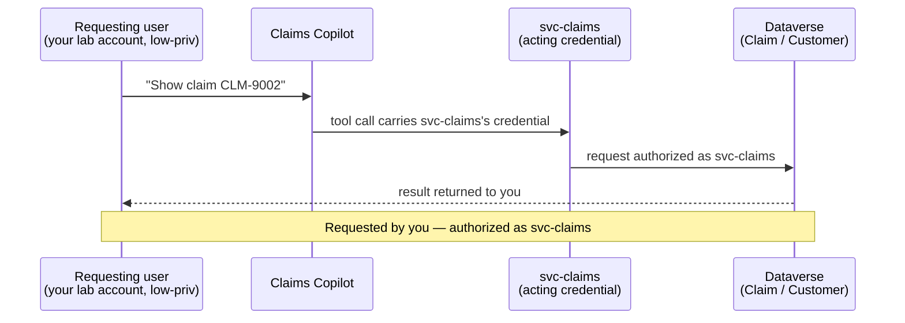
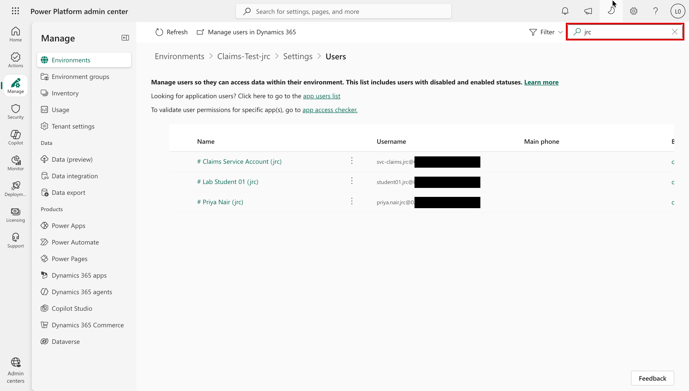
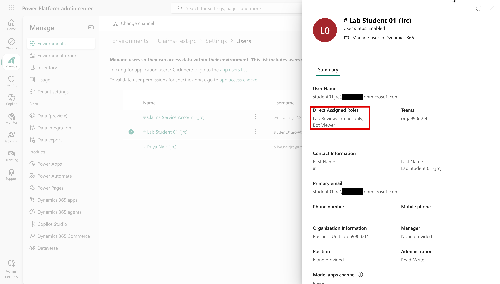
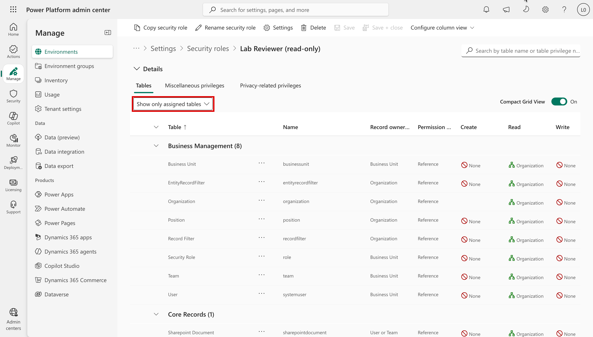
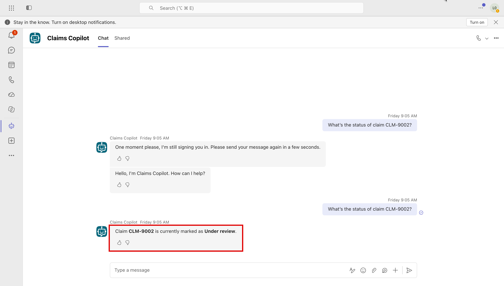
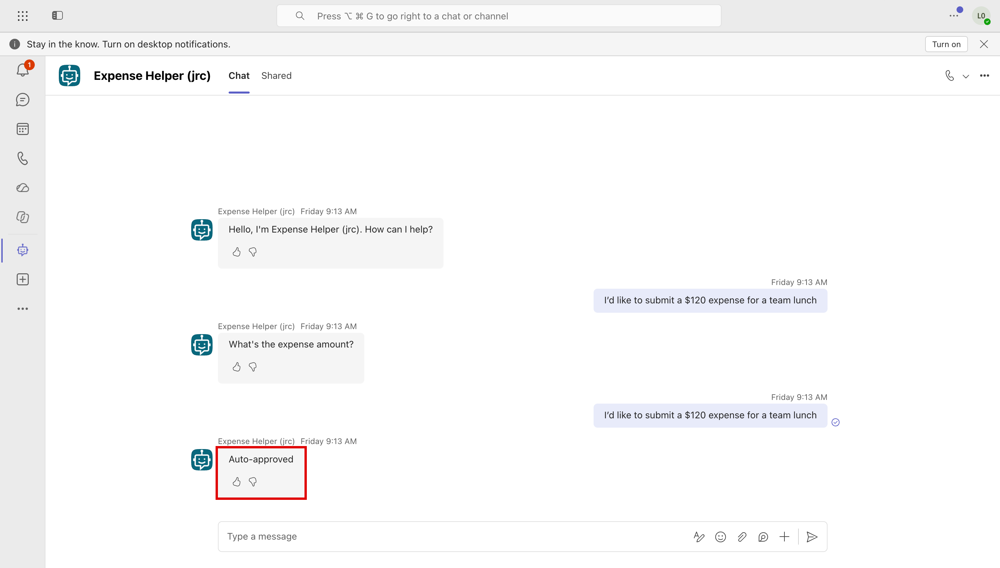

# Task 04-04 — Identity & the confused deputy

## Introduction

A **confused deputy** is a privileged component tricked into using its authority on behalf of a
less-privileged caller. When an agent's tool calls carry a shared or owner credential, it is that
credential's authority — not the chatting user's — that the downstream system checks. The questions that
define this scenario are simple and unforgiving: **who requested the action, which credential did the call
carry, did anything check the requester's entitlement, and whose identity was recorded?**

## Description

You will use your own lab account against two agents. **Claims Copilot** reads Dataverse through a
connection that uses the `svc-claims` service account. **Expense Helper** calls a Power Automate flow,
*Submit and auto-approve expense under $500*, owned by **Sam Olsen**, an expense approver. For each, you
will find out which credential the action carries, and whether that authority is something you hold
yourself.

You will **observe and record.** Prefer read-only confirmation; if you exercise a write or an approval, use
only a facilitator-designated test record. Answer the questions explicitly for each agent.

## Success Criteria

- [ ] Using the published agent and your own lab account, you checked whether Claims Copilot returns a claim
      (and, if it offers a status update and the facilitator has designated a test claim, performs an
      update) that your account cannot reach directly — or, working from the artifact pack, traced whether
      it could.
- [ ] For Expense Helper, you identified whose credential the auto-approve flow runs with.
- [ ] You answered, for each agent: who requested the action, which credential the call carried, which
      system authorized it, whether anything checked the requester's entitlement, and whose identity was
      recorded as the actor.
- [ ] You wrote the **Scenario D** row plus the confused-deputy Q&A in your
      [Agent Threat Model](), and compared it with the
      suggested row.

## Learning Resources

- [Use connectors in Copilot Studio agents](https://learn.microsoft.com/microsoft-copilot-studio/advanced-connectors){:target="_blank"}
- [Dataverse security roles and privileges](https://learn.microsoft.com/power-platform/admin/security-roles-privileges){:target="_blank"}
- [Conditional Access for agents](https://learn.microsoft.com/entra/identity/conditional-access/agent-id){:target="_blank"}
- [Manage Power Automate flows](https://learn.microsoft.com/power-platform/admin/manage-power-automate){:target="_blank"}
- [Microsoft Purview audit](https://learn.microsoft.com/purview/audit-solutions-overview){:target="_blank"}
- [Copilot Studio security and governance](https://learn.microsoft.com/microsoft-copilot-studio/security-and-governance){:target="_blank"}

## Key Tasks

### 01: Adopt the requesting-user lens

Expand this section for detailed steps

1. Open your Claims Copilot Access Map (Task 03-02). Its "Requester's direct entitlement" says what you
   can do directly, without any agent. If it's `Unknown`, check it now:
   1. In the [Power Platform admin center](https://admin.powerplatform.microsoft.com){:target="_blank"},
      go to **Manage** → **Environments** → `Claims-Test` → **Settings** → **Users + permissions** →
      **Users**.
   2. Search for your estate id, and select your own account. Its **Summary** lists its **Direct Assigned
      Roles**.
   3. For each role, go to **Settings** → **Users + permissions** → **Security roles** and open it. On
      **Tables**, select **Show only assigned tables**, and scroll for a **Custom Tables** group with
      **Claim** or **Customer** rows. None means the role gives no access to claim or customer records.

   

   

   

   Lab accounts aren't expense approvers either. The premise this scenario tests: **if the agent does
   something you can't do yourself, the authority came from somewhere else**, its acting credential.

> Key Tasks 02 and 03 are two routes to the same result. If you can reach the tenant, do **02** and skip
> 03. If you can't, skip 02 and do **03**. Both continue at Key Task 04.
{: .note }

### 02: Observe it live (tenant route)

Expand this section for detailed steps

1. Open **Claims Copilot**'s Teams link, signed in with your own lab account. The link opens
   its details in Teams: select **Add** or **Open**, whichever appears. Then, in the **Let's go** dialog,
   select **Open**, not **Open with Copilot**. If the agent's first reply says it is still signing you in,
   send your message again after a few seconds.
2. Ask it for a claim you have no direct rights to, for example *"What's the status of claim CLM-9002?"*
   Does it return the record? Claims Copilot's tools only read, so the write half of this scenario is
   reasoned from `svc-claims`'s role (Task 03-01), not observed.
3. Open **Expense Helper** from its Teams link, the same way, and say you want to submit an expense. When
   it asks **"What's the expense amount?"**, reply with **only** an amount under $500, for example `120`.
   What does it reply? Your inventory's **Calls** line shows why: the approval runs in Sam Olsen's flow,
   with his authority, and you're not an approver. A full sentence sometimes works, but the amount alone is
   reliable.

> This is not an authentication bypass. You authenticated as yourself. If the agent returned the record,
> the escalation is that the tool call carried `svc-claims`'s credential, and Dataverse authorized that
> principal. Capture that distinction in your notes — it is the entire scenario.
{: .important }

### 03: Walk it through from the artifact pack (offline route)

Expand this section for detailed steps

1. Without the tenant, take **Jordan Blake** as the requesting user: the scenario's premise is that
   Jordan is an ordinary employee who is neither a claims adjuster nor an expense approver. Jordan's row
   in your [`users-export.csv`]() confirms the
   account is enabled; it doesn't show Jordan's Dataverse access.
2. Open [`connections-export.csv`]():
   - `PA-Expense-AutoApprove` → Power Automate, `auth_type` = **Runs as owner** (`sam.olsen`), used by
     **Expense Helper**. The flow runs with its owner's connections. Its `shared_with` (`All-Employees`)
     is the flow's sharing; who can chat with Expense Helper is a separate fact.
   - `DV-Claims-Shared` → Dataverse, **Service account** (`svc-claims`), shared with `Claims-Adjusters`,
     used by **Claims Copilot**. Again, `shared_with` describes the connection, not who can chat with the
     agent.

### 04: Answer the questions and record the row

Expand this section for detailed steps

1. For each agent, answer in writing: who requested the action; which credential the call carried; which
   system authorized it; and whether anything checked the requester's entitlement. Whose identity was
   recorded as the actor is to be tested in Exercise 05.
2. Fill the **Scenario D** row in [03 — Agent Threat Model]()
   from what you observed: Attack, Asset, Trust boundary crossed, Impact, Existing control. Then compare it
   with the suggested answers below.
3. Complete the worksheet's **D** prompt — one line per agent.
4. Carry this evidence into [Exercise 05]() and
   test which controls prevent, reduce, detect, or leave it unchanged.

Reveal the suggested answers and Scenario D row

- **Who requested it?** The requesting user (you, or any employee) by asking.
- **Which credential, authorized by whom?** `svc-claims`'s, authorized by Dataverse (Claims Copilot); the
  flow owner `sam.olsen`'s authority (Expense Helper).
- **Was the requester's entitlement checked?** No — nothing checks the person chatting.
- **Recorded actor:** to be tested in Exercise 05.
  

  

- **Expense Helper consequence:** any employee can auto-approve their own under-$500 expense, because the
  *approval* runs as an approver even though the *requester* is not one.

The suggested row:

- **Attack:** confused deputy — the agent exercises an authority the requester lacks.
- **Asset:** all claims / customer PII (Claims Copilot); expense approvals (Expense Helper).
- **Trust boundary crossed:** the requesting user's authority ≠ the acting credential's authority.
- **Impact:** a low-privilege user reads any claim (and could change one, where a write tool exists); any
  employee auto-approves their own expenses.
- **Existing control:** record what exists.
- **Likely fixes to test in Exercise 05:** user-context (on-behalf-of) authorization — the tool acting with
  the requester's own credential.

## Summary

You checked whether a user entitled to almost nothing could reach protected records through an agent, and
traced which credential each action carried. When that credential holds authority the requester lacks, and
nothing checks the requester, the split is the confused deputy. Carry this evidence into Exercise 05 and test which
controls prevent, reduce, detect, or leave it unchanged.
