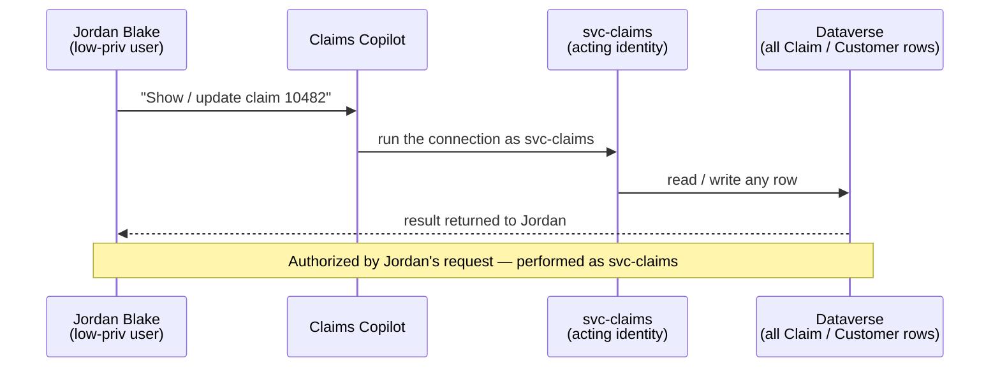

# Task 04-04 — Identity & the confused deputy

## Introduction

A **confused deputy** is a privileged component tricked into using its authority on behalf of a
less-privileged caller. Copilot Studio agents are natural confused deputies: they run their connections as
a **shared or owner identity**, so it is the *agent's* authority — not the chatting user's — that decides
what happens. The two questions that define this scenario are simple and unforgiving: **who authorized the
action, and whose identity actually performed it?**

## Description

You will take the low-privilege **Jordan Blake** persona (`jordan.blake@halcourtmutual.com`) — a user
personally entitled to almost nothing — and use it against two agents. **Claims Copilot** runs its Dataverse
connection as the `svc-claims` service account. **Expense Helper** (`cs-agent-expense-helper-default`) runs a
Power Automate flow, *Submit and auto-approve expense under $500*, as its owner **Sam Olsen**, who is a real
expense approver. In both cases the action executes with an authority Jordan does not hold.

You will **observe and record.** Prefer read-only confirmation; if you exercise a write or an approval, use
only a facilitator-designated test record. Answer the two questions explicitly for each agent.

## Success Criteria

- [ ] As Jordan Blake, you confirmed Claims Copilot performs a read (and, on a test claim, an update) that
      Jordan cannot perform directly.
- [ ] For Expense Helper, you identified that the auto-approve action executes with **Sam Olsen's** approver
      authority, not the requester's.
- [ ] You answered explicitly, for each agent: **who authorized the action** and **whose identity performed
      it**.
- [ ] You noted the audit/attribution consequence — the log shows the shared/owner identity, not Jordan.
- [ ] You wrote the **Scenario D** row plus the confused-deputy Q&A in your
      [Agent Threat Model]().

## Learning Resources

- [Connections and connectors](https://learn.microsoft.com/power-platform/admin/connections-connectors){:target="_blank"}
- [Dataverse security roles and privileges](https://learn.microsoft.com/power-platform/admin/security-roles-privileges){:target="_blank"}
- [Conditional Access for workload identities](https://learn.microsoft.com/entra/identity/conditional-access/workload-identity){:target="_blank"}
- [Microsoft Purview audit](https://learn.microsoft.com/purview/audit-solutions-overview){:target="_blank"}
- [Copilot Studio security and governance](https://learn.microsoft.com/microsoft-copilot-studio/security-and-governance){:target="_blank"}

## Key Tasks

### 01: Adopt the requesting-user lens (Jordan Blake)

Expand this section for detailed steps

1. Establish what Jordan Blake can do **directly**, without any agent. In
   [`users-export.csv`]() confirm Jordan is an enabled,
   ordinary employee. Jordan is not a claims adjuster and not an expense approver: personally, Jordan cannot
   read arbitrary claims or auto-approve expenses.
2. Write down the premise you are about to test: *if the agent does something Jordan cannot do alone, the
   authority came from somewhere else.* That "somewhere else" is the acting identity.

### 02: Observe it live — Claims Copilot as Jordan

Expand this section for detailed steps

1. Sign in (or have the facilitator provide the Jordan Blake session) and chat with **Claims Copilot**.
2. Ask it to look up a claim that Jordan has no direct rights to — e.g. *"What's the status of claim
   10482?"* Observe that it returns the record.
3. **Read-first.** Only if the facilitator has designated a safe test claim, ask the agent to update that
   claim's status, and observe that the write succeeds. Do not modify real claim data.
4. Record what happened: a low-privilege user read (and optionally changed) a claim through the agent that
   they could never touch directly.

> This is not an authentication bypass. Jordan authenticated as Jordan. The escalation is that the agent
> then acted as `svc-claims`. Capture that distinction in your notes — it is the entire scenario.
{: .important }

### 03: Reason about Expense Helper, then walk it through offline

Expand this section for detailed steps

1. Open [`connections-export.csv`]():
   - `PA-Expense-AutoApprove` → Power Automate, `auth_type` = **Runs as owner** (`sam.olsen`),
     `shared_with` = `All-Employees`, used by **Expense Helper**. Sam is a real approver, so the flow
     approves with Sam's authority — and it is shared with everyone.
   - `DV-Claims-Shared` → Dataverse, **Service account** (`svc-claims`), shared with `Claims-Adjusters`,
     used by **Claims Copilot**.
2. For each, answer the two questions in writing:
   - **Who authorized the action?** The requesting user (Jordan, or any employee) by asking.
   - **Whose identity performed it?** The connection identity — `svc-claims` for Claims Copilot, `sam.olsen`
     for Expense Helper — never the requester.
3. Note the consequence for Expense Helper specifically: any employee can auto-approve their own under-$500
   expense, because the *approval* runs as an approver even though the *requester* is not one.

### 04: Record the row and the attribution gap

Expand this section for detailed steps

1. Fill the **Scenario D** row in [03 — Agent Threat Model]():
   - **Attack:** confused deputy — the agent exercises an authority the requester lacks.
   - **Asset:** all claims / customer PII (Claims Copilot); expense approvals (Expense Helper).
   - **Trust boundary crossed:** requesting user's authority ≠ the acting (connection/owner) identity's
     authority.
   - **Impact:** a low-privilege user reads/modifies any claim; any employee auto-approves their own
     expenses.
   - **Existing control:** record what exists — and note the **attribution gap**: the activity log shows
     `svc-claims` or `sam.olsen` as the actor, so you cannot reconstruct *who really asked*.
2. Complete the worksheet's **D** prompt: *"Who authorized the action? Whose identity actually performed
   it?"* — one line per agent.
3. Save the **CLOSES IT / DENTS IT / MISSES IT** call for
   [Module 5](), where you test whether
   user-context (on-behalf-of) authorization is the real fix.

## Summary

You watched a user entitled to almost nothing read and change protected records, and you traced why: the
agent acted as `svc-claims`, and Expense Helper acts as an approver. The authorization came from Jordan's
request; the *identity* that performed the action was the agent's connection. That split is the confused
deputy, and it has a nasty second edge — the audit log names the deputy, not the requester, so even perfect
logging cannot answer "who really asked?" This is the other honest hard case of the day: the durable fix is
to authorize against the requesting user, which you will test in Module 5.
