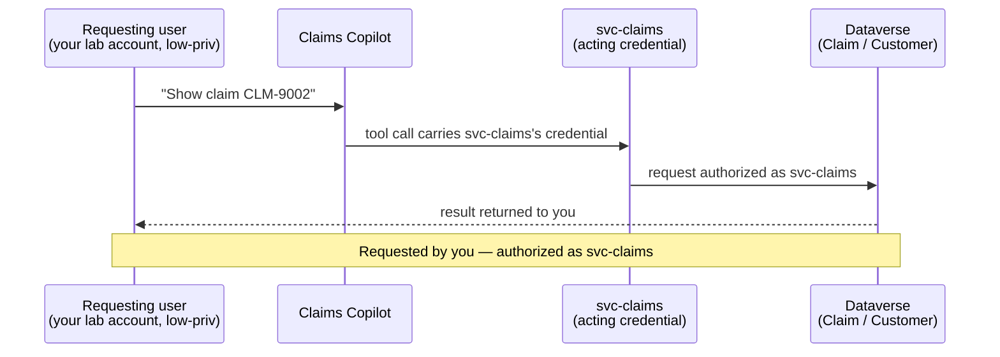

# Task 04-04 — Identity & the confused deputy

## Introduction

A **confused deputy** is a privileged component tricked into using its authority on behalf of a
less-privileged caller. When an agent's tool calls carry a shared or owner credential, it is that
credential's authority — not the chatting user's — that the downstream system checks. The questions that
define this scenario are simple and unforgiving: **who requested the action, which credential did the call
carry, did anything check the requester's entitlement, and whose identity was recorded?**

## Description

You will use your own lab account against two agents. **Claims Copilot** reads Dataverse through a
connection that uses the `svc-claims` service account. **Expense Helper** calls a Power Automate flow,
*Submit and auto-approve expense under $500*, owned by **Sam Olsen**, an expense approver. For each, you
will find out which credential the action carries, and whether that authority is something you hold
yourself.

You will **observe and record.** Prefer read-only confirmation; if you exercise a write or an approval, use
only a facilitator-designated test record. Answer the questions explicitly for each agent.

## Success Criteria

- [ ] Using the published agent and your own lab account, you checked whether Claims Copilot returns a claim
      (and, if it offers a status update and the facilitator has designated a test claim, performs an
      update) that your account cannot reach directly — or, working from the artifact pack, traced whether
      it could.
- [ ] For Expense Helper, you identified whose credential the auto-approve flow runs with.
- [ ] You answered, for each agent: who requested the action, which credential the call carried, which
      system authorized it, whether anything checked the requester's entitlement, and whose identity was
      recorded as the actor.
- [ ] You recorded which actor each log layer you could inspect shows, and classified how far the requester
      can be traced: complete, cross-log only, partial, or unavailable.
- [ ] You wrote the **Scenario D** row plus the confused-deputy Q&A in your
      [Agent Threat Model](), and compared it with the
      suggested row.

## Learning Resources

- [Use connectors in Copilot Studio agents](https://learn.microsoft.com/microsoft-copilot-studio/advanced-connectors){:target="_blank"}
- [Dataverse security roles and privileges](https://learn.microsoft.com/power-platform/admin/security-roles-privileges){:target="_blank"}
- [Conditional Access for agents](https://learn.microsoft.com/entra/identity/conditional-access/agent-id){:target="_blank"}
- [Manage Power Automate flows](https://learn.microsoft.com/power-platform/admin/manage-power-automate){:target="_blank"}
- [Microsoft Purview audit](https://learn.microsoft.com/purview/audit-solutions-overview){:target="_blank"}
- [Copilot Studio security and governance](https://learn.microsoft.com/microsoft-copilot-studio/security-and-governance){:target="_blank"}

## Key Tasks

### 01: Adopt the requesting-user lens

Expand this section for detailed steps

1. Establish what you can do **directly**, without any agent. Copy "Requester's direct entitlement" from
   your Claims Copilot Access Map. If it's `Unknown`, check it now: in the
   [Power Platform admin center](https://admin.powerplatform.microsoft.com){:target="_blank"}, go to
   **Manage** → **Environments** → `Claims-Test` → **Settings** → **Users + permissions** → **Users**,
   search for your estate id, and select your own account. Its **Summary** lists its **Direct Assigned
   Roles**. Note whether any of them grants you access to claim or customer records. Lab
   accounts are not expense approvers. Without the tenant, take **Jordan Blake** as the requesting user:
   the scenario's premise is that Jordan is an ordinary employee who is neither a claims adjuster nor an
   expense approver. Jordan's row in your
   [`users-export.csv`]() confirms the account is
   enabled; it doesn't show Jordan's Dataverse access.
2. Write down the premise you are about to test: *if the agent does something the requester cannot do alone,
   the authority came from somewhere else.* That "somewhere else" is the acting credential.

> Key Tasks 02 and 03 are two routes to the same result. If you can reach the tenant, do **02** and skip
> 03. If you can't, skip 02 and do **03**. Both continue at Key Task 04.
{: .note }

### 02: Observe it live (tenant route)

Expand this section for detailed steps

1. Open **Claims Copilot**'s Teams link, signed in with your own lab account. The link opens
   its details in Teams: select **Add** or **Open**, whichever appears. Then, in the **Let's go** dialog,
   select **Open**, not **Open with Copilot**. If the agent's first reply says it is still signing you in,
   send your message again after a few seconds.
2. Ask it to look up a claim that you have no direct rights to — e.g. *"What's the status of claim
   CLM-9002?"* Record whether it returns the record.
3. **Read-first.** A write needs two things: a status-update tool on the agent, and a safe test claim the
   facilitator has designated. If Claims Copilot offers no way to update a status, record that the write
   half of this scenario is reasoned from the connection's reach, not observed. If it does, ask it to
   update the test claim's status and observe whether the write succeeds. Do not modify real claim data.
4. Record what happened: whether a low-privilege user read (and optionally changed) a claim through the
   agent that they could not touch directly.
5. Open **Expense Helper** from its Teams link, the same way, and say you want to submit an expense. When it asks **"What's the expense amount?"**, reply with **only** an
   amount under $500 — e.g. `120`. Record what it replies, and whether you hold any approval rights
   yourself.
6. Trace Expense Helper's approval. Its line in your inventory's **Calls** column names the flow and its
   owner (Sam Olsen, `Runs as owner`), which you found in Task 01-01 from the topic's `flowId` and the
   Dataverse `workflows` call. The flow makes no connector calls of its own: the approval is decided inside
   the flow, with Sam's authority.
7. Check what the logs record. Look at whichever layers you can reach — the agent's conversation
   transcripts in Copilot Studio, the flow's run history, Dataverse auditing, Purview audit — and note which
   actor each one shows, and whether you could trace the action back to the requester end to end. Dataverse
   auditing records changes, not reads, so a read leaves no Dataverse audit entry. Classify
   what you found as one of the four outcomes Task 05-07 uses: **complete**, **cross-log only**,
   **partial**, or **unavailable**. Exercise 05 tests attribution properly; here you note what you could see.

> This is not an authentication bypass. You authenticated as yourself. If the agent returned the record,
> the escalation is that the tool call carried `svc-claims`'s credential, and Dataverse authorized that
> principal. Capture that distinction in your notes — it is the entire scenario.
{: .important }

### 03: Walk it through from the artifact pack (offline route)

Expand this section for detailed steps

1. Open [`connections-export.csv`]():
   - `PA-Expense-AutoApprove` → Power Automate, `auth_type` = **Runs as owner** (`sam.olsen`), used by
     **Expense Helper**. The flow runs with its owner's connections. Its `shared_with` (`All-Employees`)
     is the flow's sharing; who can chat with Expense Helper is a separate fact.
   - `DV-Claims-Shared` → Dataverse, **Service account** (`svc-claims`), shared with `Claims-Adjusters`,
     used by **Claims Copilot**. Again, `shared_with` describes the connection, not who can chat with the
     agent.
2. The pack doesn't record what each log layer shows, so mark attribution as `Unknown`.

### 04: Answer the questions and record the row

Expand this section for detailed steps

1. For each agent, answer in writing: who requested the action; which credential the call carried; which
   system authorized it; whether anything checked the requester's entitlement; and whose identity was
   recorded as the actor.
2. Fill the **Scenario D** row in [03 — Agent Threat Model]()
   from what you observed: Attack, Asset, Trust boundary crossed, Impact, Existing control. Then compare it
   with the suggested answers below.
3. Complete the worksheet's **D** prompt — one line per agent.
4. Carry this evidence into [Exercise 05]() and
   test which controls prevent, reduce, detect, or leave it unchanged.

Reveal the suggested answers and Scenario D row

- **Who requested it?** The requesting user (you, or any employee) by asking.
- **Which credential, authorized by whom?** `svc-claims`'s, authorized by Dataverse (Claims Copilot); the
  flow owner `sam.olsen`'s authority (Expense Helper).
- **Was the requester's entitlement checked?** No — nothing checks the person chatting.
- **Recorded actor:** where a downstream layer records the action, expect `svc-claims` or `sam.olsen`. A
  Claims Copilot read leaves no Dataverse audit entry, so only the agent layer records it. Whether the
  requester can be traced end to end depends on what the agent and flow layers keep — record which of the
  four outcomes you found.
- **Expense Helper consequence:** any employee can auto-approve their own under-$500 expense, because the
  *approval* runs as an approver even though the *requester* is not one.

The suggested row:

- **Attack:** confused deputy — the agent exercises an authority the requester lacks.
- **Asset:** all claims / customer PII (Claims Copilot); expense approvals (Expense Helper).
- **Trust boundary crossed:** the requesting user's authority ≠ the acting credential's authority.
- **Impact:** a low-privilege user reads any claim (and could change one, where a write tool exists); any
  employee auto-approves their own expenses.
- **Existing control:** record what exists — including what each log layer records, and whether it lets you
  reconstruct who really asked.
- **Likely fixes to test in Exercise 05:** user-context (on-behalf-of) authorization — the tool acting with
  the requester's own credential.

## Summary

You checked whether a user entitled to almost nothing could reach protected records through an agent, and
traced which credential each action carried. When that credential holds authority the requester lacks, and
nothing checks the requester, the split is the confused deputy — and the logs may name the deputy rather
than the requester, which you checked rather than assumed. Carry this evidence into Exercise 05 and test which
controls prevent, reduce, detect, or leave it unchanged.
