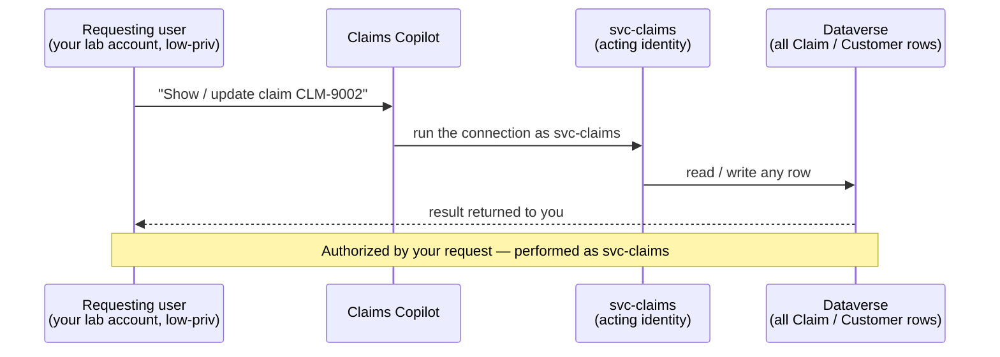

# Task 04-04 — Identity & the confused deputy

## Introduction

A **confused deputy** is a privileged component tricked into using its authority on behalf of a
less-privileged caller. Copilot Studio agents are natural confused deputies: they run their connections as
a **shared or owner identity**, so it is the *agent's* authority — not the chatting user's — that decides
what happens. The two questions that define this scenario are simple and unforgiving: **who authorized the
action, and whose identity actually performed it?**

## Description

You will use your own lab account — which can inspect the estate's configuration but holds no rights to its
claim or customer records — against two agents. **Claims Copilot** runs its Dataverse connection as the
`svc-claims` service account. **Expense Helper** runs a Power Automate flow, *Submit and auto-approve expense
under $500*, as its owner **Sam Olsen**, who is a real expense approver. In both cases the action executes
with an authority you do not hold.

You will **observe and record.** Prefer read-only confirmation; if you exercise a write or an approval, use
only a facilitator-designated test record. Answer the two questions explicitly for each agent.

## Success Criteria

- [ ] Using your lab account, you confirmed Claims Copilot performs a read (and, if the agent offers a
      status update and the facilitator has designated a test claim, an update) that your account cannot
      perform directly — or, working from the artifact pack, traced why it can.
- [ ] For Expense Helper, you identified that the auto-approve action executes with **Sam Olsen's** approver
      authority, not the requester's.
- [ ] You answered explicitly, for each agent: **who authorized the action** and **whose identity performed
      it**.
- [ ] You noted the audit/attribution consequence — the log shows the shared/owner identity, not the requester.
- [ ] You wrote the **Scenario D** row plus the confused-deputy Q&A in your
      [Agent Threat Model]().

## Learning Resources

- [Use connectors in Copilot Studio agents](https://learn.microsoft.com/microsoft-copilot-studio/advanced-connectors){:target="_blank"}
- [Dataverse security roles and privileges](https://learn.microsoft.com/power-platform/admin/security-roles-privileges){:target="_blank"}
- [Conditional Access for workload identities](https://learn.microsoft.com/entra/identity/conditional-access/workload-identity){:target="_blank"}
- [Manage Power Automate flows](https://learn.microsoft.com/power-platform/admin/manage-power-automate){:target="_blank"}
- [Microsoft Purview audit](https://learn.microsoft.com/purview/audit-solutions-overview){:target="_blank"}
- [Copilot Studio security and governance](https://learn.microsoft.com/microsoft-copilot-studio/security-and-governance){:target="_blank"}

## Key Tasks

### 01: Adopt the requesting-user lens

Expand this section for detailed steps

1. Establish what you can do **directly**, without any agent. Your lab account can inspect the estate's
   configuration, but it holds no rights to claim or customer records in Dataverse and it is not an expense
   approver: personally, you cannot read arbitrary claims or auto-approve expenses. Without the tenant, take
   **Jordan Blake** as the requesting user: read Jordan's row in your
   [`users-export.csv`]() — an enabled, ordinary employee
   who is neither a claims adjuster nor an expense approver.
2. Write down the premise you are about to test: *if the agent does something the requester cannot do alone,
   the authority came from somewhere else.* That "somewhere else" is the acting identity.

> Key Tasks 02 and 03 are two routes to the same result. If you can reach the tenant, do **02** and skip
> 03. If you can't, skip 02 and do **03**. Both continue at Key Task 04.
{: .note }

### 02: Observe it live (tenant route)

Expand this section for detailed steps

1. Signed in with your lab account, open Copilot Studio, switch to the `Claims-Test` environment, open
   **Claims Copilot**, and open its **Test** pane.
2. Ask it to look up a claim that you have no direct rights to — e.g. *"What's the status of claim
   CLM-9002?"* Observe that it returns the record.
3. **Read-first.** A write needs two things: a status-update tool on the agent, and a safe test claim the
   facilitator has designated. If Claims Copilot offers no way to update a status, record that the write
   half of this scenario is reasoned from the connection's reach, not observed. If it does, ask it to
   update the test claim's status and observe whether the write succeeds. Do not modify real claim data.
4. Record what happened: a low-privilege user read (and optionally changed) a claim through the agent that
   they could never touch directly.
5. Trace Expense Helper's approval in the tenant. In Copilot Studio, switch to the `Halcourt (default)`
   environment, open **Expense Helper**, and find the flow call on its **Topics** page — flow calls live in
   topics, and the **Tools** page doesn't show them. Then, in the Power Platform admin center, go to
   **Manage → Environments**, select `Halcourt (default)`, and under **Resources** select **Flows**. Select
   *Submit and auto-approve expense under $500*, then **Details**: note the flow's owners and the
   connections it runs on.

> This is not an authentication bypass. You authenticated as yourself. The escalation is that the agent
> then acted as `svc-claims`. Capture that distinction in your notes — it is the entire scenario.
{: .important }

### 03: Walk it through from the artifact pack (offline route)

Expand this section for detailed steps

1. Open [`connections-export.csv`]():
   - `PA-Expense-AutoApprove` → Power Automate, `auth_type` = **Runs as owner** (`sam.olsen`),
     `shared_with` = `All-Employees`, used by **Expense Helper**. Sam is a real approver, so the flow
     approves with Sam's authority — and it is shared with everyone.
   - `DV-Claims-Shared` → Dataverse, **Service account** (`svc-claims`), shared with `Claims-Adjusters`,
     used by **Claims Copilot**.

### 04: Answer the two questions and record the row

Expand this section for detailed steps

1. For each agent, answer the two questions in writing:
   - **Who authorized the action?** The requesting user (you, or any employee) by asking.
   - **Whose identity performed it?** The connection identity — `svc-claims` for Claims Copilot, `sam.olsen`
     for Expense Helper — never the requester.
2. Note the consequence for Expense Helper specifically: any employee can auto-approve their own under-$500
   expense, because the *approval* runs as an approver even though the *requester* is not one.
3. Fill the **Scenario D** row in [03 — Agent Threat Model]():
   - **Attack:** confused deputy — the agent exercises an authority the requester lacks.
   - **Asset:** all claims / customer PII (Claims Copilot); expense approvals (Expense Helper).
   - **Trust boundary crossed:** requesting user's authority ≠ the acting (connection/owner) identity's
     authority.
   - **Impact:** a low-privilege user reads/modifies any claim; any employee auto-approves their own
     expenses.
   - **Existing control:** record what exists — and note the **attribution gap**: the activity log shows
     `svc-claims` or `sam.olsen` as the actor, so you cannot reconstruct *who really asked*.
4. Complete the worksheet's **D** prompt: *"Who authorized the action? Whose identity actually performed
   it?"* — one line per agent.
5. Save the **CLOSES IT / DENTS IT / MISSES IT** call for
   [Module 5](), where you test whether
   user-context (on-behalf-of) authorization is the real fix.

## Summary

You saw how a user entitled to almost nothing can read and change protected records through an agent, and
you traced why: the agent acted as `svc-claims`, and Expense Helper acts as an approver. The authorization
came from the request; the *identity* that performed the action was the agent's connection. That split
is the confused deputy, and it has a nasty second edge — the audit log names the deputy, not the requester,
so even perfect logging cannot answer "who really asked?" This is the other honest hard case of the day: the
durable fix is to authorize against the requesting user, which you will test in Module 5.
