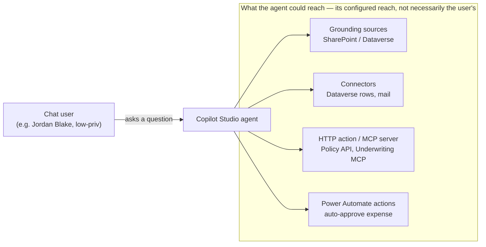

# Exercise 04: Break the Agents

## Scenario

You have inventoried the estate (Module 2) and mapped effective access (Module 3). You already know, on
paper, that some of these agents can reach more than the people who talk to them. This module makes that
concrete. Instead of a slide deck about "prompt injection" and "the confused deputy," you drive six
Halcourt Mutual agents into six distinct failure modes and watch each one happen.

Every scenario returns to the same two questions: **whose authority is this agent exercising, and what
can it reach when it does?** You are not here to build attack tools. You are here to observe controlled
failures on a training estate and write down what you saw, so that in Module 5 you can test whether any
Microsoft control actually removes each one.

> **This is a deliberately-broken TRAINING estate.** Every agent, connection, key, and grounded document
> in this estate was provisioned by the facilitator to fail in a specific, contained
> way against safe, facilitator-controlled Azure Container Apps training endpoints and `example` hosts. The techniques you observe here —
> indirect prompt injection, data exfiltration, confused-deputy escalation, credential exposure — are
> real and are damaging against systems you do not own. **Never apply them to any tenant, agent, API, or
> data you are not explicitly authorized to test.** Observe and record; do not weaponize.
{: .warning }

### How this module works

Each scenario is one task page. For each, you will:

1. **Orient** on the trust boundary the scenario stresses.
2. **Observe** the failure — either in the live tenant, or by reasoning it out from the exported artifact
   pack. Both paths are always provided.
3. **Record** exactly one row in your **Agent Threat Model**: *Attack → Asset → Trust boundary → Impact →
   Existing control.* Then compare it with the suggested row in that task's reveal.

You record what actually happened, not what you expected. You do **not** decide yet whether a control
"closes" or "misses" the failure — that verdict is Module 5's job. Here you are only building the row.

Everything inside that box is the agent's configured reach. Whether a given user can actually get it
depends on who can invoke the agent, the credential each call carries, what the downstream system
authorizes, and what you observe. That gap is the whole subject of this module.

### The six scenarios

| Scenario | Focus | Agent(s) you will drive |
|---|---|---|
| [A]() | Grounding & indirect prompt injection | Benefits Buddy |
| [B]() | Data exfiltration (agent reach > user reach) | Benefits Buddy; Claims Copilot |
| [C]() | Excessive connector & tool permissions | Claims Copilot; Underwriting Assistant |
| [D]() | Identity & the confused deputy | Claims Copilot; Expense Helper |
| [E]() | The HTTP / MCP / tool boundary | Policy Lookup Bot; Underwriting Assistant |
| [F]() | Lifecycle (orphan / test-became-prod) | Onboarding Guide; Claims Copilot |

> The live tenant is the preferred path: you drive the agents and read their configuration yourself.
> Every scenario is also completable **offline** from the five filled-in CSVs in the artifact pack plus
> the provided screenshots, so you are never blocked when the tenant is slow or the demo queue is long.
{: .note }

## Objectives

After this exercise you will be able to:

- **Observe and record six agent failure modes** on a real (training) estate, rather than describing them
  abstractly.
- **Recognize indirect prompt injection** — how trusted-looking grounding content becomes instructions the
  agent follows.
- **Show data exfiltration** as an access problem: the agent relays data it can read but the user cannot.
- **Quantify excessive connector and tool permissions** as a blast-radius multiplier (need X, granted X+Y+Z).
- **Name the confused deputy precisely** — answer, for a given action, *who requested it*, *which
  credential the call carried*, and *whether anything checked the requester's entitlement*.
- **Interrogate an HTTP / MCP / tool boundary** with four questions: what authentication, what
  authorization, what inputs cross, what comes back — including credentials exposed in configuration.
- **Trace a lifecycle failure** — an orphaned owner or a test-became-production agent whose permissions and
  connections outlived the assumptions that created them.
- **Populate the Agent Threat Model** with one defensible row per scenario, ready to test in Module 5.

## Duration

**Estimated time:** 60 minutes.

This is the centerpiece of the day and the most likely module to over-run. Roughly 15 minutes per
scenario. If the room is tight, run A and D hands-on and take B, C, E, and F as guided walk-throughs in the
live tenant, or from the artifact pack if you can't reach it — the recorded rows are what matter.

## Deliverable

The **Agent Threat Model** — one row per scenario, capturing *Attack → Asset → Trust boundary → Impact →
Existing control*, plus the two "hard questions" for Scenarios D and E.

Use the template: [03 — Agent Threat Model]().

You will carry every row of this table into [Module 5](),
where you test whether each control **CLOSES IT / DENTS IT / MISSES IT**.
