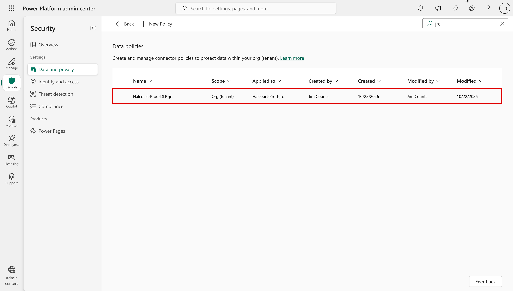
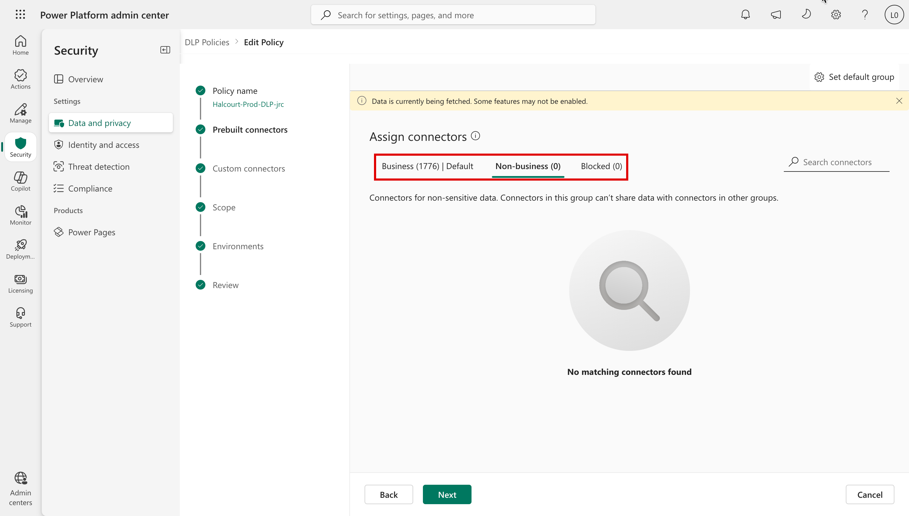
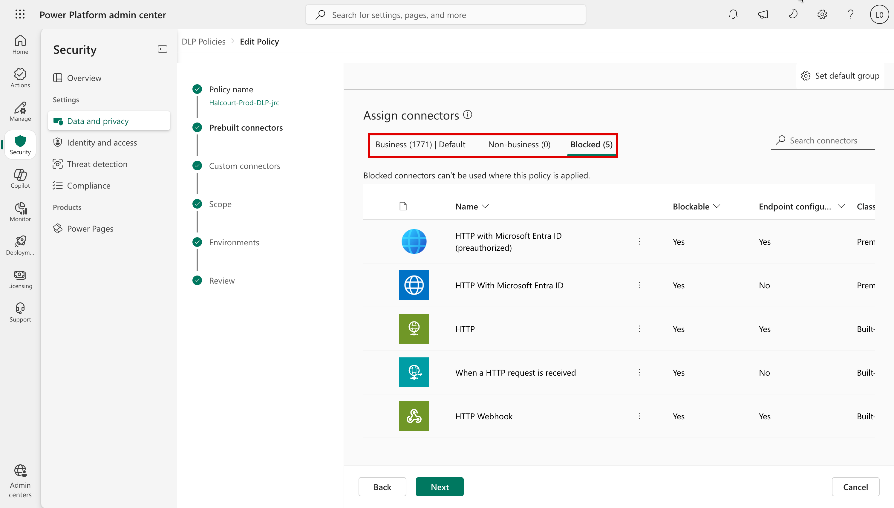
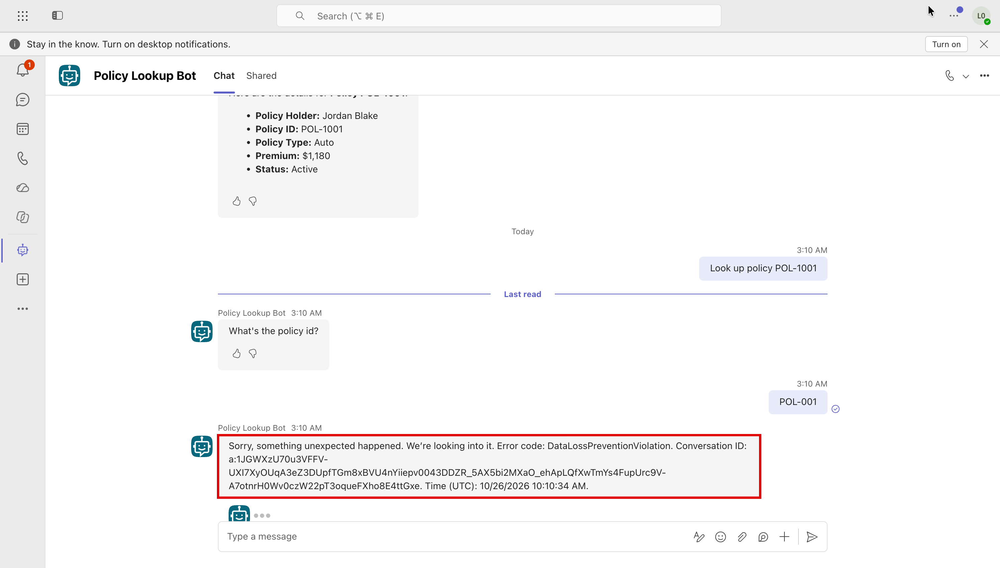

# Task 05-01 — DLP policies

## Introduction

Data Loss Prevention (DLP) in Power Platform is a **connector-governance** control. It sorts every
connector into Business, Non-Business, or Blocked, refuses to let data flow between the Business and
Non-Business groups in the same agent or flow, and can block named connectors outright — including the
generic **HTTP action** and **custom connectors**. It is the first thing most platform teams reach for,
and it is genuinely useful. It is also frequently asked to do jobs it structurally cannot do, so this is
the right place to learn where its boundary sits.

## Description

The estate starts with a single, permissive data policy: `Halcourt-Prod-DLP` covers `Halcourt-Prod`, keeps
its sensitive connectors together as Business, and blocks nothing — which is why every Exercise 04 scenario
worked. The other three environments have no policy. In this task your facilitator adds the blocks, and
you see what they change.

Then you return to two Exercise 04 failures and retest: **Scenario C** (excessive connector / tool
permissions — Claims Copilot's Dataverse reach and Underwriting's `run_query`) and **Scenario E** (the
Policy Lookup Bot's hard-coded HTTP action and the Underwriting MCP server). You record two verdicts and,
for each, the risk that DLP leaves behind.

## Success Criteria

- [ ] You can state, per environment, whether a DLP policy applies and what it classifies.
- [ ] You recorded exactly what the facilitator's DLP policy blocks, and where (or, offline, specified such a
  policy precisely): the HTTP action and custom/MCP connectors in a target environment.
- [ ] You re-ran Scenario C and Scenario E against the configured policy and observed the result.
- [ ] You recorded a **CLOSES IT / DENTS IT / MISSES IT** verdict for DLP against both C and E in the
  [Control Efficacy Matrix](), each with a
  remaining-risk note.
- [ ] You can articulate the one thing DLP cannot see: the semantic content of grounding text.

## Learning Resources

- [Data Loss Prevention (Power Platform)](https://learn.microsoft.com/power-platform/admin/wp-data-loss-prevention){:target="_blank"}
- [Manage data policies](https://learn.microsoft.com/power-platform/admin/prevent-data-loss){:target="_blank"}
- [Connector classification: connectors you can't block](https://learn.microsoft.com/power-platform/admin/dlp-connector-classification){:target="_blank"}
- [Use connectors in Copilot Studio agents](https://learn.microsoft.com/microsoft-copilot-studio/advanced-connectors){:target="_blank"}
- [Copilot Studio security and governance](https://learn.microsoft.com/microsoft-copilot-studio/security-and-governance){:target="_blank"}

## Key Tasks

### 01: Read the current DLP posture

Before you change anything, know what is already there.

Expand this section for detailed steps

1. In the **Power Platform admin center** (PPAC), open **Security → Data and privacy → Data policy**.
2. Search the list for your estate id: the list covers the whole tenant. Read the **Applied to** column:
   confirm `Halcourt-Prod-DLP` applies to `Halcourt-Prod`, and that no other environment of yours has a
   policy.

   

3. Open the policy (**Edit Policy**) and wait for the connector counts to load: they show 0 until they do.
   Note the counts on **Business**, **Non-business** and **Blocked**, and which group is marked **Default**
   (where a new connector lands). Then select **Cancel**: you're reading, not editing.

   

Without the tenant: read the `dlp_policy` column in your `environments-export.csv`.

### 02: The facilitator adds the blocks

Your facilitator tightens the environment that carries the risky connectors, once, for the whole room, and
restores it after Task 05-02's retests. Follow along: these are the steps you would take on your own tenant.

Expand this section for detailed steps

The facilitator:

1. Opens `Halcourt-Prod-DLP` (**Edit Policy**).
2. On **Prebuilt connectors**, searches the list for `http` and moves all five matches to **Blocked**:
   HTTP, HTTP with Microsoft Entra ID, HTTP with Microsoft Entra ID (preauthorized), When a HTTP request is
   received, and HTTP Webhook. Copilot Studio's HTTP request node uses **HTTP**; the others are blocked so
   the same call can't be rebuilt on a sibling connector.
3. On **Custom connectors**, sets the `*` pattern to **Blocked**.
4. Selects **Next** through the remaining pages and saves the policy on **Review**.

You:

1. Record that `Claims-Test` has no data policy, so this change doesn't touch Claims Copilot. That an
   environment holding a production-use candidate is ungoverned is itself the finding; Task 05-02 takes it
   up.
2. Record exactly what the facilitator blocked, and where.

Without the tenant: write down the policy you would apply, connector by connector.

{: .note }
> **What the HTTP block is expected to do.** Blocking HTTP and custom connectors is the lever meant to
> govern the Policy Lookup Bot's HTTP call and the Underwriting Assistant's MCP calls. The HTTP call is a
> node inside a topic; the MCP server is a tool that runs on a **custom connector**. Microsoft documents
> that blocking the HTTP connector stops agents that contain HTTP request nodes, that **endpoint filtering**
> on the HTTP connector is the finer lever (allow or deny specific endpoints), and that an MCP server
> reached through a Power Platform connector is blocked along with that connector. Documented isn't
> observed: your retest is what tells you whether each half holds in this tenant.

{: .warning }
> **Expect side effects.** In this lab's tenant, a data policy that split Business from Non-Business in
> `Halcourt-Prod` stopped agents with a connector tool from publishing: *"There is a conflict between
> business and non-business connectors."* Copilot Studio agents pull in platform connectors of their own,
> and at least one of them landed in the Non-Business group — which one, the platform doesn't say.
> Knowledge-only agents were not affected. If your policy breaks the legitimate agents, record that too: a
> control that blocks the business is a control someone will switch off.

> For each scenario below, do the tenant key task if you can reach the tenant, or the offline key task if
> you can't. Both lead to Key Task 07.
{: .note }

### 03: Retest Scenario E (tenant route)

Configuring is not testing. Start with the scenario DLP is built for and run the *same* steps you ran in
Exercise 04.

Expand this section for detailed steps

Your facilitator runs this on screen, in the estate where the control is applied. Record what it shows.
Your own estate doesn't have the change.

1. Open Policy Lookup Bot from its Teams link, say you want to look up a policy, and reply `POL-1001` when
   it asks for the id.
2. Note what comes back. A blocked call fails with an error that names `DataLossPreventionViolation`.

{: .note }
> Underwriting Assistant isn't retested here. Record the MCP half of E as not tested: in the reference
> build, blocking custom connectors by the default `*` pattern did not stop its MCP tool, but that's not
> something you observed.

{: .note }
> DLP governs connectors, not the credential design behind a call: the static API key and bearer token are
> untouched either way.

### 04: Reason about Scenario E (offline route)

Expand this section for detailed steps

1. In `connections-export.csv`, find `HTTP-PolicyAPI` (auth `API key in action config`) and
   `MCP-Underwriting` (auth `Static bearer token`). These are the integrations a Prod DLP that blocks HTTP
   and custom connectors is aimed at. `HTTP-PolicyAPI` isn't a Power Platform connection — the pack lists
   it so every credential is in one file; `MCP-Underwriting` is a connection to a custom connector.
2. Record the documented expectation — an HTTP block stops the HTTP request node from publishing, and an
   MCP server reached through a blocked connector is blocked with it — as unconfirmed in this tenant.

### 05: Retest Scenario C (tenant route)

Expand this section for detailed steps

Your facilitator runs this on screen, in the estate where the control is applied. Record what it shows.
Your own estate doesn't have the change.

1. Open Claims Copilot from its Teams link and ask again: *"What's the status of claim CLM-9002?"*
2. Note whether it still returns the record.

{: .note }
> DLP decides *whether* the Dataverse connector is allowed, not what `svc-claims` can read once it is.

### 06: Reason about Scenario C (offline route)

Expand this section for detailed steps

1. In `connections-export.csv`, find `DV-Claims-Shared` (auth `Service account`). It is a first-party
   connector.
2. Reason about whether DLP changes the *permissions* svc-claims holds inside it.
3. Record the result as a reasoned conclusion.

### 07: Record the verdicts

Expand this section for detailed steps

1. In your [Control Efficacy Matrix](), fill
   the **DLP** column's **C** and **E** cells.
2. For each, copy a **Retest log** block below the matrix: Before, After, Verdict, and Remaining risk — the
   thing still true after DLP is on.

{: .caution }
> Everything here runs against a training estate — the records, the people and the keys are made up. You're
> still practicing the habit you'll need on a real estate: confirm the path exists, record it, and move on.

{: .important }
> **The boundary to name.** DLP sees *connectors and the data flows between them*. It cannot see the
> **semantic content** of text the agent is allowed to ground on. An injection instruction hidden in an
> approved SharePoint document (Scenario A) and an exfiltration coaxed out through an allowed grounding
> source (Scenario B) both travel entirely inside connectors DLP has already permitted. Keep that in mind
> when you are tempted to reach for DLP against those two scenarios in later tasks.

Reveal the suggested verdicts and reasoning

- **DLP × E:** suggested **DENTS IT** — and possibly for only half of it. Blocking the HTTP connector (or
  filtering its endpoints) stopped the Policy Lookup Bot's call at run time
  (`DataLossPreventionViolation`). Blocking custom connectors by the default pattern did **not** stop the
  Underwriting Assistant's MCP tool in the reference build, and you didn't retest it here: the MCP half
  wasn't retested. The
  static API key and static bearer token still exist and still work wherever the
  integration is allowed; DLP does nothing to the credential design.
- **DLP × C:** suggested **MISSES IT**. Claims Copilot still returns CLM-9002. DLP controls *which* connectors are usable, not the over-grant
  within Dataverse: it decides whether the Dataverse connector is allowed, not what `svc-claims` can read
  once it is. Blocking the whole integration removes `run_query` only by removing the business function.
  - **Contrast: Team Wiki**, a shadow agent, not a Scenario C agent. Its Microsoft 365 search runs on Dev
    Kim's *HTTP with Microsoft Entra ID* connection, which a data policy *can* block, unlike Dataverse,
    which no data policy can. Blocking it in `Maker-Sandbox` removes Dev's Graph reach, again by removing
    the tool. Team Wiki keeps its SharePoint knowledge on `HR-Benefits` and `Claims-Knowledge`, and
    SharePoint can't be blocked either: **DENTS IT** for Team Wiki.
- **Remaining risk to note:** grounding content (Scenarios A and B) travels inside connectors DLP already
  permits.

## Summary

DLP is a connector firewall. It answers "should this agent be able to use the HTTP action or a custom
connector at all?" and does not answer "what can an already-allowed connector reach, and what does the text
flowing through it say?" You saw it configured against the estate, retested Scenarios C and E, and located
the two failures (A and B) that live in a layer DLP cannot inspect. Record the verdict and remaining risk in
the matrix.
