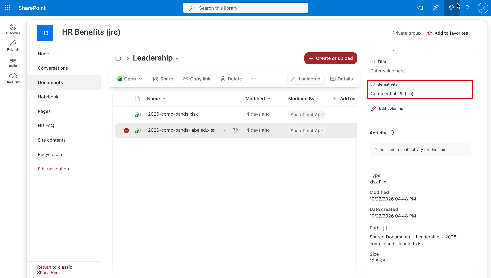
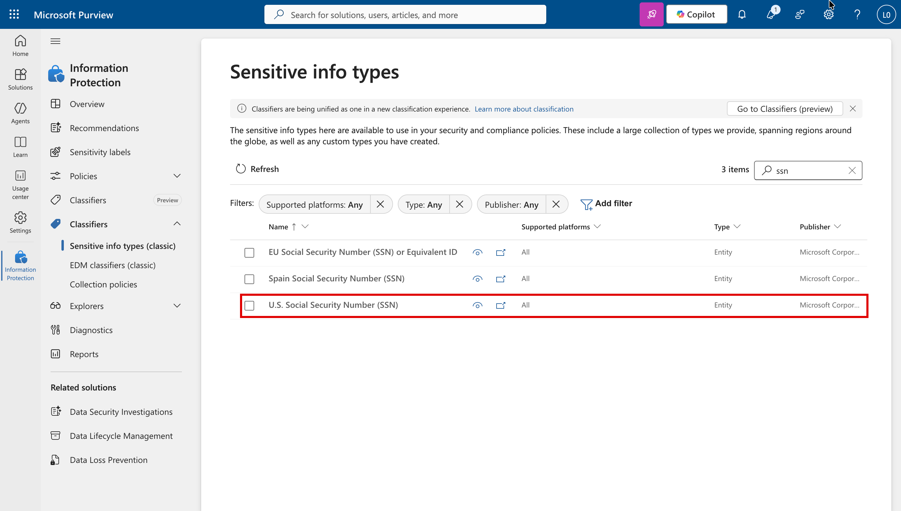

# Task 05-06 — Purview

## Introduction

Purview is a **data-classification** control. Sensitivity labels, auto-labeling, sensitive-information
types (like SSN) and data loss prevention act on the *data object itself* — the file, the record — not on
the connector or the identity. Keep three things apart:

- A label that **classifies** marks the file and is displayed. It doesn't stop Copilot Studio grounding on
  the file.
- A label that **encrypts** protects the file's content. Copilot Studio can't ground on a file with an
  encrypting label, even for users who can open it.
- A Purview **DLP policy** keyed on a label is a separate control. It acts on the locations and actions the
  policy names.

So what this control does to Scenario B depends on what the label enforces. This task tests how far that
holds, and names the two places classification does not reach.

## Description

You will inspect the `Confidential-PII` label, see which copy of the leadership compensation file carries
it (`Leadership/2026-comp-bands-labeled.xlsx`, next to the unlabeled original), and confirm the SSN
sensitive-information type exists. Nothing is configured in this task: the label and the labeled copy were
already in place in Exercise 04. So you reason through **Scenario B** (Benefits Buddy surfacing the comp
file) and **Scenarios C and D** (Customer PII through Claims Copilot's Dataverse connection), and record
where labeling withholds the data and where connector-level access makes it moot. You also note the one
thing a label can never stop: an *instruction* hidden in grounding content, which is text, not classified
data.

## Success Criteria

- [ ] You inspected `Confidential-PII` and recorded what it enforces: whether it encrypts, who may view and
  extract, and whether a DLP policy is keyed on it.
- [ ] You recorded which copy of the comp file carries the label.
- [ ] You confirmed the SSN classifier exists and that nothing applies it to Dataverse.
- [ ] You reasoned through Scenarios B, C and D.
- [ ] You recorded the three verdicts in the
  [Control Efficacy Matrix](), each with a
  **Retest log** block.

## Learning Resources

- [Sensitivity labels (Purview)](https://learn.microsoft.com/purview/sensitivity-labels){:target="_blank"}
- [Learn about data loss prevention (Purview)](https://learn.microsoft.com/purview/dlp-learn-about-dlp){:target="_blank"}
- [Copilot Studio security and governance](https://learn.microsoft.com/microsoft-copilot-studio/security-and-governance){:target="_blank"}

## Key Tasks

### 01: Inspect the label

Expand this section for detailed steps

1. In the **Microsoft Purview** portal, open **Solutions** → **Information Protection** → **Sensitivity
   labels**. The list holds one label per estate and can't be filtered: scroll to **Confidential-PII (your
   estate id)** and select it.
2. From the label's panel, read **Description for users**, **Scope**, **Access control** and **Content
   marking**, and note:
   a. whether it applies encryption: the panel lists **Access control**, and the description says what it
      enforces;
   b. who may view and extract, from the description. The rights list itself sits behind **Edit label**,
      which is greyed out for a lab account;
   c. whether any Purview DLP policy is keyed on it: **Data Loss Prevention → Policies**.

   

3. You can't open `Leadership/` yourself (that is Scenario B's boundary), so the facilitator does this step
   as the site owner. The facilitator opens `HR-Benefits` → **Documents** → `Leadership`, ticks
   `2026-comp-bands-labeled.xlsx` → **Details**: **Sensitivity** reads **Confidential-PII**. Then does the
   same for `2026-comp-bands.xlsx`: no sensitivity label.

   

4. Record which copy carries the label.

{: .note }
> Copilot Studio can't ground on a file protected by an encrypting label, even for users who can open it. A
> label that only classifies doesn't stop grounding. VIEW and EXTRACT tell you who can open the file
> themselves; they don't open it to the agent.

### 02: Confirm the SSN classifier

Expand this section for detailed steps

1. In **Information Protection**, expand **Classifiers** → **Sensitive info types (classic)** and search for
   `ssn`. **U.S. Social Security Number (SSN)** is a built-in type, published by Microsoft.

   

2. Open it and read what it matches. The `Customer` table's SSN column holds values in that format, but
   nothing in this estate scans Dataverse with this type, so it classifies nothing there. Record that the
   classifier exists and that nothing applies it to Dataverse.

{: .note }
> Classifying SSNs isn't the same as blocking a Dataverse read the acting credential is already authorized
> to make.

### 03: Reason through Scenarios B, C and D

Nothing in this task changes the estate: the label and the labeled copy were already there in Exercise 04,
and a new label takes longer to apply than a session lasts. So reason, don't retest.

Expand this section for detailed steps

1. **B:** Copilot Studio can't ground on a file with an encrypting label. Which copy can the agent still
   draw on, and what would labeling the original do — and when?
2. **C and D:** Does a classifier change what `svc-claims` is authorized to read, or whose authority the
   read uses?

{: .note }
> Scenario A isn't reasoned here: an injected instruction is text, not classified data, so no label
> describes it. Put that in your remaining-risk notes.

### 04: Record the verdicts

Expand this section for detailed steps

1. In your [Control Efficacy Matrix](), fill
   the **Purview** column's **B**, **C** and **D** cells.
2. For each, copy a **Retest log** block below the matrix: Before, After, Verdict, and Remaining risk. Label
   all three verdicts reasoned.

{: .caution }
> Everything here runs against a training estate — the records, the people and the keys are made up. You're
> still practicing the habit you'll need on a real estate: confirm the path exists, record it, and move on.

{: .important }
> **Two places classification does not reach.** First, the **connector-authorization layer**: if the acting
> identity is authorized to read a Dataverse row, a file-level label does not retroactively lock that row —
> the fix for that was least privilege (Task 05-03). Second, **instructions**: an injection hidden in
> grounding text is not a classified data object, so no label describes it.

Reveal the suggested verdicts and reasoning

- **Purview × B:** suggested **DENTS IT, reasoned**. The labeled copy is out of the agent's reach, but the
  unlabeled original holds the same figures and still leaks. It becomes **CLOSES IT** only once the
  original is labeled, the label applies and the file is re-indexed.
- **Purview × C and D:** suggested **MISSES IT, reasoned**. A classifier doesn't change what `svc-claims`
  is authorized to read or whose authority the read uses — that lever was least privilege (Task 05-03).
- **Scenario A:** an instruction is not data, so classification does not reach it.

## Summary

Purview is the content-layer control. An encrypting label puts a file out of the agent's reach, so what it
does to Scenario B depends on which copies carry it. Against the PII in Scenarios C and D, a classifier
doesn't re-authorize a connector read, and an injected instruction isn't data at all. Record the verdicts
and remaining risk in the matrix.
