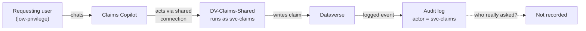

# Task 05-07 — Defender, detection & audit

## Introduction

Detection and audit are the controls that do not prevent anything — they let you **reconstruct** what
happened. Microsoft Defender for Cloud Apps, Power Platform activity logging, and the Purview / unified
audit log are how you answer, after the fact, *what did the agent do, and can we prove it?* This task tests
how much of that you can actually reconstruct for the Module 4 failures — and then it lands on the hardest
question in the whole workshop, the one where the log gives you a confident and **wrong-feeling** answer:
who really asked?

## Description

You will enable the activity logging and detection surfaces, then retest by trying to **reconstruct** the
Module 4 attacks from telemetry rather than by re-running them. You will attempt to trace the confused-deputy
event (**Scenario D**) and the injection/exfiltration events (**Scenarios A/B**), and record what the logs
can and cannot tell you. The centerpiece is the **attribution gap**: when an agent acts through a shared or
service identity, the audit entry names that identity — `svc-claims`, or an agent's owner — not the person
who actually made the request.

## Success Criteria

- [ ] You enabled Power Platform activity logging and confirmed audit is capturing agent activity (and
  connected Defender for Cloud Apps where available).
- [ ] You attempted to reconstruct Scenario D and Scenarios A/B from telemetry and recorded what each log
  did and did not show.
- [ ] You located the attribution gap: identified, in the logged event for Scenario D, which identity is
  named as the actor.
- [ ] You recorded **CLOSES IT / DENTS IT / MISSES IT** verdicts for detection/audit against the relevant
  scenarios in the [Control Efficacy Matrix](),
  each with a remaining-risk note — including, for D, a note that the log misses *who really asked*.
- [ ] You can explain why "detect and reconstruct" is not "prevent", and why attribution can fail even when
  logging is perfect.

## Learning Resources

- [Microsoft Defender for Cloud Apps](https://learn.microsoft.com/defender-cloud-apps/what-is-defender-for-cloud-apps){:target="_blank"}
- [Power Platform activity logging](https://learn.microsoft.com/power-platform/admin/logging-powerapps){:target="_blank"}
- [Microsoft Purview audit](https://learn.microsoft.com/purview/audit-solutions-overview){:target="_blank"}
- [Copilot Studio security and governance](https://learn.microsoft.com/microsoft-copilot-studio/security-and-governance){:target="_blank"}

## Key Tasks

### 01: Turn on the telemetry and reconstruct the attacks

Detection can only find what it records. Confirm the surfaces are on, then try to rebuild the Module 4
events from what they captured.

Expand this section for detailed steps

1. Confirm **Power Platform activity logging** is enabled and flowing to the **Purview / unified audit
   log**, and connect **Defender for Cloud Apps** if the tenant has it. Verify agent activity is actually
   being captured before you rely on it.
2. **Reconstruct Scenario D.** Re-open [Task 04-04 — Identity / confused deputy]().
   Find the Dataverse read/write event from the Jordan Blake path against Claims Copilot in the audit log.
   Read the **actor** field carefully, and compare it with the owner of the connection the agent acted
   through: `properties.createdBy.userPrincipalName` for `DV-Claims-Shared` in the `az rest` connections
   list, or `connection_owner_upn` in your `connections-export.csv`. `DV-Claims-Shared` runs as
   `svc-claims` (`auth_type = Service account`) — so the event is attributed to the service account, not to
   the chat user who caused it.
3. **Reconstruct Scenarios A/B.** Re-open [Task 04-01 — Grounding / indirect injection]()
   and [Task 04-02 — Data exfiltration](). Look for signals that
   the agent read `Leadership/2026-comp-bands.xlsx` or rendered the injected link. Note whether these
   surface as anomalous behavior you could alert on, and how long after the fact.
4. Confirm which agent activities actually appear in your tenant's telemetry today — this is a 2026 detail
   that changes what "detectable" means and is worth recording next to each verdict.

### 02: Find the attribution gap and record the verdict

This is the retest that does not re-run the attack — it re-reads the evidence and asks whether the evidence
can answer the question that matters.

Expand this section for detailed steps

1. For each reconstructed event, write down two things: **what** the agent did (which the logs usually
   capture), and **who caused it** (which they often do not). Detection and audit are strong on the first
   and can be blind on the second.
2. Look hard at the Scenario D event. The chain is: a low-privilege user chats with the agent, the agent
   acts through a shared connection, and the connection authenticates as `svc-claims`. The audit trail
   faithfully records `svc-claims` as the actor. It is *correct* and it is *useless* for accountability —
   you cannot reconstruct which human requested the change. This is the confused-deputy attribution gap.

3. **Offline path.** `connections-export.csv` predicts every attribution gap before you open a log:
   `DV-Claims-Shared` runs as `svc-claims`; `PA-Expense-AutoApprove` runs as owner Sam Olsen
   (`Runs as owner`); `O365-Outlook-Onboarding` runs as the departed Tom Dean. Any action through those
   connections will be attributed to the *connection identity*, not the requester. That is a verdict you can
   reach without the tenant.
4. Record verdicts for detection/audit against the scenarios you reconstructed. For Scenario D, your
   remaining-risk note must state the attribution gap explicitly: the log answers *what happened* but not
   *who really asked*. For A/B, note that reconstruction-after-the-fact is not prevention.

{: .caution }
> Training estate only. Read and record the telemetry — actor fields, timestamps, the shape of the event —
> rather than acting on any customer data you find in it. The reconstruction is the deliverable.

{: .important }
> **The confused-deputy attribution gap.** Even with logging fully enabled and working, a shared or service
> identity collapses accountability: the audit entry names `svc-claims` (or an agent's owner), which is both
> accurate and unhelpful. This is the single most important limitation in the module — a control can be
> functioning perfectly and still fail to answer the question an investigator most needs answered. The fix
> is upstream: per-user, on-behalf-of authorization so the acting identity *is* the requester (Task 05-03's
> caveat and Task 05-04's boundary), not a better log.

{: .note }
> **2026 product detail — verify in the tenant.** Which Copilot Studio / agent activities surface in
> Defender for Cloud Apps and the unified audit log, the schema of those events, and how the requester is
> (or is not) represented are evolving through 2026. Confirm what your delivery tenant actually logs and
> annotate each verdict with what you verified rather than assumed.

## Summary

Detection and audit close the loop on incident response: with logging on, you can often reconstruct what an
agent did and sometimes alert on it after the fact. But they prevent nothing, and they hit a wall exactly
where the estate uses shared and service identities — the log records the connection identity, not the human
who caused the action, so the confused-deputy scenario defeats attribution even when every control is
working. You recorded verdicts that separate *what happened* from *who asked*, and named the upstream fix
that a log can never substitute for. That gap is the closing point of the whole retest module.
