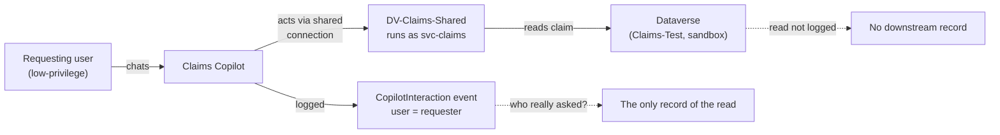

# Task 05-07 — Defender, detection & audit

## Introduction

This task tests two kinds of control. **Defender real-time protection prevents**: it checks each tool call
an agent makes and blocks a risky one before it runs. **Audit detects and reconstructs**: it records what
happened, so afterwards you can answer who did what. You test audit live and reason through Defender, and
end on the hardest audit question in the workshop: who really asked?

## Description

The audit surfaces were turned on before Exercise 04 ran, as part of the lab build, so your Exercise 04
activity is already in the logs. You start a slow audit search first, then reconstruct the Exercise 04
attacks from the logs without re-running them. The centerpiece is an **attribution test** for **Scenario
D**: you record why there's no downstream record of Claims Copilot's read, check what the agent layer shows,
and classify how far the logs link the action to the person who asked: complete, cross-log only, partial,
or unavailable. Last, you reason through whether Defender real-time protection would block Scenario A. You reason
it through rather than test it live, whether or not it's switched on in your estate.

## Success Criteria

- [ ] You started the audit search first, because it's slow.
- [ ] You attempted to reconstruct Scenario D and Scenarios A/B from telemetry and recorded what each log
  did and did not show.
- [ ] You tested attribution for Scenario D: recorded why there's no downstream record of Claims Copilot's
  read, and compared that with what the `CopilotInteraction` event and the DSPM record show.
- [ ] You reasoned whether Defender real-time protection would block Scenario A, and labelled that verdict
  reasoned.
- [ ] You recorded **CLOSES IT / DENTS IT / MISSES IT** verdicts for detection/audit against the relevant
  scenarios in the [Control Efficacy Matrix](),
  each with a remaining-risk note — including, for D, whether the logs link the action to *who really
  asked* (complete, cross-log only, partial, or unavailable).
- [ ] You can explain why "detect and reconstruct" is not "prevent", and why attribution can fail even when
  logging is turned on.

## Learning Resources

- [Real-time protection for AI agents (Microsoft Defender)](https://learn.microsoft.com/defender-xdr/security-for-ai/ai-agent-real-time-protection){:target="_blank"}
- [Agent security moves to Microsoft Agent 365](https://learn.microsoft.com/defender-xdr/security-for-ai/transition-agent-security-to-agent-365){:target="_blank"}
- [Manage Dataverse auditing](https://learn.microsoft.com/power-platform/admin/manage-dataverse-auditing){:target="_blank"}
- [Power Platform activity logging](https://learn.microsoft.com/power-platform/admin/activity-logging-auditing/activity-logs-power-apps){:target="_blank"}
- [View Copilot Studio audit logs in Purview](https://learn.microsoft.com/microsoft-copilot-studio/admin-logging-copilot-studio){:target="_blank"}
- [Microsoft Purview audit](https://learn.microsoft.com/purview/audit-solutions-overview){:target="_blank"}
- [Copilot Studio security and governance](https://learn.microsoft.com/microsoft-copilot-studio/security-and-governance){:target="_blank"}

## Key Tasks

> Key Tasks 01–06 need the tenant. If you can't reach it, do Key Task 07 instead. Both lead to Key Task 08.
{: .note }

### 01: Start your audit search now

Expand this section for detailed steps

1. In the **Microsoft Purview** portal ([purview.microsoft.com](https://purview.microsoft.com){:target="_blank"}),
   select **Solutions** → **Audit** → **Search**.
2. Set:
   a. **Record Types** to `CopilotInteraction`. Without it, the list fills with sign-ins and admin-center
      calls;
   b. **Users** to your own lab account;
   c. a range from the start of Exercise 04 to now. The end time must be after your last chat: it defaults
      to 00:00 UTC on the date you pick.
3. Name the search and select **Search**. It takes 3–4 minutes: carry on with Key Task 02 and come back.

{: .note }
> Events can take hours to arrive. If your Exercise 04 chats aren't in the results yet, use DSPM for AI
> (Key Task 03) instead. Copilot Studio records these events only for users with a Microsoft 365 license.

### 02: Record the downstream result

Expand this section for detailed steps

1. Record it: Dataverse holds no record of Claims Copilot's read. Its auditing records changes, not reads,
   and read logs reach Purview only for production environments; `Claims-Test` is a sandbox. Downstream
   attribution is **unavailable**.

{: .note }
> A missing record is a result, not a failed step. That gap is what you classify in Key Task 04.

### 03: Read the interaction in DSPM for AI

Expand this section for detailed steps

1. In Purview, select **Solutions** → **DSPM for AI (classic)** → **Activity explorer**. If a *New Unified
   Data Security Posture Management* window opens, select **Maybe later**.
2. Find the row whose **Agent name** is Claims Copilot, and open it. The list shows your own activity; an
   *Additional permissions required* banner about AI Visits and risk levels doesn't affect this step.
3. Read **User participant details**, **App details** and **Agent details**, and any resources the record
   lists. Does anything name the claim the agent returned?
4. If you can see the prompt and response text, record what you asked and which claim came back.

### 04: Read your audit event and classify attribution

Expand this section for detailed steps

1. Open your finished search from Key Task 01. Read the list, not the **Total Result Count** line, which can
   disagree with it.
2. No column names the agent: open rows until **AgentName** reads Claims Copilot. Note the date, the
   **User** column, **AgentName** and **AgentId**.
3. Compare the agent layer (this event and the DSPM record) with the downstream layer (Key Task 02).
4. Record the result:
   a. **complete** — one log names the requester alongside the action;
   b. **cross-log only** — only correlating the two logs links the requester to the action;
   c. **partial** — the correlation narrows it down but doesn't prove who asked;
   d. **unavailable** — the logs can't link them.

{: .note }
> For a write, the claim's Audit History would name the acting credential, `svc-claims`, not you. Only
> correlating that entry with the `CopilotInteraction` event, by time and by record, would link it back to
> the requester. Claims Copilot has no write tool, so this lab reasons that half rather than running it.

### 05: Look for the Scenario A and B signals

Expand this section for detailed steps

1. In DSPM's **Activity explorer** (Key Task 03), open the rows whose **Agent name** is Benefits Buddy:
   your chats from [Task 04-01]() and
   [Task 04-02](). Does any record list
   `Leadership/2026-comp-bands.xlsx` as a resource?
2. In the Defender portal, check for alerts on Benefits Buddy. If you're not using Defender today, record it
   as not checked.

{: .note }
> For each event, write down **what** the agent did and **who caused it**. Logs are usually strong on the
> first and can be blind on the second.

### 06: Reason through the preventive control

Expand this section for detailed steps

1. Read how Defender real-time protection works (Learning Resources): before a Copilot Studio agent runs a
   **tool**, Copilot Studio asks Defender, and Defender can block the call. It inspects tool invocations,
   not the text of an answer.
2. Look back at your Task 04-01 result for Scenario A. Did the injected instruction make Benefits Buddy call
   a tool, or only change what its answer said? Check the agent's **Tools** page in Copilot Studio. Offline,
   use your Task 04-01 notes: the artifact pack lists connections, not tools.
3. Decide whether real-time protection would have had anything to block, and record a **reasoned**
   conclusion.

{: .note }
> This lab reasons real-time protection through rather than testing it live. Since July 2026 it needs a
> Microsoft Agent 365 licence: on your own estate, check which licence you hold before you count on it.

### 07: Reason it through offline

Expand this section for detailed steps

1. In your `connections-export.csv`, note what each connection predicts the downstream logs will name:
   a. `DV-Claims-Shared` → `svc-claims`, for a change. A read isn't in Dataverse's Audit History, and
      `environments-export.csv` gives `Claims-Test`'s type, which decides whether read logs reach Purview;
   b. `PA-Expense-AutoApprove` → owner Sam Olsen (`Runs as owner`);
   c. `O365-Outlook-Onboarding` → the departed Tom Dean.
2. Record a reasoned conclusion for each, and record attribution as an open question.

### 08: Record the verdicts

Expand this section for detailed steps

1. In your [Control Efficacy Matrix](), fill
   the **Defender / audit** column's **A**, **B** and **D** cells.
2. For each, copy a **Retest log** block below the matrix: Before, After, Verdict, and Remaining risk. For
   D, state how far attribution got; label A reasoned.
3. The matrix has one Defender / audit cell per scenario. For Scenario A, put the stronger verdict there and
   name the control that earned it, for example "DENTS IT (Defender RTP)". Put the other result in the
   remaining-risk note or the retest log.

{: .caution }
> Everything here runs against a training estate — the records, the people and the keys are made up. You're
> still practicing the habit you'll need on a real estate: confirm the path exists, record it, and move on.

{: .important }
> **The confused-deputy attribution question.** With a shared or service credential, a downstream entry
> names `svc-claims` (or an agent's owner), not the requester. A read may leave no downstream entry at
> all. Either way, *who really asked* depends on the agent-layer telemetry — and how far it gets you is
> what you are testing, not assuming.

Reveal the suggested verdicts and reasoning

- **Detection/audit × D:** suggested **MISSES IT**: audit detects after the fact at best.
  - **Agent layer: partial.** The `CopilotInteraction` event and the DSPM record name you and the agent,
    not the claim. If you can read the prompt and response and they show the claim, it's **complete**.
  - **Downstream: unavailable.** Dataverse audits changes, not reads, and `Claims-Test` is a sandbox, so
    nothing ties the read to anyone, not even `svc-claims`.
  - **Timing:** agent-layer events can take hours to arrive.
  - **For a write:** the Audit History would name `svc-claims`; matching it to the `CopilotInteraction`
    event makes it **cross-log only** at best.
  - **The fix** is upstream: on-behalf-of authorization, so the acting credential *is* the requester — not
    a better log.
- **Detection/audit × B:** suggested **MISSES IT**, or **DENTS IT** if the DSPM record lists the comp file
  as a resource — an alertable signal, after the fact. Either way, reconstruction is not prevention.
- **Defender real-time protection × A (reasoned):** it acts only on tool calls. Where an injection drives a
  tool call, blocking it before it runs is prevention — suggested **DENTS IT** at least for that path. Where
  the injection only changes the answer text, there is no call for it to inspect. Reconstruction alone is not
  prevention either way.

## Summary

Defender real-time protection can block a risky tool call at runtime, before it runs; audit can't stop
anything, but it lets you reconstruct what an agent did — where something was logged. Where the estate
uses shared and service credentials, a downstream change names the connection credential, and a read in a
sandbox leaves no downstream record at all. Either way, attribution rests on whether the
`CopilotInteraction` event and the interaction record link the action back to the requester. Separate *what
happened* from *who asked*, and check that each log records the action at all. Record the verdict and
remaining risk in the matrix.
