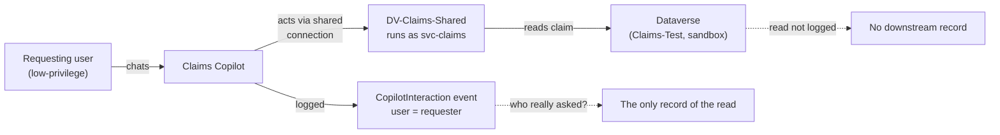

# Task 05-07 — Defender, detection & audit

## Introduction

This task tests two kinds of control. **Defender real-time protection prevents**: it checks each tool call
an agent makes and blocks a risky one before it runs. **Audit detects and reconstructs**: it records what
happened, so afterwards you can answer who did what. You test audit live and reason through Defender, and
end on the hardest audit question in the workshop: who really asked?

## Description

The audit surfaces were turned on before Exercise 04 ran, as part of the lab build, so your Exercise 04
activity is already in the logs. You will check the surfaces are on, then reconstruct the Exercise 04
attacks from the logs without re-running them. The centerpiece is an **attribution test** for **Scenario
D**: you look for the downstream record of Claims Copilot's read, check what the agent-layer event shows,
and classify how far the logs link the action to the person who asked: complete, cross-log only, partial,
or unavailable. Last, you reason through whether Defender real-time protection would block Scenario A. It
can't be switched on in the lab tenant: since July 2026 it needs a Microsoft Agent 365 licence.

## Success Criteria

- [ ] You confirmed the audit surfaces are on — Purview Audit and Dataverse auditing for `Claims-Test`.
- [ ] You attempted to reconstruct Scenario D and Scenarios A/B from telemetry and recorded what each log
  did and did not show.
- [ ] You tested attribution for Scenario D: checked where Dataverse would log Claims Copilot's read,
  recorded what you found there, and compared it with what the `CopilotInteraction` event shows.
- [ ] You reasoned whether Defender real-time protection would block Scenario A, and labelled that verdict
  reasoned.
- [ ] You recorded **CLOSES IT / DENTS IT / MISSES IT** verdicts for detection/audit against the relevant
  scenarios in the [Control Efficacy Matrix](),
  each with a remaining-risk note — including, for D, whether the logs link the action to *who really
  asked* (complete, cross-log only, partial, or unavailable).
- [ ] You can explain why "detect and reconstruct" is not "prevent", and why attribution can fail even when
  logging is turned on.

## Learning Resources

- [Real-time protection for AI agents (Microsoft Defender)](https://learn.microsoft.com/defender-xdr/security-for-ai/ai-agent-real-time-protection){:target="_blank"}
- [Agent security moves to Microsoft Agent 365](https://learn.microsoft.com/defender-xdr/security-for-ai/transition-agent-security-to-agent-365){:target="_blank"}
- [Manage Dataverse auditing](https://learn.microsoft.com/power-platform/admin/manage-dataverse-auditing){:target="_blank"}
- [Power Platform activity logging](https://learn.microsoft.com/power-platform/admin/activity-logging-auditing/activity-logs-power-apps){:target="_blank"}
- [View Copilot Studio audit logs in Purview](https://learn.microsoft.com/microsoft-copilot-studio/admin-logging-copilot-studio){:target="_blank"}
- [Microsoft Purview audit](https://learn.microsoft.com/purview/audit-solutions-overview){:target="_blank"}
- [Copilot Studio security and governance](https://learn.microsoft.com/microsoft-copilot-studio/security-and-governance){:target="_blank"}

## Key Tasks

> Key Tasks 01–06 need the tenant. If you can't reach it, do Key Task 07 instead. Both lead to Key Task 08.
{: .note }

### 01: Check the audit surfaces are on

Expand this section for detailed steps

1. Open the **Microsoft Purview** portal ([purview.microsoft.com](https://purview.microsoft.com){:target="_blank"}),
   select **Solutions → Audit**, and run a search for the last few days. The date picker stops at today; set
   the end time late in the day (times are UTC). A search takes a few minutes; select **Refresh** to see it
   finish.
2. In the Power Platform admin center, confirm auditing is on for the `Claims-Test` environment and for the
   `Claim` table.

### 02: Find your Exercise 04 conversation

Expand this section for detailed steps

1. In **Purview → Audit**, set **Record Types** to `CopilotInteraction`, **Users** to your own lab account,
   and a time range covering when you ran [Task 04-04](). Filter
   by your account: the search covers the whole tenant, so without it you also see everyone else's chats.
   Read the results list, not the *Total Result Count* line above it, which can say 0 while the list has
   rows.
2. Find the event for your chat with Claims Copilot and note:
   a. the user;
   b. the agent (`BotId`);
   c. the time;
   d. the transcript thread ID.

{: .note }
> Copilot Studio records these events only for users with a Microsoft 365 license.

### 03: Look for the downstream record of the read

Expand this section for detailed steps

Claims Copilot only reads: its tools list claims and customers. Check each place Dataverse could log that
read.

1. Open `Claims-Test`'s **Audit summary view**. In the Power Platform admin center, open `Claims-Test` and
   copy its **Environment URL** (for example `https://org1234abcd.crm3.dynamics.com/`), then open that
   address with `tools/audit/audit_summary.aspx` added to the end. (The admin center's own **Settings →
   Audit and logs → Audit summary view** link fails for a lab account with *Error loading control*.) Filter **Entity** to *contains* `Claim` and look for any event on the claim you looked up
   in Task 04-04, around the time you asked. You can't open the claim itself - your account has no read on
   claims, which is what made Scenario D a confused deputy - but its audit records are listed here. Dataverse
   auditing records creates, updates, deletes and sharing changes. It doesn't record reads, so a read never
   appears here.
2. Reads are logged only by activity logging: the environment's **Read logs** audit setting, plus the
   table's auditing settings. Those events go to **Purview Audit**, and only for production environments.
   Check the environment type of `Claims-Test` in the Power Platform admin center, or in
   `environments-export.csv`.
3. In **Purview → Audit**, search the time you ran Task 04-04 for Dataverse activity in `Claims-Test`. Note
   whether any event records the read.
4. Record the downstream event for Claims Copilot's read, or record that it is unavailable, and why.

{: .note }
> A missing record is a result, not a failed step. Write down which log you checked and why it holds no
> read. That gap is what you classify in Key Task 04.

### 04: Test attribution

Expand this section for detailed steps

1. Return to the `CopilotInteraction` event from Key Task 02. Note who it names as the user, and which
   agent.
2. Find the same interaction in DSPM for AI: in the Purview portal, select **Solutions → DSPM for AI
   (classic) → Activity explorer**. If a *New Unified Data Security Posture Management* window opens, select
   **Maybe later** to stay in the classic view. Set **User participant** to your own lab account — like the
   audit search, this view shows everyone's activity — and read the interaction's record: the user, the
   agent, the time, and the resources it lists. Check whether any of it names the claim the agent
   returned. If your account can also see the prompt and response text, record what the user asked and
   which claim came back.
3. Compare the two layers: what the agent layer names, and what the downstream layer recorded in Key
   Task 03.
4. Record the result:
   a. **complete** — one log names the requester alongside the action;
   b. **cross-log only** — only correlating the two logs links the requester to the action;
   c. **partial** — the correlation narrows it down but doesn't prove who asked;
   d. **unavailable** — the logs can't link them.

{: .note }
> For a write, the claim's Audit History would name the acting credential, `svc-claims`, not you. Only
> correlating that entry with the `CopilotInteraction` event, by time and by record, would link it back to
> the requester. Claims Copilot has no write tool, so this lab reasons that half rather than running it.

### 05: Look for the Scenario A and B signals

Expand this section for detailed steps

1. In **Purview → Audit**, with the same filters as Key Task 02, find the `CopilotInteraction` events for
   your Benefits Buddy chats from
   [Task 04-01]() and
   [Task 04-02]().
2. In **DSPM for AI** (same route and **User participant** filter as Key Task 04), check which
   resources each event lists — does `Leadership/2026-comp-bands.xlsx`
   appear?
3. In the Defender portal, check for alerts on Benefits Buddy.

{: .note }
> For each event, write down **what** the agent did and **who caused it**. Logs are usually strong on the
> first and can be blind on the second.

### 06: Reason through the preventive control

Expand this section for detailed steps

1. Read how Defender real-time protection works (Learning Resources): before a Copilot Studio agent runs a
   **tool**, Copilot Studio asks Defender, and Defender can block the call. It inspects tool invocations,
   not the text of an answer.
2. Look back at your Task 04-01 result for Scenario A. Did the injected instruction make Benefits Buddy call
   a tool, or only change what its answer said? Check the agent's **Tools** page in Copilot Studio. Offline,
   use your Task 04-01 notes: the artifact pack lists connections, not tools.
3. Decide whether real-time protection would have had anything to block, and record a **reasoned**
   conclusion.

{: .note }
> Real-time protection isn't switched on in the lab tenant: since July 2026 it needs a Microsoft Agent 365
> licence, which the lab tenant doesn't have. On your own estate, check which licence you hold before you
> count on it.

### 07: Reason it through offline

Expand this section for detailed steps

1. In your `connections-export.csv`, note what each connection predicts the downstream logs will name:
   a. `DV-Claims-Shared` → `svc-claims`, for a change. A read isn't in Dataverse's Audit History, and
      `environments-export.csv` gives `Claims-Test`'s type, which decides whether read logs reach Purview;
   b. `PA-Expense-AutoApprove` → owner Sam Olsen (`Runs as owner`);
   c. `O365-Outlook-Onboarding` → the departed Tom Dean.
2. Record a reasoned conclusion for each, and record attribution as an open question.

### 08: Record the verdicts

Expand this section for detailed steps

1. Record detection/audit verdicts for the scenarios you reconstructed.
2. For Scenario D, state how far attribution got: complete, cross-log only, partial, or unavailable.
3. For Scenario A, record your reasoned conclusion on whether Defender would block it, labelled reasoned.
4. The matrix has one Defender / audit cell per scenario. For Scenario A, put the stronger verdict there and
   name the control that earned it, for example "DENTS IT (Defender RTP)". Put the other result in the
   remaining-risk note or the retest log.

{: .caution }
> Everything here runs against a training estate — the records, the people and the keys are made up. You're
> still practicing the habit you'll need on a real estate: confirm the path exists, record it, and move on.

{: .important }
> **The confused-deputy attribution question.** With a shared or service credential, a downstream entry
> names `svc-claims` (or an agent's owner), not the requester. A read may leave no downstream entry at
> all. Either way, *who really asked* depends on the agent-layer telemetry — and how far it gets you is
> what you are testing, not assuming.

Reveal the suggested verdicts and reasoning

- **Detection/audit × D:** suggested **MISSES IT** as a preventive control — it detects after the fact at
  best. Attribution goes in the remaining-risk note. For Claims Copilot's read, the downstream record is
  **unavailable**: Dataverse's Audit History records changes, not reads, and read logs reach Purview only
  for production environments. `Claims-Test` is a sandbox. Nothing downstream ties the read to anyone, not
  even to `svc-claims`. Attribution rests entirely on the agent layer: the `CopilotInteraction` event and
  the DSPM interaction record name the requester and the agent, but not the claim. Record **partial** at
  the agent layer and **unavailable** downstream. If you could also read the prompt and response, and they
  show the claim returned, the agent layer becomes **complete**. If the agent-layer record is
  missing, nothing records the read.
  For a write, the Audit History would name `svc-claims`, and only matching it to the `CopilotInteraction`
  event would link it to the requester — **cross-log only** at best. The durable fix is upstream —
  per-user, on-behalf-of authorization so the acting credential *is* the requester (Task 05-03's caveat,
  Task 05-04's boundary) — not a better log.
- **Detection/audit × A/B:** suggested **DENTS IT** where the read or the injected link surfaces as an
  alertable signal; **MISSES IT** where it does not. Either way, reconstruction is not prevention.
- **Defender real-time protection × A (reasoned):** it acts only on tool calls. Where an injection drives a
  tool call, blocking it before it runs is prevention — suggested **DENTS IT** at least for that path. Where
  the injection only changes the answer text, there is no call for it to inspect. Reconstruction alone is not
  prevention either way.

## Summary

Defender real-time protection can block a risky tool call at runtime, before it runs; audit can't stop
anything, but it lets you reconstruct what an agent did — where something was logged. Where the estate
uses shared and service credentials, a downstream change names the connection credential, and a read in a
sandbox leaves no downstream record at all. Either way, attribution rests on whether the
`CopilotInteraction` event and the interaction record link the action back to the requester. Separate *what
happened* from *who asked*, and check that each log records the action at all. Record the verdict and
remaining risk in the matrix.
