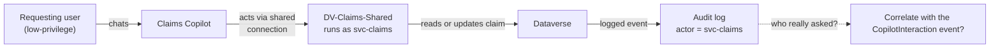

# Task 05-07 — Defender, detection & audit

## Introduction

This task tests two kinds of control. **Defender real-time protection prevents**: it checks each tool call
an agent makes and blocks a risky one before it runs. **Audit detects and reconstructs**: it records what
happened, so afterwards you can answer who did what. You test both, and end on the hardest audit question in
the workshop: who really asked?

## Description

The audit surfaces were turned on before Exercise 04 ran, as part of the lab build, so your Exercise 04
activity is already in the logs. You will check the surfaces are on, then reconstruct the Exercise 04
attacks from the logs without re-running them. The centerpiece is an **attribution test** for **Scenario
D**: the downstream Dataverse entry names the acting credential, and you try to link it back to the
person who made the request; the outcome may be complete, cross-log only, partial, or unavailable. Last,
you test whether Defender real-time protection blocks a Scenario A prompt.

## Success Criteria

- [ ] You confirmed the audit surfaces are on: Purview Audit, Dataverse auditing for `Claims-Test`, and
  Defender real-time protection.
- [ ] You attempted to reconstruct Scenario D and Scenarios A/B from telemetry and recorded what each log
  did and did not show.
- [ ] You tested attribution: identified, in the logged event for Scenario D, which credential is named as
  the actor, and tried to correlate it with the user's Copilot Studio interaction.
- [ ] You tested whether Defender real-time protection blocks the Scenario A prompt.
- [ ] You recorded **CLOSES IT / DENTS IT / MISSES IT** verdicts for detection/audit against the relevant
  scenarios in the [Control Efficacy Matrix](),
  each with a remaining-risk note — including, for D, whether you could link the downstream event to *who
  really asked* (complete, cross-log only, partial, or unavailable).
- [ ] You can explain why "detect and reconstruct" is not "prevent", and why attribution can fail even when
  logging is perfect.

## Learning Resources

- [Microsoft Defender for Cloud Apps](https://learn.microsoft.com/defender-cloud-apps/what-is-defender-for-cloud-apps){:target="_blank"}
- [Power Platform activity logging](https://learn.microsoft.com/power-platform/admin/activity-logging-auditing/activity-logs-power-apps){:target="_blank"}
- [View Copilot Studio audit logs in Purview](https://learn.microsoft.com/microsoft-copilot-studio/admin-logging-copilot-studio){:target="_blank"}
- [Microsoft Purview audit](https://learn.microsoft.com/purview/audit-solutions-overview){:target="_blank"}
- [Copilot Studio security and governance](https://learn.microsoft.com/microsoft-copilot-studio/security-and-governance){:target="_blank"}

## Key Tasks

> Key Tasks 01–06 need the tenant. If you can't reach it, do Key Task 07 instead. Both lead to Key Task 08.
{: .note }

### 01: Check the audit surfaces are on

Expand this section for detailed steps

1. In the **Microsoft Purview** portal, select **Solutions → Audit** and run a search for the last few days.
2. In the Power Platform admin center, confirm auditing is on for the `Claims-Test` environment and for the
   `Claim` and `Customer` tables.
3. In the **Microsoft Defender** portal, check whether real-time protection is enabled for the estate's
   agents.

### 02: Find your Exercise 04 conversation

Expand this section for detailed steps

1. In **Purview → Audit**, filter **Activities** to `CopilotInteraction` and the time you ran
   [Task 04-04]().
2. Find the event for your chat with Claims Copilot and note:
   a. the user;
   b. the agent (`BotId`);
   c. the time;
   d. the transcript thread ID.

{: .note }
> Copilot Studio records these events only for users with a Microsoft 365 license.

### 03: Find the downstream Dataverse event

Expand this section for detailed steps

1. In `Claims-Test`, open the claim you looked up in Task 04-04 and view its audit history.
2. Note the actor and the time.
3. Compare the actor with `DV-Claims-Shared`'s `connection_owner_upn` in your `connections-export.csv` from
   Task 01-01.

{: .note }
> Expect the downstream event to name the acting credential, not you. That's what one log shows — not yet
> proof that the requester can't be traced.

### 04: Test attribution

Expand this section for detailed steps

1. Match the `CopilotInteraction` event to the Dataverse event:
   a. by time window;
   b. by the claim it touched.
2. Open the transcript from the event in **DSPM for AI** and check whether it shows the request that led to
   the Dataverse read.
3. Record the result:
   a. **complete** — one log names the requester alongside the action;
   b. **cross-log only** — only correlating the two logs links the requester to the action;
   c. **partial** — the correlation narrows it down but doesn't prove who asked;
   d. **unavailable** — the logs can't link them.

### 05: Look for the Scenario A and B signals

Expand this section for detailed steps

1. In **Purview → Audit**, find the `CopilotInteraction` events for your Benefits Buddy chats from
   [Task 04-01]() and
   [Task 04-02]().
2. In **DSPM for AI**, check which resources each event lists — does `Leadership/2026-comp-bands.xlsx`
   appear?
3. In the Defender portal, check for alerts on Benefits Buddy.

{: .note }
> For each event, write down **what** the agent did and **who caused it**. Logs are usually strong on the
> first and can be blind on the second.

### 06: Test the preventive control

Expand this section for detailed steps

1. Changing Defender's real-time protection setting needs **Security Administrator**, which your lab
   account holds as an *eligible* role: activate it first under **Privileged Identity Management** →
   **My roles**, as in [Task 05-05]().
2. With Defender real-time protection on, re-run the Scenario A prompt from Task 04-01 against the
   published Benefits Buddy.
3. Note whether Defender blocks the action, and whether an alert appears in the Defender portal.

### 07: Reason it through offline

Expand this section for detailed steps

1. In your `connections-export.csv`, note what each connection predicts the downstream logs will name:
   a. `DV-Claims-Shared` → `svc-claims`;
   b. `PA-Expense-AutoApprove` → owner Sam Olsen (`Runs as owner`);
   c. `O365-Outlook-Onboarding` → the departed Tom Dean.
2. Record a reasoned conclusion for each, and record attribution as an open question.

### 08: Record the verdicts

Expand this section for detailed steps

1. Record detection/audit verdicts for the scenarios you reconstructed.
2. For Scenario D, state how far attribution got: complete, cross-log only, partial, or unavailable.
3. For Scenario A, record whether Defender blocked the prompt.
4. The matrix has one Defender / audit cell per scenario. For Scenario A, put the stronger verdict there and
   name the control that earned it, for example "DENTS IT (Defender RTP)". Put the other result in the
   remaining-risk note or the retest log.

{: .caution }
> Everything here runs against a training estate — the records, the people and the keys are made up. You're
> still practicing the habit you'll need on a real estate: confirm the path exists, record it, and move on.

{: .important }
> **The confused-deputy attribution question.** With logging fully enabled, a shared or service credential
> means the downstream entry names `svc-claims` (or an agent's owner), not the requester. Whether the
> investigator can still answer *who really asked* depends on correlating that entry with agent-layer
> telemetry — and that correlation is what you are testing, not assuming.

Reveal the suggested verdicts and reasoning

- **Detection/audit × D:** suggested **MISSES IT** as a preventive control — it detects after the fact at
  best. Attribution goes in the remaining-risk note. If you got **cross-log only**, the requester can be
  recovered, but only by matching the `CopilotInteraction` event to the downstream log. Note how much work
  that took and how long each log is kept. If you got **partial** or **unavailable**, that is the
  remaining risk: the logs worked, and still can't say who asked. The durable fix is upstream — per-user,
  on-behalf-of authorization so the acting credential *is* the requester (Task 05-03's caveat, Task 05-04's
  boundary) — not a better log.
- **Detection/audit × A/B:** suggested **DENTS IT** where the read or the injected link surfaces as an
  alertable signal; **MISSES IT** where it does not. Either way, reconstruction is not prevention.
- **Defender real-time protection × A:** where it blocks the tool call before it runs, that part is
  prevention — suggested **DENTS IT** at least for that path; reconstruction alone is not.

## Summary

Defender real-time protection can block a risky tool call at runtime, before it runs; audit can't stop
anything, but it lets you reconstruct what an agent did. Where the estate uses shared and service
credentials, the downstream log names the connection credential, so attribution becomes a test of whether
the `CopilotInteraction` event and its transcript link the action back to the requester. Separate *what
happened* from *who asked*. Record the verdict and remaining risk in the matrix.
