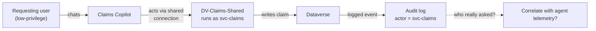

# Task 05-07 — Defender, detection & audit

## Introduction

Detection and audit are the controls that do not prevent anything — they let you **reconstruct** what
happened. Microsoft Defender for Cloud Apps, Power Platform activity logging, and the Purview / unified
audit log are how you answer, after the fact, *what did the agent do, and can we prove it?* This task tests
how much of that you can actually reconstruct for the Exercise 04 failures — and then it lands on the hardest
question in the whole workshop, the one where the log gives you a confident and **wrong-feeling** answer:
who really asked?

## Description

You will enable the activity logging and detection surfaces, then retest by trying to **reconstruct** the
Exercise 04 attacks from telemetry rather than by re-running them. You will attempt to trace the confused-deputy
event (**Scenario D**) and the injection/exfiltration events (**Scenarios A/B**), and record what the logs
can and cannot tell you. The centerpiece is an **attribution test**: when an agent acts through a shared or
service credential, the downstream entry names that credential — `svc-claims`, or an agent's owner — not
the person who made the request. You try to correlate the user's Copilot Studio interaction (user and
resource identifiers, timestamps, conversation or transcript IDs) with the downstream Dataverse and flow
events; the outcome may be complete, partial, or an unresolved gap.

## Success Criteria

- [ ] You enabled Power Platform activity logging and confirmed audit is capturing agent activity (and
  connected Defender for Cloud Apps where available).
- [ ] You attempted to reconstruct Scenario D and Scenarios A/B from telemetry and recorded what each log
  did and did not show.
- [ ] You tested attribution: identified, in the logged event for Scenario D, which credential is named as
  the actor, and tried to correlate it with the user's Copilot Studio interaction.
- [ ] You recorded **CLOSES IT / DENTS IT / MISSES IT** verdicts for detection/audit against the relevant
  scenarios in the [Control Efficacy Matrix](),
  each with a remaining-risk note — including, for D, whether you could link the downstream event to *who
  really asked* (complete, partial, or unresolved).
- [ ] You can explain why "detect and reconstruct" is not "prevent", and why attribution can fail even when
  logging is perfect.

## Learning Resources

- [Microsoft Defender for Cloud Apps](https://learn.microsoft.com/defender-cloud-apps/what-is-defender-for-cloud-apps){:target="_blank"}
- [Power Platform activity logging](https://learn.microsoft.com/power-platform/admin/logging-powerapps){:target="_blank"}
- [Microsoft Purview audit](https://learn.microsoft.com/purview/audit-solutions-overview){:target="_blank"}
- [Copilot Studio security and governance](https://learn.microsoft.com/microsoft-copilot-studio/security-and-governance){:target="_blank"}

## Key Tasks

### 01: Turn on the telemetry and reconstruct the attacks

Detection can only find what it records. Confirm the surfaces are on, then try to rebuild the Exercise 04
events from what they captured.

Expand this section for detailed steps

1. Confirm **Power Platform activity logging** is enabled and flowing to the **Purview / unified audit
   log**, and connect **Defender for Cloud Apps** if the tenant has it. Verify agent activity is actually
   being captured before you rely on it.
2. **Reconstruct Scenario D.** Re-open [Task 04-04 — Identity / confused deputy]().
   Find the Dataverse read/write event from your own lab account's path against the published Claims
   Copilot in the audit log. Read the **actor** field carefully, and compare it with the owner of the
   connection the agent acted through: the `DV-Claims-Shared` row of the `connections-export.csv` you built
   in Task 01-01 (`connection_owner_upn`). `DV-Claims-Shared` runs as `svc-claims`
   (`auth_type = Service account`) — so expect the downstream event to name the service account, not the
   chat user who caused it. That is an observation about one log, not proof that the requester cannot be
   traced.
3. **Reconstruct Scenarios A/B.** Re-open [Task 04-01 — Grounding / indirect injection]()
   and [Task 04-02 — Data exfiltration](). Look for signals that
   the agent read `Leadership/2026-comp-bands.xlsx` or rendered the injected link. Note whether these
   surface as anomalous behavior you could alert on, and how long after the fact.
4. Confirm which agent activities actually appear in your tenant's telemetry today — this is a 2026 detail
   that changes what "detectable" means and is worth recording next to each verdict.

### 02: Test attribution and record the verdict

This is the retest that does not re-run the attack — it re-reads the evidence and asks whether the evidence
can answer the question that matters.

Expand this section for detailed steps

1. For each reconstructed event, write down two things: **what** the agent did (which the logs usually
   capture), and **who caused it** (which they often do not). Detection and audit are strong on the first
   and can be blind on the second.
2. Look hard at the Scenario D event. The chain is: a low-privilege user chats with the agent, the agent
   acts through a shared connection, and the connection authenticates as `svc-claims`. The downstream log
   names the acting credential, not the initiator. Now try to close that gap: correlate the event with the
   user's Copilot Studio interaction — user and resource identifiers, timestamps, conversation or
   transcript IDs — and record whether you could link them completely, partially, or not at all.

3. **Offline path.** `connections-export.csv` predicts what the downstream logs will name before you open
   one:
   `DV-Claims-Shared` runs as `svc-claims`; `PA-Expense-AutoApprove` runs as owner Sam Olsen
   (`Runs as owner`); `O365-Outlook-Onboarding` runs as the departed Tom Dean. Any action through those
   connections should be attributed downstream to the *connection credential*, not the requester. Whether
   agent telemetry lets you link it back to the requester is what the live test checks; offline, record it
   as a reasoned conclusion and an open question.
4. Record verdicts for detection/audit against the scenarios you reconstructed. For Scenario D, your
   remaining-risk note must state how far attribution got: complete, partial, or an unresolved gap. For A/B,
   note that reconstruction-after-the-fact is not prevention.

{: .caution }
> Everything here runs against a training estate — the records, the people and the keys are made up. You're
> still practicing the habit you'll need on a real estate: confirm the path exists, record it, and move on.

{: .important }
> **The confused-deputy attribution question.** With logging fully enabled, a shared or service credential
> means the downstream entry names `svc-claims` (or an agent's owner), not the requester. Whether the
> investigator can still answer *who really asked* depends on correlating that entry with agent-layer
> telemetry — and that correlation is what you are testing, not assuming.

{: .note }
> **2026 product detail — verify in the tenant.** Which Copilot Studio / agent activities surface in
> Defender for Cloud Apps and the unified audit log, the schema of those events, and how the requester is
> (or is not) represented are evolving through 2026. Confirm what your delivery tenant actually logs and
> annotate each verdict with what you verified rather than assumed.

Reveal the suggested verdicts and reasoning

- **Detection/audit × D:** suggested **MISSES IT** as a preventive control — it detects after the fact at
  best. Attribution is the remaining-risk note: if you could not link the downstream `svc-claims` event to
  the requester through agent telemetry, a control functioning perfectly still failed to answer the
  question an investigator most needs answered. The durable fix is upstream — per-user, on-behalf-of
  authorization so the acting credential *is* the requester (Task 05-03's caveat, Task 05-04's boundary) —
  not a better log.
- **Detection/audit × A/B:** suggested **DENTS IT** where the read or the injected link surfaces as an
  alertable signal; **MISSES IT** where it does not. Either way, reconstruction is not prevention.

## Summary

Detection and audit close the loop on incident response: with logging on, you can often reconstruct what an
agent did and sometimes alert on it after the fact. They prevent nothing, and where the estate uses shared
and service credentials the downstream log names the connection credential, so attribution becomes a test of
whether agent telemetry can link the event back to the requester. Separate *what happened* from *who asked*,
and record the verdict and remaining risk in the matrix.
