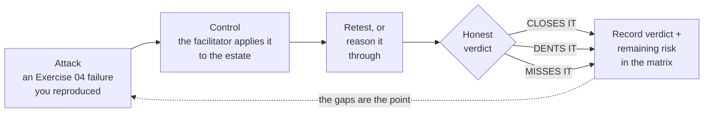

# Exercise 05: Put the Controls to the Test

## Scenario

You spent Exercise 04 breaking things. Every scenario ended the same way: you reproduced a failure, wrote
down what worked, and moved on. That was the point — you now hold a list of concrete, demonstrated ways
the Halcourt Mutual estate misbehaves.

This exercise returns to that list. For each failure, your facilitator either **applies a Microsoft control
to the estate**, where it can be done and undone within the session, or you **reason through** what the
control would do. Then you check whether the attack still works.
The estate is shared by everyone in the room, so each change is made once, by the facilitator, and undone
when the retests are done. You are not here to admire
a feature list. You are here to answer one honest question per cell: after this control is on, does the
attack still work?

Three verdicts, and you will use them constantly:

- **CLOSES IT** — after the control is configured, the attack no longer works. The failure is gone.
- **DENTS IT** — the attack is harder, or lower-impact, but a real gap remains. You made the attacker
  work more; you did not stop them.
- **MISSES IT** — the control does not address this failure at all. It may be a fine control for other
  reasons, but for *this* failure it is irrelevant.

The rhythm of the whole exercise is **Attack → Control → Retest**:

{: .important }
> **The gaps are the point.** Some of this estate's failures will close with a single control; some won't.
> If every cell in your matrix reads *CLOSES IT*, re-check your retests before you trust them. An honest
> *DENTS IT* or *MISSES IT* is worth more than a hopeful *CLOSES IT*.

Each task in this exercise takes one control family, explains what it actually governs (and where its
boundary lies), shows you every step of configuring it against the Halcourt Mutual estate — the
facilitator's steps are written out so you can repeat them on your own tenant — and sends you back to the
specific Exercise 04 scenario to retest. Decide each verdict yourself first; then reveal the suggested
verdict to compare. You *will* be told what to look for and where the control stops being able to help.

Work each task in the live tenant, the preferred path. Every task also has an **offline path**: if the
tenant is slow or unavailable, you can reason each verdict from your CSVs — the copies you filled in from
the tenant, or the filled-in [artifact pack](#the-artifact-pack) if you are
working without it — because they already tell you which environment carries which DLP policy and which
credential each connection carries. Label those offline verdicts as reasoned conclusions, not retest
results.

Your lab account reads the estate; it doesn't change it. Some controls aren't demonstrated: Conditional
Access (Task 05-04), because one wrong policy locks out the tenant, and Purview labeling (Task 05-06) and
Defender real-time protection (Task 05-07), because they take longer to apply than a session lasts. For
those, you reason it through and label the verdict reasoned, like an offline one.

## Objectives

After this exercise you will be able to:

- Explain how each core Microsoft control is configured, and evaluate it — DLP, environment strategy,
  Dataverse least privilege, Conditional Access for agents, Agent 365 governance, Purview, and Defender /
  audit — against a live Copilot Studio estate.
- Retest a reproduced attack against a configured control — or reason it through where the control can't
  be applied in the session — and reach a defensible **CLOSES IT / DENTS IT / MISSES IT** verdict rather than assuming the control worked.
- Name the *boundary* of each control — the trust boundary or processing stage it structurally cannot
  reach — so you can predict, before testing, which failures it will miss.
- Explain why some failures close with a platform control while others are only dented, using your own
  retest evidence.
- Complete the Control Efficacy Matrix: a verdict and a remaining-risk note for every failure you tested.

## Duration

**Estimated time:** 90 minutes

## Deliverable

The **Control Efficacy Matrix** — a verdict in every cell you test, plus a one-line remaining-risk note
per test. Use the template: [Control Efficacy Matrix]().

Bring your completed [Agent Threat Model]() from
Exercise 04 — its list of reproduced failures is your worklist for this exercise.
