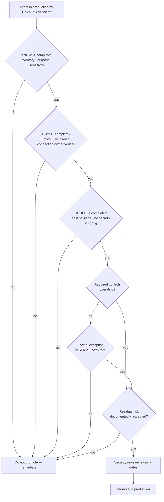

# Task 06-01 — The production promotion gate

## Introduction

The five baseline stages on the
[exercise landing page]() are useful only if
something *enforces* them. The production promotion gate is that enforcement point: the short,
non-negotiable list of what must be true before an agent is trusted with production data and authority.
This is where KNOW IT → OWN IT → SCOPE IT → CONTROL IT → WATCH IT stops being guidance and becomes a
pass/fail decision — and where you finalize the
[Agent Security Review Checklist]()
as the gate itself.

## Description

Turn the five stages into a gate with three categories:

- **Required before production:** every condition in the gate's table, from KNOW IT through WATCH IT.
- **Accepted residual risk:** a control is implemented and operating but can't fully eliminate the risk;
  the remaining risk is documented and explicitly accepted by the security reviewer, who signs it.
- **Formal temporary exception:** a required control isn't yet implemented; the exception records the
  reason, compensating controls, accountable approver, remediation owner, remediation date, and expiry
  date. An expired exception blocks continued production use.

You start from Halcourt's definition of "production", apply it to two agents, then run two more through
the gate's conditions and watch where they stall. Finally you define residual risk, exceptions and the
security reviewer's sign-off. Apply the gate to the artifacts you built — from the tenant or the artifact
pack.

## Success Criteria

- [ ] You applied Halcourt's exposure-based definition of "production" to Claims Copilot and Meeting
      Notes Summarizer, and can say why environment type predicted neither result.
- [ ] The gate lists the **required-before-production** conditions as a table, one row per stage, with
      the evidence for each.
- [ ] You ran Onboarding Guide and Policy Lookup Bot through the table and recorded where each stalls.
- [ ] Every **DENTS IT** failure in your Exercise 05 matrix is layered or accepted, and each acceptance is
      signed and dated by the security reviewer.
- [ ] The gate defines the **formal temporary exception** fields, and that an expired exception blocks
      production use.
- [ ] The [checklist]() is finalized
      as the gate, with a **security reviewer sign-off and date** line, and you have run at least one
      Halcourt agent through it end to end.

## Learning Resources

- [Copilot Studio security and governance](https://learn.microsoft.com/microsoft-copilot-studio/security-and-governance){:target="_blank"}
- [Environment strategy](https://learn.microsoft.com/power-platform/guidance/adoption/environment-strategy){:target="_blank"}
- [CoE Starter Kit](https://learn.microsoft.com/power-platform/guidance/coe/starter-kit){:target="_blank"}

## Key Tasks

### 01: Apply Halcourt's definition of production

The most expensive lifecycle failure in this estate is an agent that did production work under a "test"
label and never faced a promotion review. If your gate keys off the environment's name, that agent walks
straight past it. So Halcourt defines production by exposure:

> **Halcourt's definition of production.** An agent is in production, and must pass the gate, if *any* of
> these is true, whatever environment it lives in:
>
> - **Others use it.** Anyone other than its maker can chat with it.
> - **It reaches sensitive data.** Its **Data sensitivity** in your
>   [Exercise 02 inventory]() is PII or
>   Compensation.
> - **It acts.** It writes, approves or sends anything, or changes anything beyond the maker's own files.

{: .note }
> Your own organization's definition may vary in the details — for example, some count any customer data,
> some count internal-only use — but it should be keyed to exposure, not the environment's name or type.

Expand this section for detailed steps

1. Apply the definition to **Claims Copilot**, which lives in `Claims-Test`, an environment typed
   Sandbox. Check each of the three tests against your inventory and Access Map, and decide whether it is
   in production.
2. Apply the definition to **Meeting Notes Summarizer**, which lives in `Maker-Sandbox`. Decide the same
   way.
3. Compare your calls with the suggested ones below.

Reveal the suggested production calls

- **Claims Copilot is production**, despite its sandbox environment: it reaches customer PII (the
  Dataverse `Customer` table, with SSN and DOB), it updates claim status, and claims staff use it.
- **Meeting Notes Summarizer is not production**, despite being published: only its maker uses it, on the
  maker's own notes, and it takes no actions.

| Agent | Production? | Why |
|---|---|---|
| Benefits Buddy | Yes | Employees use it; reaches Compensation |
| Claims Copilot | Yes | Claims staff use it; reaches PII; updates claims |
| Policy Lookup Bot | Yes | Others use it; reaches PII |
| Underwriting Assistant | Yes | Underwriters use it |
| Expense Helper | Yes | Employees use it; it approves expenses |
| Onboarding Guide | Yes | New hires use it; it sends mail |
| Team Wiki | No | Only its maker uses it; read-only; Internal |
| Sales Nudge | Yes | Reps use it; reaches PII |
| HR FAQ v2 (copy) | Yes | All staff use it |
| Meeting Notes Summarizer | No | Only its maker uses it, on the maker's own notes |

Team Wiki is a reminder that the gate isn't what catches a shadow agent: nobody proposes it for
promotion, so the Exercise 02 inventory (KNOW IT) is what finds it, and its broad reach across every site
its maker can read is a finding in its own right.

Environment type predicts neither result: Claims Copilot lives in a sandbox and is production; Meeting
Notes Summarizer is published and isn't.

### 02: Set the required-before-production conditions

| Stage | Required before production | Your evidence |
|---|---|---|
| KNOW IT | Inventoried, purpose recorded, sensitivity classified | [Exercise 02 inventory](), [Exercise 03 Access Map]() |
| OWN IT | Named business owner, technical owner and security reviewer; agent and connection owners live | [Exercise 02 inventory]() and flags ([Task 02-03]()) |
| SCOPE IT | Least privilege, no secrets in configuration | [Exercise 03 Access Map](), [Exercise 05 matrix]() |
| CONTROL IT | Authorization, DLP and environment controls operating | [Exercise 05 matrix](), **Data sensitivity** column of the [Exercise 02 inventory]() |
| WATCH IT | Logging on, attribution tested, review scheduled | [Task 05-07](), [Exercise 02 inventory]() |

{: .note }
> The scheduled review re-checks every agent owner and connection owner: in **Entra ID → Users**, or for
> every account at once in
> [Graph Explorer](https://developer.microsoft.com/graph/graph-explorer){:target="_blank"} with
> `GET https://graph.microsoft.com/v1.0/users?$select=userPrincipalName,displayName,accountEnabled,signInActivity`,
> or in [`users-export.csv`]() without the tenant.

Expand this section for detailed steps

1. Use the table as your gate's required-before-production conditions.
2. For each condition, look up its control in your Exercise 05 matrix. Where the control **CLOSES IT**,
   that control must be operating before promotion. Where it only **DENTS IT**, handle it in Key Task 03.
3. Run **Onboarding Guide** and **Policy Lookup Bot** through the table, stage by stage, and record the
   first stage where each stalls and why.
4. Compare your results with the suggested ones below.

Reveal the suggested results

- **Onboarding Guide fails OWN IT.** Its owner, and the owner of the shared connection it sends mail
  through, is Tom Dean, who has left and whose account is disabled. The connection is still live.
- **Policy Lookup Bot fails OWN IT first.** Its owner is the IT Helpdesk shared mailbox, not a named
  person. Fix that and it still fails SCOPE IT: its HTTP integration carries a static, full-scope API key
  in the action configuration, so anyone who can view or export the agent gets the key.

{: .note }
> There is no "we'll fix it after launch" for a required condition — only a formal, dated exception.

### 03: Define residual risk, exceptions and sign-off

Expand this section for detailed steps

1. **For each DENTS IT failure in your Exercise 05 matrix, choose one:**
   - **Layer it.** Name a second control that, together with the first, raises the bar — for example,
     scoped grounding plus an encrypting label. Confirm both are operating.
   - **Accept it.** Record the remaining risk and why the controls can't remove it. The security
     reviewer signs and dates it.
2. Write the gate rule: an agent with a DENTS IT failure passes only with a layered control or a
   documented, signed residual risk.
3. Define the **formal temporary exception**. It records:
   - the reason;
   - the compensating controls;
   - the accountable approver;
   - the remediation owner;
   - the remediation date;
   - the expiry date — an expired exception blocks continued production use.
4. Add the **sign-off line**: the security reviewer signs and dates the promotion.
5. Finalize your
   [Agent Security Review Checklist]()
   so it reads as the gate — required conditions, residual risk, exceptions, sign-off — and walk at least
   one agent through it completely.

{: .note }
> Promotion without a signature is not a gate.

{: .important }
> The gate is deliberately unromantic. It does not promise an agent is safe — it promises that a named
> person looked at each trust boundary, closed what could be closed, documented and signed the risk that
> remains, and put a deadline on any exception. That is the difference between an estate you govern
> and one you merely host.

## Summary

The production promotion gate converts the five-stage baseline into a pass/fail decision. You applied
Halcourt's exposure-based definition of "production" and saw that environment type predicts nothing, set
the required conditions as one table row per stage with the evidence for each, required a layered control
or a signed residual risk for every dented failure, separated required controls from accepted residual
risk and time-limited exceptions, and added the security reviewer's sign-off that makes residual risk
something a person accepted rather than something everyone missed. Your Agent Security Review Checklist
is now an operating model, not a snapshot. Carry it into
[Exercise 07](), where you point the same
gate at your own tenant and decide your top three first-week actions.
