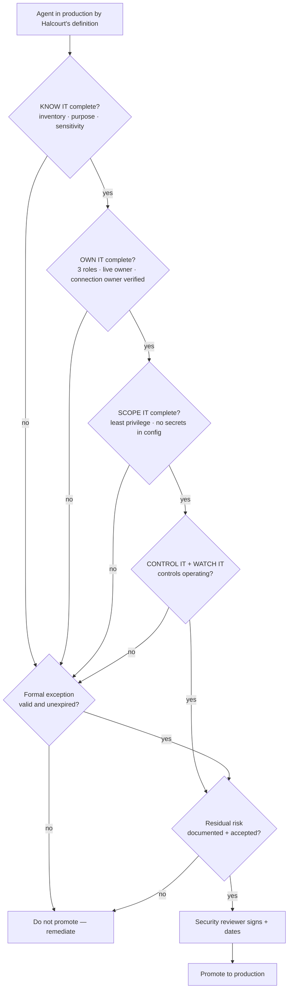

# Task 06-01 — The production promotion gate

## Introduction

The five baseline stages on the
[exercise landing page]() are useful only if
something *enforces* them. The production promotion gate is that enforcement point: the short,
non-negotiable list of what must be true before an agent is trusted with production data and authority.
This is where KNOW IT → OWN IT → SCOPE IT → CONTROL IT → WATCH IT stops being guidance and becomes a
pass/fail decision, recorded in the
[Gate record](#gate-record) of the
Agent Security Review Checklist.

## Description

Halcourt's gate sorts everything it checks into three categories:

- **Required before production:** the conditions in the gate's table, one per stage from KNOW IT through
  WATCH IT. Each one must be met before promotion.
- **Accepted residual risk:** a control that is operating but can't remove all of the risk. The security
  reviewer documents what remains, accepts it and signs it.
- **Formal temporary exception:** a required control that isn't implemented yet. A dated exception covers
  it for a limited time, and once the exception expires it blocks production use.

You apply the gate rather than design it. First you use Halcourt's definition of production to decide
which agents must pass. Then you run two agents through the required conditions to see where they stall.
Last, you take Benefits Buddy all the way through and sign it off. Everything goes in the Gate record, from
the tenant or from the artifact pack.

## Success Criteria

- [ ] You applied Halcourt's definition of production to Claims Copilot and Meeting Notes Summarizer and
      recorded each call in the
      [Gate record](#gate-record).
      You can explain why environment type predicted neither result.
- [ ] You ran Onboarding Guide and Policy Lookup Bot through the table and recorded where each stalls and
      why.
- [ ] Benefits Buddy has a complete Gate record: roles named, owners confirmed live, and every stage as
      found and after the fixes. Each **DENTS IT** failure is layered or accepted, the exception decision
      is recorded, and the **security reviewer sign-off** is signed and dated.
- [ ] You can name what a formal temporary exception records, and why an expired one blocks production
      use.

## Learning Resources

- [Copilot Studio security and governance](https://learn.microsoft.com/microsoft-copilot-studio/security-and-governance){:target="_blank"}
- [Environment strategy](https://learn.microsoft.com/power-platform/guidance/adoption/environment-strategy){:target="_blank"}
- [CoE Starter Kit](https://learn.microsoft.com/power-platform/guidance/coe/starter-kit){:target="_blank"}

## Key Tasks

### 01: Apply Halcourt's definition of production

The most expensive lifecycle failure in this estate is an agent that did production work under a "test"
label and never faced a promotion review. If your gate keys off the environment's name, that agent walks
straight past it. So Halcourt defines production by exposure:

> **Halcourt's definition of production.** An agent is in production, and must pass the gate, if *any* of
> these is true, whatever environment it lives in:
>
> - **Others use it.** Anyone other than its maker can chat with it.
> - **It reaches sensitive data.** Its **Data sensitivity** in your
>   [Exercise 02 inventory]() is PII or
>   Compensation.
> - **It acts.** It writes, approves or sends anything, or changes anything beyond the maker's own files.

{: .note }
> Your own organization's definition may vary in the details. Some count any customer data; some count
> internal-only use. Either way, key it to exposure, not the environment's name or type.

Expand this section for detailed steps

1. Apply each of the three tests to **Claims Copilot**, using your inventory and Access Map. If any test
   is true, it's in production.
2. Apply the same tests to **Meeting Notes Summarizer**.
3. Record each agent and its **Production?** call in the first table of the
   [Gate record](#gate-record).
4. Compare your calls with the suggested ones below.

Reveal the suggested production calls

- **Claims Copilot is production**, despite its sandbox environment: it reaches customer PII (the
  Dataverse `Customer` table, with SSN and DOB), and claims staff use it.
- **Meeting Notes Summarizer is not production**, despite being published: only its maker uses it, on the
  maker's own notes, and it takes no actions. That holds only if the notes hold nothing sensitive: its
  sensitivity stays Unknown in your inventory until you check.

| Agent | Production? | Why |
|---|---|---|
| Benefits Buddy | Yes | Employees use it; reaches Compensation |
| Claims Copilot | Yes | Claims staff use it; reaches PII |
| Policy Lookup Bot | Yes | Others use it; reaches PII |
| Underwriting Assistant | Yes | Underwriters use it |
| Expense Helper | Yes | Employees use it; it approves expenses |
| Onboarding Guide | Yes | New hires use it; it sends mail |
| Team Wiki | Yes | Classified Compensation in your inventory: it grounds on the `HR-Benefits` site |
| Sales Nudge | Yes | Reps use it; reaches PII |
| HR FAQ v2 (copy) | Yes | All staff use it |
| Meeting Notes Summarizer | No | Only its maker uses it, on the maker's own notes; sensitivity Unknown until checked |

Team Wiki meets the definition, yet nobody will ever propose it for promotion, so the gate never sees it.
The Exercise 02 inventory (KNOW IT) is what finds a shadow agent; the gate only governs what's brought to
it.

Environment type predicts neither result: Claims Copilot lives in a sandbox and is production; Meeting
Notes Summarizer is published and isn't.

### 02: Run two agents through the conditions

| Stage | Required before production | Your evidence |
|---|---|---|
| KNOW IT | Inventoried, purpose recorded, sensitivity classified | [Exercise 02 inventory](), [Exercise 03 Access Map]() |
| OWN IT | Named business owner, technical owner and security reviewer; agent and connection owners live | [Exercise 02 inventory]() and flags ([Task 02-03]()) |
| SCOPE IT | Least privilege, no secrets in configuration | [Exercise 03 Access Map](), [Exercise 05 matrix]() |
| CONTROL IT | Authorization, DLP and environment controls operating | [Exercise 05 matrix](), **Data sensitivity** column of the [Exercise 02 inventory]() |
| WATCH IT | Logging on, attribution tested, review scheduled | [Task 05-07](), [Exercise 02 inventory]() |

{: .note }
> The scheduled review re-checks every agent owner and connection owner. Check them in **Entra ID →
> Users**, or all at once in
> [Graph Explorer](https://developer.microsoft.com/graph/graph-explorer){:target="_blank"} with
> `GET https://graph.microsoft.com/v1.0/users?$select=userPrincipalName,displayName,accountEnabled,signInActivity`.
> Without the tenant, use [`users-export.csv`]().

Expand this section for detailed steps

1. For each condition, look up its controls in your Exercise 05 matrix. A control that **CLOSES IT** must
   be operating before promotion. A **DENTS IT** control is handled in Key Task 03. Where every control
   **MISSES IT** on a required condition, no control meets it: the design has to change, or the gate needs
   a formal exception (Key Task 03, step 4).
2. Run **Onboarding Guide** and **Policy Lookup Bot** through the table, stage by stage. Record the first
   stage where each stalls, and why, in the **Stalls at** and **Why** columns of the
   [Gate record](#gate-record).
3. Compare your results with the suggested ones below.

Reveal the suggested results

- **Onboarding Guide fails OWN IT.** Its owner, and the owner of the shared connection it sends mail
  through, is Tom Dean, who has left. Nobody disabled his account, so the connection is still live.
- **Policy Lookup Bot fails OWN IT first.** Its owner is the IT Helpdesk shared mailbox, not a named
  person. Fix that and it still fails SCOPE IT. Its HTTP integration carries a static, full-scope API key
  in the action configuration, so anyone who can view or export the agent gets the key.

{: .note }
> There is no "we'll fix it after launch" for a required condition — only a formal, dated exception.

### 03: Take Benefits Buddy through the gate

Walk **Benefits Buddy** through the gate completely. Name who is accountable for it and take it stage by
stage. Then handle its dented failures, any exception and the sign-off. An agent with a **DENTS IT**
failure passes the gate only with a layered control or a documented, signed residual risk.

Expand this section for detailed steps

1. **Name the three roles.** OWN IT needs a named business owner, technical owner and security reviewer,
   and no agent in the estate has them on record yet. For Benefits Buddy:
   - the **business owner** and **technical owner** are its owner, from your
     [Exercise 02 inventory]();
   - the **security reviewer** is you: you joined Halcourt as its platform owner and security reviewer, so
     in this workshop that role is yours. The maker is not the security reviewer by default.

   Then confirm that the **agent owner** and the owner of **each connection** it uses are enabled
   accounts. Check in **Entra ID → Users**, in Graph Explorer, or in
   [`users-export.csv`]() and
   [`connections-export.csv`]().
2. **Walk the stages.** For each stage, KNOW IT through WATCH IT, check the agent against that stage's
   section of the
   [Agent Security Review Checklist]()
   twice: **as found**, and **after the fixes**. Record pass or fail and the reason each time.
   - **CONTROL IT:** check the environment and its DLP policy against the agent's **Data sensitivity**.
     Decide from that sensitivity and the agent's actions whether the requesting-user authorization rule
     applies. Then check data protection, starting with the label on what it reaches.
   - **WATCH IT:** take logging and attribution from your
     [Task 05-07]() result, and name a review owner and
     frequency for the scheduled review.

   Record its **Production?** call, the first stage where it stalls as found, and whether it passes after
   the fixes. These go in the first table of the
   [Gate record](#gate-record).
3. **Handle what's still open.** In your
   [Exercise 05 matrix](), read the **A**
   (grounding injection) and **B** (exfiltration) rows, Benefits Buddy's failures. For each **DENTS IT**
   cell, record either:
   - **a layer:** a second control that, together with the first, raises the bar. Confirm both are
     operating.
   - **an accepted risk:** the remaining risk and why the controls can't remove it. As the security
     reviewer, you sign and date it.

   Where every control in a row **MISSES IT** and no required condition depends on it, nothing dents the
   failure: record it as an accepted risk, with what limits it. If a required condition does depend on it,
   it needs a formal exception instead (step 4). Record each as a row in the **DENTS IT failures** table of the Gate record.
4. **Decide on an exception.** A **formal temporary exception** covers a required control that isn't yet
   implemented. It records:
   - the reason;
   - the compensating controls;
   - the accountable approver;
   - the remediation owner;
   - the remediation date;
   - the expiry date — an expired exception blocks continued production use.

   If Benefits Buddy needs one, record it in the **Formal temporary exception** table of the Gate record.
5. **Sign off.** Record the **security reviewer sign-off** — your name and the date — at the bottom of the
   Gate record.
6. Compare your record with the suggested one below.

Reveal the suggested Benefits Buddy record

**Roles.** Marcus Webb owns the agent, so he is its business owner and technical owner; you are its
security reviewer. Marcus's account is enabled. The agent has no connection of its own: its SharePoint
knowledge searches the site directly, so there is no connection owner to check.

| Stage | As found | After fixes | Why |
|---|---|---|---|
| KNOW IT | Pass | Pass | Inventoried in `Halcourt-Prod`, purpose recorded (employee benefits and open-enrollment questions), sensitivity classified as Compensation. |
| OWN IT | Pass, once you name the roles | Pass | The three roles are named in step 1; the agent owner's account is enabled, and there is no connection owner to account for. |
| SCOPE IT | **Fail** — first stall | **Exception** | Whole-site grounding reaches `Leadership/2026-comp-bands.xlsx`, beyond its users' reach. Removing the Members group's access to `Leadership/` ([Task 05-03]()) is the right fix, but the agent kept returning the band table from its index. Until a retest shows the table gone, the stage isn't met. No HTTP or MCP integration, so no secrets in configuration. |
| CONTROL IT | **Fail** | **Exception** | Environment and DLP pass: it lives in `Halcourt-Prod`, under `Halcourt-Prod-DLP`, which permits SharePoint, so DLP doesn't bound what grounding returns. The requesting-user rule doesn't apply: it reads Compensation, not PII, and changes nothing. Data protection fails because the original `2026-comp-bands.xlsx` carries no label. The labeled copy you inspected in [Task 05-06]() shows the fix, reasoned rather than retested. Applying the label to the original is a fix the gate requires, not one Exercise 05 made. |
| WATCH IT | **Fail** | Pass | No review is scheduled as found. After the fixes, the review owner and frequency are the ones you named (for example, Marcus Webb, quarterly), with audit and DSPM for AI on and your Task 05-07 attribution result recorded. Defender real-time protection doesn't apply: it inspects tool calls, and Benefits Buddy makes none. |

The Gate record row you would write:

| Agent | Production? | Stalls at | Why |
|---|---|---|---|
| Benefits Buddy | Yes | As found: SCOPE IT. After the fixes: passes under a formal temporary exception until the retest shows the band table gone. | Employees use it and it reaches Compensation. Whole-site grounding reached `Leadership/2026-comp-bands.xlsx`, beyond its users' reach. The access change and the label are the fixes, but neither showed within the session; the exception below covers the gap, and the remaining Scenario A risk is accepted. |

| Agent | Dented control | Layered control *or* accepted residual risk | Accepted by | Date |
|---|---|---|---|---|
| Benefits Buddy | B — Least privilege / identity | **Layer:** remove the Members group's access to `Leadership/`, and put `Confidential-PII` on the original `2026-comp-bands.xlsx`. Neither showed within the session: the agent answered from its index, and labels take longer to apply. Exercise 05 restored the access after its retests, so remove it again before sign-off. That's why the exception below exists. | — | — |
| Benefits Buddy | B — Purview | **Layer:** the label is the second control in the pair above. | — | — |
| Benefits Buddy | A — nothing dented it | **Accept:** no control in Exercise 05 stops hidden instructions in a document the agent is allowed to read. Limit who can edit `HR-Benefits`, and review Benefits Buddy's interactions in DSPM for AI. | You (security reviewer) | Today's date |

| Agent | Reason | Compensating controls | Accountable approver | Remediation owner | Remediation date | Expiry date |
|---|---|---|---|---|---|---|
| Benefits Buddy | The band table is still reachable: `Leadership/` access was restored after the Exercise 05 retests, the agent answers from its index, and the original comp file carries no label yet. | DSPM for AI reviews Benefits Buddy's interactions weekly; the Members group's access to `Leadership/` is removed again, and checked, before sign-off. | You (security reviewer) | Marcus Webb (technical owner) | Label applied and retest passed, within 14 days | 30 days from today |

- **Exception:** needed. An exception that expires before the retest passes blocks Benefits Buddy from
  production use.
- **Sign-off:** you are Halcourt's security reviewer in this workshop, so the sign-off is your name and
  today's date. The approver isn't the agent's owner: the person who owns the fix doesn't approve running
  without it.

{: .note }
> Promotion without a signature is not a gate.

{: .important }
> The gate is deliberately unromantic. It does not promise an agent is safe. It promises that a named
> person looked at each trust boundary and closed what could be closed. That person also documented and
> signed the risk that remains, and put a deadline on any exception. That is the difference between an estate you govern
> and one you merely host.

## Summary

The production promotion gate is where the five-stage baseline becomes a pass/fail decision that a named
person signs. You applied Halcourt's exposure-based definition of "production" and saw that environment
type predicts nothing. Then you ran agents through the required-before-production conditions to find
where they stall. Last, you took Benefits Buddy all the way through and layered or accepted each dented
failure. You ended with the security reviewer's sign-off in the Gate record of your Agent Security Review
Checklist.
Take that checklist home: the [Appendix]() shows where to look in your own tenant
and how to pick your first-week actions.
