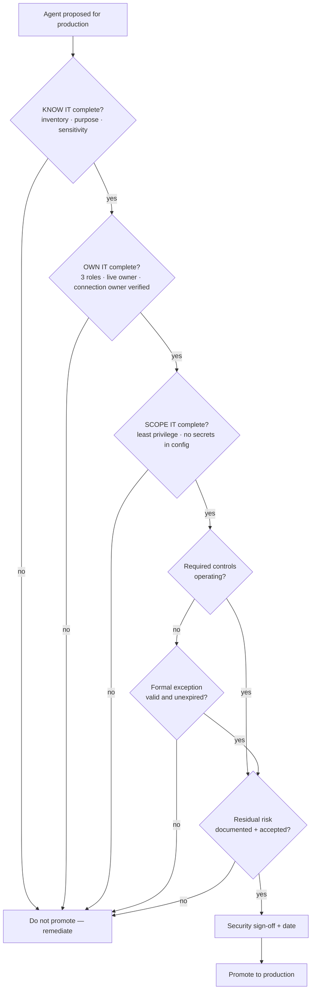

# Task 06-04 — The production promotion gate

## Introduction

Five stages of a baseline are useful only if something *enforces* them. The production promotion gate is
that enforcement point: the short, non-negotiable list of what must be true before an agent is trusted
with production data and authority. This is where KNOW IT → OWN IT → SCOPE IT → CONTROL IT → WATCH IT
stops being guidance and becomes a pass/fail decision — and where you finalize the
[Agent Security Review Checklist]()
as the gate itself.

## Description

Turn the five stages into a gate with three categories:

- **Required before production:** every KNOW / OWN / SCOPE criterion, plus appropriate authorization
  operating, applicable DLP and environment controls operating, secrets handled (none in configuration),
  required logging enabled, and minimum monitoring and lifecycle ownership established.
- **Accepted residual risk:** a control is implemented and operating but can't fully eliminate the risk;
  the remaining risk is documented and explicitly accepted by security accountability.
- **Formal temporary exception:** a required control isn't yet implemented; the exception records the
  reason, compensating controls, accountable approver, remediation owner, remediation date, and expiry
  date. An expired exception blocks continued production use.

Define what "production" means for your estate, set the gate, and record sign-off. The Halcourt estate is
the test: run a couple of its agents through the gate and watch where they stall. Apply the gate to the
artifacts you built — from the tenant or the artifact pack.

## Success Criteria

- [ ] "Production" is defined by **real exposure**, not by an environment's name or type.
- [ ] The gate lists the **required-before-production** conditions.
- [ ] The gate defines how **accepted residual risk** is documented and signed.
- [ ] The gate defines the **formal temporary exception** fields, and that an expired exception blocks
      production use.
- [ ] The [checklist]() is finalized
      as the gate, with a **sign-off and date** line, and you have run at least one Halcourt agent through
      it end to end.

## Learning Resources

- [Copilot Studio security and governance](https://learn.microsoft.com/microsoft-copilot-studio/security-and-governance){:target="_blank"}
- [Environment strategy](https://learn.microsoft.com/power-platform/guidance/adoption/environment-strategy){:target="_blank"}
- [CoE Starter Kit](https://learn.microsoft.com/power-platform/guidance/coe/starter-kit){:target="_blank"}

## Key Tasks

### 01: Define what "production" means — by exposure, not label

The most expensive lifecycle failure in this estate is an agent that did production work under a "test"
label and never faced a promotion review. If your gate keys off the environment's name, that agent walks
straight past it.

Expand this section for detailed steps

1. Write a one-line definition of "production" for your estate based on **exposure**: an agent is in scope
   for the gate if real users depend on it, or it reaches real customer/employee data or takes
   consequential actions — regardless of which environment it happens to live in.
2. Sanity-check it against the estate: find an agent whose environment is typed "sandbox" or "test" but
   whose usage and data reach are clearly production. Confirm your definition would pull it into the gate.
   This is the case that defeats a label-based rule.
3. Record the definition at the top of the gate so nobody can argue an agent is exempt because of where it
   was built.

### 02: Set the required-before-production conditions

Expand this section for detailed steps

1. List the conditions an agent must meet before promotion:
   a. fully inventoried and classified (KNOW IT — your inventory and Access Map from Exercises
      02–03);
   b. a named, **live** business owner, technical owner and security accountability, and every
      **connection owner** enabled and known (OWN IT — the owner and connection-owner lookups in your
      [Exercise 02 inventory]() and the
      [Exercise 02 flags]());
   c. least-privilege permissions and **no secrets in configuration** (SCOPE IT);
   d. appropriate authorization operating, and applicable DLP and environment controls operating
      (CONTROL IT);
   e. required logging enabled, and minimum monitoring and lifecycle ownership established (WATCH IT).
2. Use your Exercise 05 matrix: anything a control closed is required, not optional.
3. Run a Halcourt agent through these conditions and record where it stalls:
   a. an agent owned or connected-to by a disabled account fails at OWN IT;
   b. an agent with a static key in its HTTP action fails at SCOPE IT.

{: .note }
> There is no "we'll fix it after launch" for a required condition — only a formal, dated exception.

### 03: Define residual risk, exceptions and sign-off

Expand this section for detailed steps

1. Define **accepted residual risk**: for each failure your Exercise 05 matrix marked as only dented,
   record the remaining risk and why the operating control can't eliminate it, and have security
   accountability sign and date its acceptance.
2. Define the **formal temporary exception**:
   a. reason;
   b. compensating controls;
   c. accountable approver;
   d. remediation owner;
   e. remediation date;
   f. expiry date — an expired exception blocks continued production use.
3. Add the **sign-off line**: security accountability signs and dates the promotion.
4. Finalize your [Agent Security Review Checklist]()
   so it reads as the gate — required conditions, residual risk, exceptions, sign-off — and walk at least
   one agent through it completely.

{: .note }
> Promotion without a signature is not a gate.

{: .important }
> The gate is deliberately unromantic. It does not promise an agent is safe — it promises that a named
> person looked at each trust boundary, closed what could be closed, documented and signed the risk that
> remains, and put a deadline on any exception. That is the difference between an estate you govern
> and one you merely host.

## Summary

The production promotion gate converts the five-stage baseline into a pass/fail decision. You defined
"production" by exposure so a mislabeled agent cannot dodge review, made every KNOW / OWN / SCOPE
criterion a hard block, separated required controls from accepted
residual risk and time-limited exceptions, and added the sign-off
that makes residual risk something a person accepted rather than something everyone missed. Your Agent
Security Review Checklist is now an operating model, not a snapshot. Carry it into
[Exercise 07](), where you point the same
gate at your own tenant and decide your top three first-week actions.
