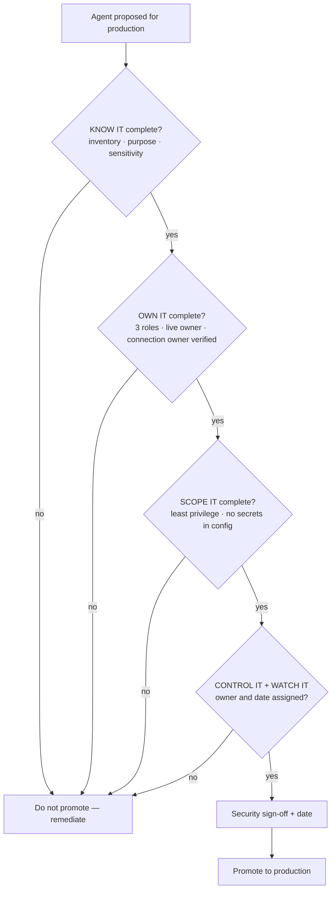

# Task 06-06 — The production promotion gate

## Introduction

Five stages of a baseline are useful only if something *enforces* them. The production promotion gate is
that enforcement point: the short, non-negotiable list of what must be true before an agent is trusted
with production data and authority. This is where KNOW IT → OWN IT → SCOPE IT → CONTROL IT → WATCH IT
stops being guidance and becomes a pass/fail decision — and where you finalize the
[Agent Security Review Checklist]()
as the gate itself.

## Description

Turn the five stages into a gate with two kinds of criteria: **hard pass/fail** conditions that must be
checked before promotion, and **assigned-with-a-date** conditions that must have a named owner and a
committed timeline. Define what "production" means for your estate, set the gates, and record sign-off.
The Meridian estate is the test: run a couple of its agents through the gate and watch where they stall.

**Offline path.** The gate is applied against the artifacts you have already built from the
[artifact pack](#the-artifact-pack) — inventory, ownership joins, access
map, control matrix. No new data is needed; the gate is the synthesis.

## Success Criteria

- [ ] "Production" is defined by **real exposure**, not by an environment's name or type.
- [ ] The gate lists the **hard pass/fail** conditions (every KNOW / OWN / SCOPE box) that block promotion
      when unmet.
- [ ] The gate lists the **assigned-with-a-date** conditions (CONTROL / WATCH) that require a named owner
      and a committed date.
- [ ] The [checklist]() is finalized
      as the gate, with a **sign-off and date** line, and you have run at least one Meridian agent through
      it end to end.

## Learning Resources

- [Copilot Studio security and governance](https://learn.microsoft.com/microsoft-copilot-studio/security-and-governance){:target="_blank"}
- [Environment strategy](https://learn.microsoft.com/power-platform/guidance/adoption/environment-strategy){:target="_blank"}
- [CoE Starter Kit](https://learn.microsoft.com/power-platform/guidance/coe/starter-kit){:target="_blank"}

## Key Tasks

### 01: Define what "production" means — by exposure, not label

The most expensive lifecycle failure in this estate is an agent that did production work under a "test"
label and never faced a promotion review. If your gate keys off the environment's name, that agent walks
straight past it.

Expand this section for detailed steps

1. Write a one-line definition of "production" for your estate based on **exposure**: an agent is in scope
   for the gate if real users depend on it, or it reaches real customer/employee data or takes
   consequential actions — regardless of which environment it happens to live in.
2. Sanity-check it against the estate: find an agent whose environment is typed "sandbox" or "test" but
   whose usage and data reach are clearly production. Confirm your definition would pull it into the gate.
   This is the case that defeats a label-based rule.
3. Record the definition at the top of the gate so nobody can argue an agent is exempt because of where it
   was built.

### 02: Set the hard pass/fail gates

Some conditions are not negotiable and not deferrable. If they are not true, the agent does not go to
production — there is no "we'll fix it after launch" for these.

Expand this section for detailed steps

1. Make **every KNOW IT, OWN IT, and SCOPE IT** criterion a hard gate. Concretely, an agent fails
   promotion if it is not fully inventoried and classified; if it lacks a named, **live** business owner,
   technical owner, and security accountability; if its **connection owner** is disabled or unknown; if
   its permissions are not least-privilege; or if a **secret sits in an action configuration**.
2. These map directly to the failures that a real fix genuinely **CLOSES IT** — over-permission,
   surviving-connection lifecycle, secrets in config. There is no reason to promote past an unfixed one,
   so they block.
3. Run a Meridian agent through these gates and record where it stalls. An agent owned or connected-to by
   a disabled account should fail at OWN IT; an agent with a static key in its HTTP action should fail at
   SCOPE IT. The gate working *is* the exercise succeeding.

### 03: Finalize the checklist and record sign-off

CONTROL IT and WATCH IT include the honest hard cases — indirect injection and confused-deputy — that a
platform toggle only **DENTS IT**. You do not block forever on a failure that cannot be fully closed
today; you require an accountable owner and a committed date, and an explicit, informed sign-off.

Expand this section for detailed steps

1. Make the **CONTROL IT and WATCH IT** criteria assigned-with-a-date gates: each must have a named owner
   and a committed date before promotion, so residual risk is *accepted by someone*, not ignored.
2. Add the **sign-off line**: security accountability signs and dates the promotion, confirming the hard
   gates are met and the dated commitments are real. Promotion without a signature is not a gate.
3. Finalize your [Agent Security Review Checklist]()
   so it reads as the gate — hard conditions up top, dated commitments next, sign-off at the bottom — and
   confirm you have walked at least one agent through it completely.

{: .important }
> The gate is deliberately unromantic. It does not promise an agent is safe — it promises that a named
> person looked at each trust boundary, closed what could be closed, put an owner and a date on what could
> not, and signed. That is the difference between an estate you govern and one you merely host.

## Summary

The production promotion gate converts the five-stage baseline into a pass/fail decision. You defined
"production" by exposure so a mislabeled agent cannot dodge review, made every KNOW / OWN / SCOPE
criterion a hard block, made CONTROL / WATCH criteria owner-and-date commitments, and added the sign-off
that makes residual risk something a person accepted rather than something everyone missed. Your Agent
Security Review Checklist is now an operating model, not a snapshot. Carry it into
[Exercise 07](), where you point the same
gate at your own tenant and decide your first three Monday-morning actions.
