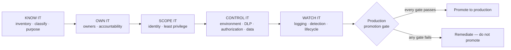

# Exercise 06: Build an Agent Security Baseline

## Scenario

You spent the morning finding out what Halcourt Mutual's agents can actually do. Now turn that into
something you can hand to a colleague on Monday: an operating model that any agent must pass through
before it earns production trust.

By this point you have an inventory, an access map, a threat model, and an honest control-efficacy
matrix. That is a snapshot of *one* estate on *one* day. It is not yet an operating model. When the next
maker ships the next agent — and they will, before anyone tells you — you need a repeatable standard that
answers the same three questions every time: **how many agents, who owns them, what can they reach.**

This exercise assembles that standard as five plain-English stages and a gate:

**KNOW IT → OWN IT → SCOPE IT → CONTROL IT → WATCH IT → the production promotion gate.**

Each stage takes one of the artifacts you already built and distils it into a reusable checklist section.
The Halcourt estate is your worked example: you run its agents through the checklist, watch which ones
stall at which gate, and write the rule so the *next* estate — including your own — clears the same bar.

{: .note }
> This is the **OPERATIONALIZE** phase of the through-line. Nothing here is Halcourt-specific by the end:
> the deliverable is a checklist you take home and apply to agents that don't exist yet.

## Objectives

After this exercise you will be able to:

- Convert an ad-hoc inventory, access map, and control assessment into a repeatable **agent security
  baseline** organized as KNOW IT → OWN IT → SCOPE IT → CONTROL IT → WATCH IT.
- State, for each stage, the concrete criterion an agent must meet and how to verify it in the live admin
  surfaces, or from a tenant export when you can't reach them.
- Carry your Exercise 05 verdicts into the baseline: where a control closed a failure, require it; where
  it only dented one, require a documented residual-risk decision.
- Define a **production promotion gate** in three categories — required controls, accepted residual
  risk, and formal time-limited exceptions — that must be settled before any agent is trusted with
  production data and authority.
- Finalize the **Agent Security Review Checklist** as the artifact that enforces the gate.

## Duration

**Estimated time:** 25 minutes

## Deliverable

The [Agent Security Review Checklist]()
— completed as your operating model and framed as the gate an agent must clear before production. Each
task in this exercise builds and sharpens one section of it; the final task turns the whole checklist
into the promotion gate.
