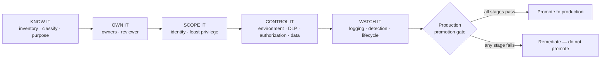

# Exercise 06: Apply an Agent Security Baseline

## Scenario

You've found out what Halcourt Mutual's agents can actually do. Now see how that work becomes an operating
model any agent must pass through before it earns production trust — one you can hand to a colleague.

By this point you have an inventory, an access map, a threat model, and an honest control-efficacy
matrix. That is a snapshot of *one* estate on *one* day. It is not yet an operating model. When the next
maker ships the next agent — and they will, before anyone tells you — you need a repeatable standard that
answers the same three questions every time: **how many agents, who owns them, what can they reach.**

The standard is five plain-English stages and a gate:

**KNOW IT → OWN IT → SCOPE IT → CONTROL IT → WATCH IT → the production promotion gate.**

You've done the work behind every stage. The one new step is naming who's accountable: a business owner,
a technical owner and a security reviewer. This exercise names each stage, points to where you did it, and
hands you the rules as a ready-made checklist.

| Stage | What it asks | Where you already did it |
|---|---|---|
| KNOW IT | What agents exist, what each is for, how sensitive its data is | [Exercise 02 inventory](), [Exercise 03 Access Map]() |
| OWN IT | Who's accountable, and are the owners and connection owners live | [Exercise 02 owner and connection-owner lookups](), [Task 02-03]() flags |
| SCOPE IT | Whose credential acts, and is its reach the minimum the job needs | [Exercise 03 Access Map](), [Exercise 05 least-privilege retests]() |
| CONTROL IT | Do the platform's controls hold for this agent | [Exercise 05 DLP, Purview and Conditional Access tests](); [Scenario D in Exercise 04]() |
| WATCH IT | Would you notice drift, misuse or an orphan | [Task 05-07]() audit and Defender work, Exercise 02 lookups run on a schedule |

The operating rules for each stage are in the
[Agent Security Review Checklist]().

The one task in this exercise applies all five stages:
[the production promotion gate]().

{: .note }
> This is the **OPERATIONALIZE** phase of the through-line. Nothing here is Halcourt-specific by the end:
> the deliverable is a checklist you take home and apply to agents that don't exist yet.

## Objectives

After this exercise you will be able to:

- Explain the five stages and where in this workshop you did each one.
- Apply an exposure-based definition of production, and explain why an environment's name or type can't
  decide it.
- Run an agent through the gate's required conditions and name the first stage where it stalls.
- Handle a DENTS IT failure by layering a second control, or by recording a residual risk the security
  reviewer signs.
- Name what a formal temporary exception records, and why an expired one blocks production use.

## Duration

**Estimated time:** 20 minutes

## Deliverable

The [Agent Security Review Checklist]()
— the gate's rules, ready to apply to your own agents — plus your
[gate results](#gate-record) for the
Halcourt agents you ran through it.
