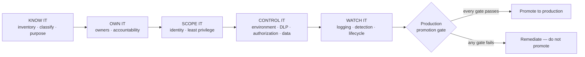

# Exercise 06: Build an Agent Security Baseline

## Scenario

You've found out what Halcourt Mutual's agents can actually do. Now turn that into something you can hand
to a colleague: an operating model that any agent must pass through before it earns production trust.

By this point you have an inventory, an access map, a threat model, and an honest control-efficacy
matrix. That is a snapshot of *one* estate on *one* day. It is not yet an operating model. When the next
maker ships the next agent — and they will, before anyone tells you — you need a repeatable standard that
answers the same three questions every time: **how many agents, who owns them, what can they reach.**

This exercise assembles that standard as five plain-English stages and a gate:

**KNOW IT → OWN IT → SCOPE IT → CONTROL IT → WATCH IT → the production promotion gate.**

Each stage takes one of the artifacts you already built and distils it into a reusable checklist section.
The Halcourt estate is your worked example: you run its agents through the checklist, watch which ones
stall at which gate, and write the rule so the *next* estate — including your own — clears the same bar.

KNOW IT has no task of its own here: it is the inventory you built in Exercises 02 and 03, including each
agent's data-sensitivity classification and its intended users. As an operating rule, KNOW IT means three
things. The inventory covers **every** environment, including the default and personal ones, and is
refreshed on a set cadence, because any inventory is a point-in-time snapshot. The Agent 365 registry
(**Microsoft 365 admin center → Agents → All agents → Registry**) is the ongoing source for it. And an
agent's purpose and intended users are recorded *before* it is considered for promotion.

OWN IT has no task of its own either: it is the owner and connection-owner checks you ran in Exercise 02,
when you looked up each agent owner and each connection owner separately and flagged the ones that didn't
hold up. As an operating rule, OWN IT means three things. A **business owner**, a **technical owner** and
**security accountability** are named when the agent is registered. The maker who built the agent is
*not* the security-accountable party by default. And a disabled owner, or an unreviewed shared-mailbox or
service-account owner, of the agent **or of any connection it uses** is an automatic fail until a live,
named person is accountable.

SCOPE IT has no task of its own either: it is the access mapping you did in Exercise 03 and the
least-privilege and grounding retests you ran in Exercise 05. As an operating rule, SCOPE IT means six
things. The **acting credential** is recorded for every knowledge source, connector, tool, flow, HTTP and
MCP integration. Dataverse access uses a scoped security role with narrowed record-level access, not a
broad customizer or admin role. Connectors, tools and MCP operations are limited to what the purpose needs.
Grounding is narrowed to the minimum content. HTTP and MCP integrations authenticate **per-user where
possible**, validate their input, and hold **no secrets in configuration**. And the agent's data reach is
bounded by its intended users' reach.

{: .note }
> A shared service identity has one fixed security context: scoping it shrinks the blast radius, but
> requester-specific access needs on-behalf-of authorization. And what an MCP server advertises, what the
> agent calls, and what the token can invoke are three different lists — scope is set by the widest.

CONTROL IT has no task of its own either: it is the DLP, authorization, data-protection and Conditional
Access tests you ran in Exercise 05, with the Scenario D evidence from Exercise 04. As an operating rule,
CONTROL IT means six things. An agent lives in an environment whose DLP policy matches the **Data
sensitivity** in its Exercise 02 inventory. The default environment is disallowed for sensitive agents. A
sandbox doing production work needs production DLP, or the agent moves to a managed production
environment. Authorization is enforced against the **requesting user**, not a shared identity, for any
agent that can change state or read PII. Data protection is verified, not assumed: the label applied,
whether it encrypts, who holds VIEW and EXTRACT, and any DLP policy keyed on the label. And Conditional
Access applicability is recorded per path.

{: .note }
> Neither DLP nor Conditional Access changes whose credential acts. And Conditional Access on an agent's
> Agent ID is enforced only when the agent runs in Teams, and requires Microsoft Agent 365 (or E7).

WATCH IT has no task of its own either: it is the audit and Defender work you did in Exercise 05 (Task
05-07) and the owner and connection-owner lookups from Exercise 02, run on a schedule. As an operating
rule, WATCH IT means three things:

- **Logging.** Agent actions are logged and attributable. Any agent whose attribution — the
  `CopilotInteraction` event correlated with the downstream event — is partial or unavailable is flagged
  for the requesting-user authorization fix under CONTROL IT.
- **Detection and protection.** Detection and Defender real-time protection are specified per sensitivity
  class: a PII-handling agent warrants both; a public-FAQ agent does not. "Anomalous" means unusual
  volumes of records read, access to a sensitive store the agent rarely touches, a new connector
  appearing, or an action far outside normal hours or patterns. Defender for Cloud Apps, Purview audit and
  Power Platform activity logs are the surfaces that watch for them.
- **Reviews.** A lifecycle and permission review runs on a schedule, with a named owner and frequency.
  Owner departure triggers orphan detection immediately: reassign the business, technical and security
  roles; review, then replace, reassign or retire connections backed by the departed owner's credentials;
  and confirm the Agent ID is gone when the agent is retired or deleted, because the Agent ID follows the
  agent, not the owner. The permission review re-runs the SCOPE IT checks on the same cadence.

{: .note }
> Most of the estate's worst findings are lifecycle failures a calendar would have caught; orphan
> detection is the same lookup, run on a schedule.

The one task in this exercise applies all five stages:
[the production promotion gate]().

{: .note }
> This is the **OPERATIONALIZE** phase of the through-line. Nothing here is Halcourt-specific by the end:
> the deliverable is a checklist you take home and apply to agents that don't exist yet.

## Objectives

After this exercise you will be able to:

- Convert the inventory, access map, and control assessment from earlier exercises into a repeatable
  **agent security baseline** organized as KNOW IT → OWN IT → SCOPE IT → CONTROL IT → WATCH IT, with all
  five checklist sections filled.
- State, for each stage, the concrete criterion an agent must meet and how to verify it in the live admin
  surfaces, or from a tenant export when you can't reach them.
- Carry your Exercise 05 verdicts into the baseline: where a control closed a failure, require it; where
  it only dented one, require a documented residual-risk decision.
- Define a **production promotion gate** in three categories — required controls, accepted residual
  risk, and formal time-limited exceptions — that must be settled before any agent is trusted with
  production data and authority.
- Apply the filled **Agent Security Review Checklist** as the gate, and run a Halcourt agent through it.

## Duration

**Estimated time:** 10 minutes

## Deliverable

The [Agent Security Review Checklist]()
— completed as your operating model and framed as the gate an agent must clear before production. The
earlier exercises fill all five of its sections: your Exercise 02–03 inventory and Access Map fill KNOW
IT, OWN IT and SCOPE IT; your Exercise 04 Scenario D evidence and Exercise 05 retests fill SCOPE IT and
CONTROL IT; and your Exercise 05 audit work and Exercise 02 owner lookups fill WATCH IT. The task in this
exercise applies them as the promotion gate.
