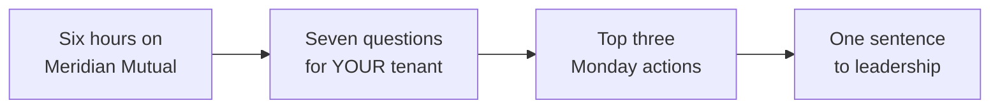

# Your estate, Monday morning

For six hours you have been the platform owner and security reviewer for a tenant that
was not yours. You discovered Meridian Mutual's agents, mapped what they could reach,
broke them in controlled scenarios, and judged whether the controls held. This last
exercise turns the lens around: the same three questions — *how many agents do we have,
who owns them, what can they reach* — are unanswered in **your** organization too.

## Scenario

You go back to work with a real tenant, real makers, and real data behind your agents.
You will not finish an inventory in thirty minutes, and that is not the goal. The goal is
to leave knowing exactly what to pull, which surfaces to open, and which questions you
cannot yet answer — plus three concrete actions you can take Monday morning and one
sentence that gets leadership to fund them. Everything you practiced against Meridian
maps directly onto your own estate; this exercise is where you make that translation
explicit.

## Objectives

After this exercise you will be able to:

- Translate the lab's discovery, mapping, and control techniques onto your own tenant's Microsoft surfaces.
- Answer — or explicitly scope *how* you will answer — the seven questions for your estate.
- Name your top three Monday-morning actions, each with an owner and a date.
- Make a one-sentence case to leadership for why agent governance matters *now*.

## Duration

**Estimated time:** 20 minutes.

## Deliverable

The [Own-Estate Assessment]()
— the take-home page of your [Estate Binder](). Fill the
seven questions, commit to three actions, and draft the leadership sentence. This one is
yours to keep and act on.

{: .warning }
> This page is about your real organization. Keep any live tenant details — agent names,
> owners, connection strings, data locations — in your own private binder, not in shared
> lab notes. Never paste real secrets or customer data into workshop materials.

{: .note }
> Since March 2026 every new Copilot Studio agent gets an Entra identity automatically,
> and Agent 365 went GA in May 2026. The governance surface arrived faster than the
> governance did — which is exactly why this exercise exists.
