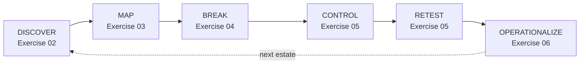

# Exercise 07: Wrap-up & Take-home

## Scenario

You started the day unable to answer three plain questions about Halcourt Mutual: how many agents there
are, who owns them, and what they can reach. You end it with a running **Estate Binder** that answers all
three — and, harder, with an honest read on whether Microsoft's controls actually reduce the risk you
found.

This last stop is not another lab. It is the hand-off. You will retell the day as a method you can run
again, this time against your own tenant: [Take it home]()
shows where to look and what to do first. You will also keep the references you need to go deeper on any
control that maps to a gap you carry home. Nothing here reveals anything you did
not already discover for yourself; it names what you learned so you can repeat it.

## Objectives

After this exercise you will be able to:

- Retell the day as a repeatable loop — **DISCOVER → MAP → BREAK → CONTROL → RETEST → OPERATIONALIZE** —
  and say which phase produced which binder deliverable.
- State plainly, for each class of failure, whether the platform's controls **close it, dent it, or miss
  it** — and explain why the honest answer is the one worth briefing to leadership.
- Recognize the two hard cases that a platform toggle mostly only dents, versus the failures that least
  privilege and lifecycle hygiene genuinely close.
- Take the seven questions home: know where each one is answered in your own tenant, and leave with a
  first-week plan that starts with a quick win.
- Find the right Microsoft Learn or OWASP reference for any control gap you take home, and point your own
  team at the Estate Binder as the scaffold for a real review.

## The arc, end to end

Everything you did fits one loop. You ran it once against a training estate that was built to be broken;
you can run it again against a real one.

Each phase left a page in your binder. Follow the deliverable links to your own filled-in work:

| Phase | Exercise | Deliverable |
|---|---|---|
| DISCOVER | [Discover & inventory]() | [Agent Estate Inventory]() |
| MAP | [Identity & effective access]() | [Agent Access Map]() |
| BREAK | [Break the agents]() | [Agent Threat Model]() |
| CONTROL / RETEST | [Put the controls to the test]() | [Control Efficacy Matrix]() |
| OPERATIONALIZE | [Apply a security baseline]() | [Agent Security Review Checklist]() |
| TAKE HOME | [Take it home]() | [Own-Estate Assessment]() |

The one question that runs through every phase is the same one: **whose authority is this agent
exercising, and what can it reach when it does?**

## What the day actually taught

The point of testing every control against every failure was to be able to tell the truth about what the
platform does and does not fix. Three honest takeaways are worth carrying out the door.

{: .warning }
> **Indirect injection and confused-deputy are the honest hard cases.** Platform toggles — DLP,
> environment separation, Conditional Access — mostly only *dent* them. The strongest measures aren't
> admin-center switches. Scoping grounding shrinks the injection surface and keeps sensitive content out of
> reach; authorizing against the *requesting* user removes the confused deputy. Scoping reduces indirect
> injection — it doesn't eliminate it for content that stays in scope.

{: .note }
> **Over-permission and lifecycle are genuinely closable.** Least privilege on the acting identity,
> record-level access in Dataverse (security-role privilege depth, ownership, business units, teams, and
> sharing), and joiner-mover-leaver hygiene — disable the departed owner's account *and* kill the
> connections it left live — actually remove the failure rather than just shrinking it.

{: .important }
> **Logging can split the most important question across two logs.** The downstream log records the
> shared or service identity as the actor. Copilot Studio's own audit event may still carry the requesting
> user and a thread ID, so attribution often depends on correlating the two. Complete, cross-log only,
> partial or unavailable is something you find out, not something you assume. Design for attribution
> before you need it.

## The closing promise, kept

At the start of the day the promise was that you would be able to answer three questions for a real estate
— and know which controls actually reduce the risk. You can now:

- **How many agents do you have?** — You inventory *all* environments, including the personal and "test"
  ones, and you count the agents nobody realizes exist.
- **Who owns them?** — You record the agent owner and the connection owner separately — who is
  accountable — and, per operation, the credential that acts and whose request it was.
- **What can they access?** — You map effective access to the data and endpoints an agent's identity can
  reach, not the data its user can, and you say plainly which control closes, dents, or misses each gap.

The governance surface for agents arrived faster than the governance did. You now have a method for
closing that distance — and the honesty to say where the method, and the platform, still fall short.

## Where to next

Start with [Take it home](): the seven questions mapped to
your own tenant, and a first-week plan. Keep the [Estate Binder]() as the
scaffold for your first real review, and use the curated
[resources & further reading]() to go deeper on any control
that maps to a gap you are taking home.
